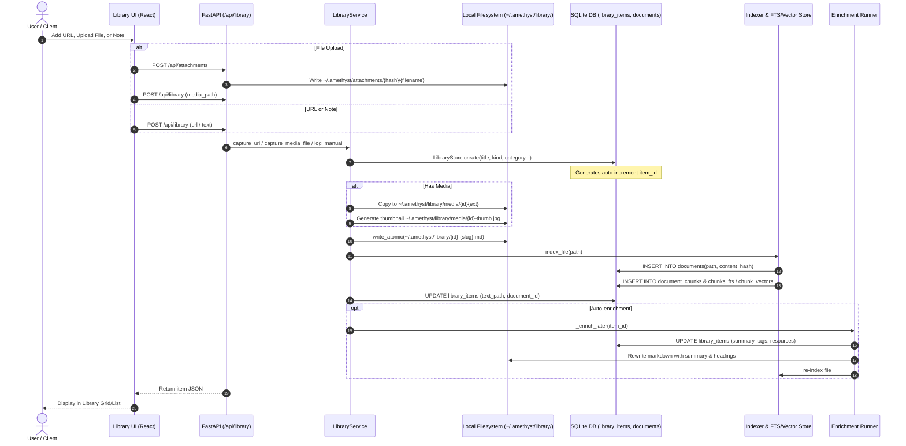
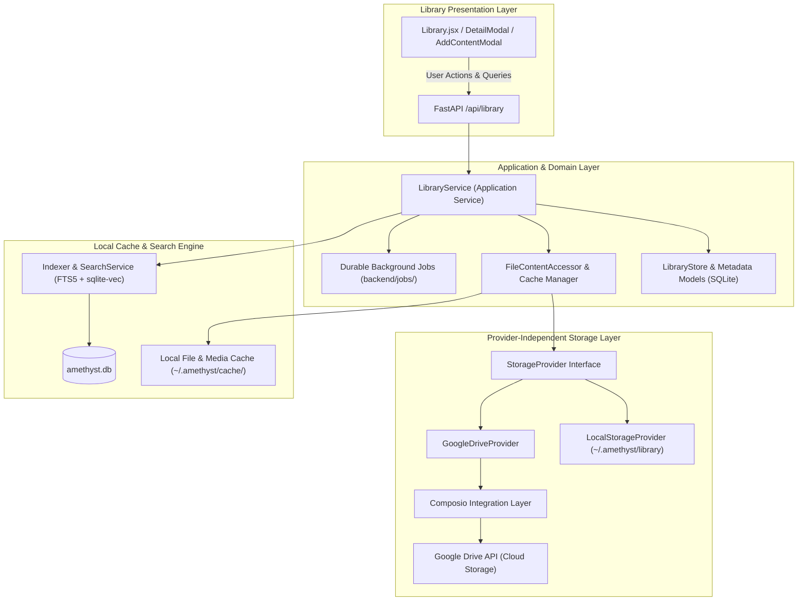

# Amethyst Library — Architecture Audit & Target Migration Design
**Phase 0 Deliverable**
**Date:** 2026-11-04
**Branch:** `feat/library-gdrive-migration`

---

## 1. Executive Summary

This audit establishes the baseline architecture of Amethyst's existing Library system before introducing cloud-backed storage with Google Drive and Composio.

The target architecture transforms Amethyst into a **local-first, cloud-backed knowledge repository**.
- **Amethyst owns**: The Library UX, stable internal identifiers, taxonomy (kinds, categories, tags/collections), indexing, search vector/keyword pipelines, and knowledge graph links.
- **Google Drive owns**: Cloud persistence of file contents within a user-selected or default root folder (`Amethyst/Library/`).
- **Composio owns**: Secure OAuth lifecycle and managed API execution against the Google Drive service.
- **Local Cache owns**: Instant offline access, temporary downloads, media previews, thumbnails, and write staging.

---

## 2. Current Library Architecture & Codebase Map

### 2.1 Codebase Entry Points and Responsibilities

| Layer | Files | Current Responsibilities & Implementation |
|---|---|---|
| **UI Views & Modals** | `frontend/src/views/Library.jsx` `frontend/src/views/library/AddContentModal.jsx` `frontend/src/views/library/LibraryDetailModal.jsx` `frontend/src/views/library/LibraryCard.jsx` `frontend/src/views/library/LibraryGrid.jsx` `frontend/src/views/library/LibraryListView.jsx` `frontend/src/views/library/LibraryFilterDesk.jsx` `frontend/src/views/library/LibraryTagRail.jsx` `frontend/src/views/library/LibraryRightRail.jsx` | - Browses items via Grid, List, or Shelf views. - Omnibar capture (URLs) & Add Content modal (URLs, Notes, Wikipedia, File Uploads). - Categorization & faceted filtering by `kind`, `category`, `tag`, and `progress`. - Direct API calls to `/api/library` and `/api/attachments`. |
| **API Client** | `frontend/src/api.js` | HTTP wrappers for `/api/library`, `/api/attachments`, and item operations. |
| **Backend API Surface** | `backend/api/main.py` | Exposes REST endpoints: - `GET /api/library`: Listing with facets, filtering, search. - `POST /api/library`: Capture URLs, media files, or notes. - `GET /api/library/{id}`: Single item detail. - `PATCH /api/library/{id}`: Field updates. - `DELETE /api/library/{id}`: Item removal. - `GET /api/library/{id}/thumbnail`: Image still via `FileResponse`. - `GET /api/library/{id}/media`: Binary media stream via `FileResponse`. - `GET /api/library/{id}/slides/{index}`: Carousel slide image. - `POST /api/library/{id}/enrich`: Run model enrichment. - `POST /api/library/{id}/reindex`: Rebuild search index. - `POST /api/attachments`: Multipart file upload. |
| **Library Service** | `backend/library/service.py` | - Business coordinator (`LibraryService`). - Orchestrates capture pipelines (`capture_url`, `capture_media_file`, `log_manual`). - Writes Markdown file atomically to local disk. - Calls `Indexer.index_file()`. - Coordinates background LLM enrichment (`_enrich_later`). |
| **Library Store** | `backend/library/store.py` | - SQL repository for `library_items` table. - Resolves local filesystem paths (`library_dir()`, `text_path()`, `media_path()`, `thumbnail_path()`, `slide_path()`). |
| **Enrichment & Ingest** | `backend/library/enrich.py` `backend/library/reels.py` `backend/media/audio.py` | - Summarization, tagging, resource extraction, category inference via LLM. - Media downloading (`yt_dlp`), audio extraction (`ffmpeg`), transcription (`Whisper`). |
| **Search & Retrieval** | `backend/retrieval/indexer.py` `backend/retrieval/search.py` `backend/retrieval/store.py` | - Chunks documents into `document_chunks`. - Full-text search via SQLite FTS5 (`chunks_fts`). - Semantic embeddings via `sqlite-vec` (`chunk_vectors`). - Requires physical local file path for indexing. |
| **Background Infrastructure** | `backend/library/runner.py` `backend/jobs/runner.py` `backend/jobs/store.py` | - `LibraryRunner`: Periodic loop sweeping unsummarized items. - `JobRunner`: Durable job system with leases, retries, idempotent step ledger. |
| **Composio / External Gateway** | `backend/mcp/composio_service.py` `backend/dashboard/connectors.py` | - Manages Composio sessions, OAuth credentials, tool router, and hosted MCP server. - Connectors gateway executes tools with circuit breakers and rate-limit backoff. |

---

## 3. Existing File Lifecycle

---

## 4. Organizational Taxonomy Analysis

Amethyst organizes knowledge without physical directories:

1. **Kind (Format Facet):**
   - Controlled vocabulary: `article`, `book`, `place`, `idea`, `video`, `podcast`, `music`, `newsletter`, `paper`, `post`, `note`, `other`.
   - Represents the medium/shape of the content.
2. **Category (Topic/Intent Facet):**
   - Freeform text string stored in `library_items.category`.
   - Common values: `general`, `technology`, `travel`, `books`, `ideas`, `design`, `business`, `science`.
   - Inferred automatically by `backend/library/enrich.py:infer_category()` if missing.
3. **Tags & Collections:**
   - JSON array of strings in `library_items.tags`.
   - Curated user collections are encoded as tags prefixed with `collection:<name>` (e.g. `collection:Favorite Research`).
4. **Physical Disk Organization:**
   - Completely flat:
     - Text files: `~/.amethyst/library/{item_id:06d}-{slug}.md`
     - Media files: `~/.amethyst/library/media/{item_id:06d}.mp4`
     - Thumbnails: `~/.amethyst/library/media/{item_id:06d}-thumb.jpg`
     - Attachment uploads: `~/.amethyst/attachments/{hash}/{filename}`

> [!IMPORTANT]
> **Key Finding:** Amethyst does not have a native folder tree in the filesystem or database. Logical organization is entirely metadata-driven (`kind`, `category`, `tags`).
> In Google Drive, physical storage will map cleanly:
> - Root: User-selected folder OR default `Amethyst/Library/`
> - Subfolders in Drive reflect logical facets: `articles/`, `books/`, `media/`, `notes/`, etc., or by `category/`.
> - Amethyst's internal SQLite database remains the single source of truth for IDs and relationships.

---

## 5. Architectural Audit: Coupled Assumptions & Technical Debt

The audit identified five major architectural assumptions binding Amethyst directly to the local filesystem:

| # | Assumption | Current Implementation | Required Decoupling |
|---|---|---|---|
| 1 | **Every file has a local filesystem path** | `library_items.text_path`, `media_path`, `thumbnail_path` store absolute string paths. | Introduce `storage_provider` (`local` \| `google_drive`), `external_id`, and a unified `FileContentAccessor`. |
| 2 | **File operations are synchronous & local** | `write_atomic(path, text)` and `shutil.copy2()` execute inline on the request loop. | Abstract file writes behind asynchronous `StorageProvider` contracts with local caching and background job queuing. |
| 3 | **Search indexing requires a local file `Path`** | `Indexer.index_file(path: Path)` expects a local path to stat and read from disk. | Decouple `Indexer` to accept a readable content buffer/stream or resolve through the local file cache. |
| 4 | **HTTP media streaming directly serves local files** | `library_thumbnail()` and `library_media()` instantiate `FileResponse(path)` directly. | Support streaming from local cache, downloading on-demand from Google Drive if cache missed. |
| 5 | **Unique document path constraint in DB** | `documents.path` is `TEXT NOT NULL UNIQUE`. | Decouple document identity from physical paths or namespace them with URI schemes (e.g. `gdrive://{file_id}`). |

---

## 6. Target Migration Architecture

### 6.1 Architectural Contracts

1. **Storage Provider Interface (`StorageProvider`)**:
   - `upload(file_id, stream_or_bytes, filename, mime_type, folder_hint) -> StorageObject`
   - `download(external_id) -> BinaryIO`
   - `delete(external_id) -> bool`
   - `get_metadata(external_id) -> StorageMetadata`
   - `create_folder(name, parent_external_id) -> str`
   - `list_objects(folder_external_id) -> list[StorageObject]`
   - `verify_checksum(external_id, expected_hash) -> bool`

2. **Google Drive Root Folder Management (Option 3 Implementation)**:
   - Configuration table `storage_configurations`:
     - `provider`: `'google_drive'`
     - `root_folder_id`: Google Drive folder ID
     - `root_folder_name`: Name (e.g. `'Amethyst/Library'` or user selected)
     - `is_active`: `1`
   - On initial connection: Check if `root_folder_id` exists; if not, create `Amethyst/Library/` automatically.
   - User root picker: Allows selecting an existing folder or switching roots with explicit confirmation and safety checks.
   - Scope containment: All Amethyst operations strictly query and write inside `root_folder_id`. Zero scanning outside this tree.

3. **Database Schema Enhancements (Additive & Backwards-Compatible)**:
   - Add columns to `library_items`:
     - `storage_provider TEXT DEFAULT 'local'` (`'local'` | `'google_drive'`)
     - `external_id TEXT` (Google Drive file ID)
     - `cached_locally INTEGER DEFAULT 1`
     - `sync_state TEXT DEFAULT 'synced'` (`'synced'` | `'pending'` | `'syncing'` | `'failed'`)
     - `checksum TEXT` (SHA-256)
     - `last_synced_at TEXT`
   - Add `storage_configurations` table for provider credentials & root folder references.
   - Add `storage_migration_manifest` table for resilient, resumable batch migration.

---

## 7. Risk Assessment & Mitigations

| Risk | Impact | Likelihood | Mitigation Strategy |
|---|---|---|---|
| **Data Loss during migration** | Critical | Low | Local originals are NEVER deleted automatically. Manifest tracks checksums before and after upload. |
| **Composio / Drive Rate Limits or Quota Exhaustion** | High | Medium | Migration runs in small batches through `backend/jobs/` durable queues with exponential backoff and pause/resume controls. |
| **Network disruption during large file upload/download** | Medium | High | Resumable chunked uploads where supported; durable job step-ledger prevents re-uploading completed steps. |
| **Broken Search Indexing for Cloud-Backed Files** | High | Low | Text and document content is cached locally before indexing. Indexer operates on cached copies. |
| **UI Latency / Freezing** | Medium | Medium | All cloud synchronization and uploads run asynchronously in background job lanes. UI updates optimistically with subtle state chips. |
| **OAuth Token Expiry / Reauth Required** | Medium | Medium | Handled via existing Composio reauth detection (`is_reauth_required`); jobs pause gracefully without corrupting state. |

---

## 8. Dependencies & Implementation Phasing Order

---

## 9. Phase 0 Exit Criteria Verification

- [x] Complete Library codebase explored and documented.
- [x] File lifecycle traced from ingest to indexing and deletion.
- [x] Organizational taxonomy audited (Kind, Category, Tags/Collections identified).
- [x] Tight local filesystem couplings catalogued.
- [x] User-selected Google Drive root folder design incorporated.
- [x] Existing unit tests verified.
