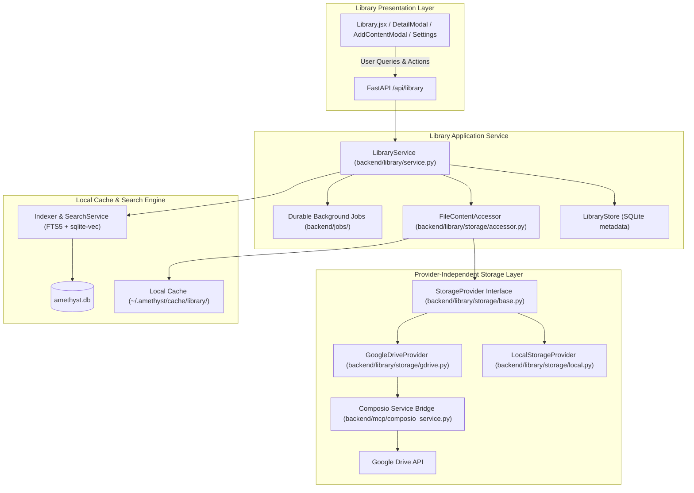
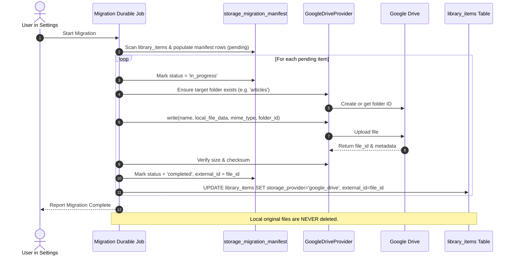

# Amethyst Library — Storage Architecture Specification
**Target Architecture for Local-to-Google Drive Migration**
**Document:** `LIBRARY_STORAGE_ARCHITECTURE.md`
**Status:** Approved Architectural Design
**Date:** 2026-11-04
**Branch:** `feat/library-gdrive-migration`

---

## 1. Architectural Principles & Boundaries

The Amethyst Library evolves into a **local-first, cloud-backed personal knowledge repository**.

### 1.1 Core Principles
1. **Amethyst owns the knowledge layer**: Metadata, stable internal IDs, taxonomies (kind, category, tags, collections), full-text search, and semantic embedding vectors remain strictly inside Amethyst's local SQLite database.
2. **Google Drive provides file storage**: Serves as the cloud storage destination for documents, Markdown notes, and media files.
3. **Composio handles Google Drive connectivity**: Handles OAuth token lifecycle and authorized Google Drive API calls.
4. **Local storage provides offline access & cache**: Reads are served from local cache when present; writes can be staged locally before cloud upload.
5. **Zero UI breakage**: The Library user interface (Grid, List, Detail modal, Omnibar capture) remains completely intact without redesign or intrusive file-picker mechanics.
6. **Isolated Google Drive Root**: Amethyst strictly manages files within a designated root folder (`Amethyst/Library/` default or user-selected). Never scans, moves, or touches external user files in Google Drive.
7. **Safe, non-destructive migration**: Migration from local storage to Google Drive is resumable, verified via checksums, and never deletes local originals automatically.

---

## 2. System Architecture & Component Responsibilities



### 2.2 Layer Responsibilities

| Layer | Component | Responsibilities | Constraints |
|---|---|---|---|
| **Library UI** | `frontend/src/views/Library.jsx`<br>`frontend/src/views/library/*` | - Browsing, filtering, sorting, searching.<br>- Uploading, capturing notes/URLs.<br>- Viewing item details & media playback.<br>- Displaying subtle cloud status chip. | Must NOT call Composio or Google Drive APIs directly.<br>Must NOT be redesigned into a file browser. |
| **Application Service** | `LibraryService`<br>`backend/library/service.py` | - High-level business coordinator.<br>- Ingestion, enrichment triggers, re-indexing.<br>- Interacts with `FileContentAccessor` instead of raw filesystem. | Never accesses raw file paths directly for cloud-backed items. |
| **File Content Accessor** | `FileContentAccessor`<br>`backend/library/storage/accessor.py` | - Single point of entry for reading/writing file bytes.<br>- Resolves items by internal `item_id`.<br>- Manages local cache hits, misses, and downloads. | Transparent to consumers (looks like local read/write). |
| **Storage Provider** | `StorageProvider` (Interface)<br>`LocalStorageProvider`<br>`GoogleDriveProvider` | - Atomic file read, write, delete, list, folder creation.<br>- Normalizes provider responses into standard `StorageObject`. | Provider-specific errors normalized to `StorageError`. |
| **Composio Bridge** | `ComposioService`<br>`backend/mcp/composio_service.py` | - OAuth token management, account health, re-auth detection.<br>- Executes Google Drive actions (`googledrive_*`). | Does not store Amethyst metadata. |

---

## 3. Storage Provider Contract & Models

Defined in `backend/library/storage/base.py`:

```python
from __future__ import annotations
from abc import ABC, abstractmethod
from dataclasses import dataclass
from typing import BinaryIO, Any

class StorageError(Exception):
    """Base exception for storage provider errors."""

class StorageUnavailableError(StorageError):
    """Provider is disconnected, offline, or requires re-authentication."""

class StorageNotFoundError(StorageError):
    """Requested file or folder does not exist."""

@dataclass(frozen=True)
class StorageObject:
    external_id: str
    name: str
    size_bytes: int
    mime_type: str
    checksum: str | None
    modified_at: str
    parent_folder_id: str | None
    is_folder: bool = False
    extra: dict[str, Any] | None = None

@dataclass(frozen=True)
class StorageCapabilities:
    supports_checksum: bool = True
    supports_streaming_download: bool = True
    supports_folders: bool = True
    supports_resumable_upload: bool = True

class StorageProvider(ABC):
    @property
    @abstractmethod
    def provider_id(self) -> str:
        """Unique identifier: 'local' | 'google_drive'."""

    @property
    @abstractmethod
    def capabilities(self) -> StorageCapabilities:
        """Capabilities supported by this provider."""

    @abstractmethod
    async def get_object(self, external_id: str) -> StorageObject | None:
        """Retrieve metadata for an object."""

    @abstractmethod
    async def read(self, external_id: str) -> bytes:
        """Download and read full content of an object."""

    @abstractmethod
    async def write(
        self,
        name: str,
        data: bytes | BinaryIO,
        mime_type: str,
        parent_folder_id: str | None = None,
        expected_checksum: str | None = None,
    ) -> StorageObject:
        """Write or upload an object to storage."""

    @abstractmethod
    async def delete(self, external_id: str) -> bool:
        """Delete an object from storage."""

    @abstractmethod
    async def create_folder(self, name: str, parent_folder_id: str | None = None) -> StorageObject:
        """Create a folder in storage."""

    @abstractmethod
    async def list_folder(self, folder_id: str) -> list[StorageObject]:
        """List immediate child items of a folder."""
```

---

## 4. Google Drive Root Management & Folder Isolation

### 4.1 Option 3 Specification: User-Selectable Root Folder
1. **Default Root**:
   - On initial connection, Amethyst searches for a folder named `Amethyst/Library` in Google Drive root.
   - If not found, Amethyst creates `Amethyst` and subfolder `Library`.
   - The resulting Google Drive folder ID is stored in `storage_configurations.gdrive_root_id`.
2. **User-Selected Root**:
   - User can choose an existing folder via Google Drive picker in Settings.
   - The selected folder's Google Drive ID is saved to `storage_configurations.gdrive_root_id`.
3. **Strict Query & Mutation Boundaries**:
   - Every file query, list, and search executed by `GoogleDriveProvider` includes `'{root_folder_id}' in parents`.
   - Amethyst will **never** scan or synchronize folders outside this root boundary.
   - No external user files are ever renamed, moved, or deleted.
4. **Subfolder Hierarchy**:
   - Mirrored based on Amethyst's existing format facets (`kind`):
     - `{root}/articles/`
     - `{root}/books/`
     - `{root}/media/`
     - `{root}/notes/`
     - `{root}/other/`
   - Amethyst maintains internal folder IDs mapped to Google Drive folder IDs.

---

## 5. Database Schema & Migration Foundation

### 5.1 Schema Additions (Additive, SQLite WAL Compatible)

```sql
-- 1. Additive columns to library_items table
ALTER TABLE library_items ADD COLUMN storage_provider TEXT DEFAULT 'local';
ALTER TABLE library_items ADD COLUMN external_id TEXT;
ALTER TABLE library_items ADD COLUMN cached_locally INTEGER DEFAULT 1;
ALTER TABLE library_items ADD COLUMN sync_state TEXT DEFAULT 'synced'; -- 'synced' | 'pending' | 'syncing' | 'failed'
ALTER TABLE library_items ADD COLUMN checksum TEXT;
ALTER TABLE library_items ADD COLUMN last_synced_at TEXT;

CREATE INDEX IF NOT EXISTS idx_library_storage_provider ON library_items(storage_provider);
CREATE INDEX IF NOT EXISTS idx_library_external_id ON library_items(external_id) WHERE external_id IS NOT NULL;
CREATE INDEX IF NOT EXISTS idx_library_sync_state ON library_items(sync_state);

-- 2. Storage configuration table
CREATE TABLE IF NOT EXISTS storage_configurations (
    id                 INTEGER PRIMARY KEY CHECK (id = 1),
    active_provider    TEXT NOT NULL DEFAULT 'local', -- 'local' | 'google_drive'
    gdrive_root_id     TEXT,
    gdrive_root_name   TEXT DEFAULT 'Amethyst/Library',
    auto_upload_new    INTEGER NOT NULL DEFAULT 0,
    created_at         TEXT NOT NULL DEFAULT (datetime('now')),
    updated_at         TEXT NOT NULL DEFAULT (datetime('now'))
);

-- 3. Resumable migration manifest table
CREATE TABLE IF NOT EXISTS storage_migration_manifest (
    id                 INTEGER PRIMARY KEY AUTOINCREMENT,
    item_id            INTEGER NOT NULL REFERENCES library_items(id) ON DELETE CASCADE,
    file_type          TEXT NOT NULL, -- 'text' | 'media' | 'thumbnail' | 'slide'
    local_path         TEXT NOT NULL,
    file_size          INTEGER NOT NULL,
    checksum           TEXT NOT NULL,
    target_folder      TEXT NOT NULL,
    status             TEXT NOT NULL DEFAULT 'pending', -- 'pending' | 'in_progress' | 'completed' | 'failed'
    external_id        TEXT,
    error_message      TEXT,
    attempt_count      INTEGER DEFAULT 0,
    updated_at         TEXT NOT NULL DEFAULT (datetime('now'))
);
CREATE INDEX IF NOT EXISTS idx_migration_status ON storage_migration_manifest(status);
CREATE INDEX IF NOT EXISTS idx_migration_item ON storage_migration_manifest(item_id);
```

---

## 6. Local-First Caching & File Access Abstraction

### 6.1 `FileContentAccessor` Lifecycle
- Cache directory: `~/.amethyst/cache/library/`
- Read workflow:
  1. If `storage_provider == 'local'`, read directly from `text_path` or `media_path`.
  2. If `storage_provider == 'google_drive'`:
     - Check cache for `{item_id}_{file_type}_{checksum}`.
     - Cache hit: Return cached local file path / bytes.
     - Cache miss:
       - Check if online and Google Drive connected. If offline, return `StorageUnavailableError`.
       - Download content via `GoogleDriveProvider.read(external_id)`.
       - Verify SHA-256 checksum against database record.
       - Store in cache directory.
       - Update `cached_locally = 1` in `library_items`.
       - Return local cached file path / bytes.
- Indexing compatibility:
  - `Indexer.index_file()` always receives a readable local file path (from local storage or local cache).
  - Search indexes (`chunks_fts`, `chunk_vectors`) continue operating with zero disruption.

---

## 7. Migration Engine & Background Job Infrastructure

### 7.1 Durable Job Design
- Uses Amethyst's existing `backend/jobs/` durable job framework.
- Job kind: `storage_migration`.
- Lane: `workers`.
- Idempotency key: `migration:gdrive:{batch_id}:{root_id}`.

### 7.2 Migration Workflow


---

## 8. Library UI Integration & Experience

1. **Item Detail Modal**:
   - Displays subtle badge: `Local` (disk icon) or `Cloud (Google Drive)` (drive icon).
   - If cloud-backed and not cached while offline: displays "Available when reconnected".
2. **Settings > Storage**:
   - Google Drive connection card (connect, disconnect, status, active account).
   - Root folder path selector with default `Amethyst/Library/`.
   - Migration card:
     - Statistics: Total files, migrated count, pending count, failed count.
     - Controls: "Start Migration", "Pause", "Resume", "Retry Failed".
     - Real-time progress bar.
3. **Capture & Add Modal**:
   - Zero changes to inputs or workflows.
   - New items write locally first, then asynchronously sync to Google Drive if `auto_upload_new` is enabled.

---

## 9. Verification & Safety Safeguards

1. **Non-destructive**: Local files are retained indefinitely. No automated file purge.
2. **Checksum verification**: SHA-256 generated locally prior to upload and verified against uploaded Drive metadata.
3. **Rollback strategy**: Setting `active_provider = 'local'` immediately switches all reads and writes back to local disk paths.
4. **Network resilience**: Interrupted transfers automatically pause and resume without duplicate file creation.
