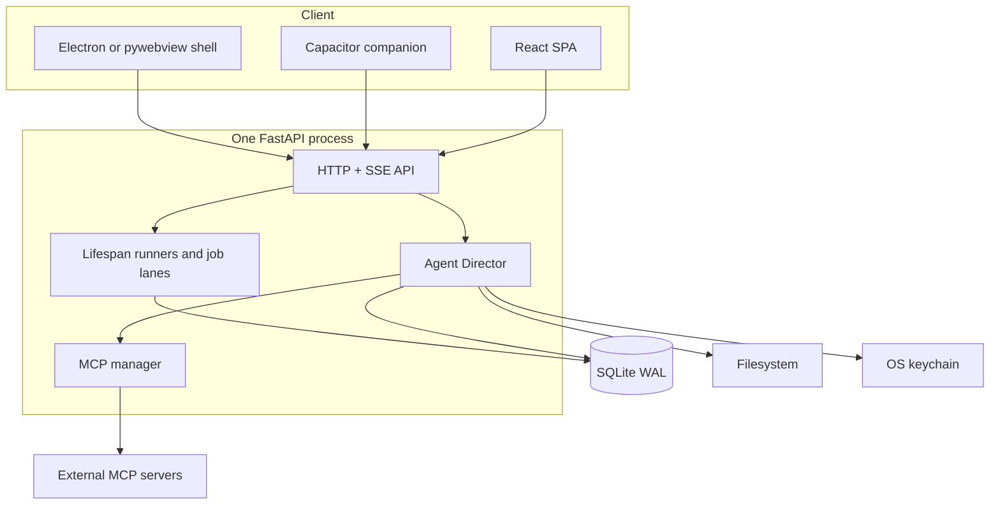

# Architecture

Amethyst is a single-user, local-first personal operating system. One FastAPI
process serves the API, runs the agent loop, and owns all background work. One
React application is the interface. Persistent state is SQLite plus the local
filesystem; secrets are in the OS keychain. There is no multi-tenancy and no
separate worker service.

**Verified 2026-10-31 · commit `3c363b7` · dirty working tree.**

Deeper rationale: [`../architecture/overview.md`](../architecture/overview.md).

## Runtime shape

The process is the deployment unit. `amethyst serve` refuses to start a second
server on the same port; the kernel's port bind is the lock. `backend/cli.py`
performs that check before starting uvicorn.

## Layers and ownership

| Layer | Owns | Does not own |
|---|---|---|
| Interface | Rendering, input, streaming display, approvals | Provider, tool or storage details |
| Agent loop | Reason/act/observe cycle, prompt assembly, termination, turn state | Individual tool behavior |
| AI runtime | Provider adapters, schema translation, streaming, fallback | Tool semantics, conversation state |
| Tool registry | Flat namespace, permission gate, result normalization, audit | What a tool does internally |
| Domain services | Tasks, library, mail, memory, automations, dashboard, sync | Transport or UI concerns |
| Data layer | SQLite, migrations, repositories, filesystem, keychain | Business rules |

The agent loop is the hub, not a pipeline stage. It calls the runtime, the tool
registry and retrieval repeatedly. Skills are markdown content read through
filesystem tools; MCP tools register into the same flat registry as builtins.

## Repository map

The repository follows a clean, scalable monorepo architecture (`apps/`, `packages/`, `infrastructure/`, `docs/`, `scripts/`, `tests/`):

| Path | Responsibility |
|---|---|
| `apps/backend/backend/` | FastAPI core app, routers, agent director, runtime, DB, tools (symlinked to `backend/`) |
| `apps/desktop/` | Electron desktop shell and build config (symlinked to `electron/`) |
| `apps/extension/` | Browser extension companion for instant capture (symlinked to `extension/`) |
| `apps/web/` | React single-page application & mobile companion (symlinked to `frontend/`) |
| `packages/widgets/catalog/` | Widget catalog designs, fixtures, and templates (symlinked to `widgets/`) |
| `packages/widgets/prompts/` | Widget prompt definitions (symlinked to `widget-prompts/`) |
| `packages/widget-factory/src/` | Automated widget generation factory (symlinked to `widget-factory/`) |
| `packages/automations/definitions/` | Automated workflow scripts and definitions (symlinked to `automations/`) |
| `packages/agents/skills/` | Agent skills library (symlinked to `agents/`) |
| `packages/relay/relay/` | Cloudflare Worker relay for capture & sync (symlinked to `relay/`) |
| `infrastructure/docker/` | Dockerfile and compose configurations (symlinked at root) |
| `infrastructure/deployment/` | Render and Vercel deployment manifests (symlinked at root) |
| `infrastructure/packaging/src/` | PyInstaller standalone packaging specs (symlinked to `packaging/`) |
| `infrastructure/notifier/notifier/` | Notifier briefing/digest jobs for CI (symlinked to `notifier/`) |
| `tests/`, `apps/web/tests/` | Python backend and frontend verification test suites |

## Request path

A chat turn is the canonical path:

1. `frontend/src/api.js` sends `POST /api/conversations/{id}/turn` and reads SSE.
2. `backend/api/main.py` validates the conversation and starts one Director.
3. The Director assembles the prompt and tool catalogue, resolves a provider,
   calls the model, and streams events.
4. Tool calls go through `backend/tools/registry.py`; the permission gate may
   suspend the turn.
5. Results return to the model; the loop continues until it answers or a guard
   stops it.
6. Messages, run state and audit rows persist in SQLite.

Full sequence: [DATA-FLOW.md](DATA-FLOW.md#1-chat-turn).

## Invariants

- One server process against one database. Background work runs in the same
  lifespan, not in a second worker.
- Every tool dispatch passes the permission gate and writes an audit row.
- A tool's static risk floor can be raised by the model's self-report, never
  lowered.
- Provider differences stay inside adapters. The loop sees one normalized type
  surface.
- Secrets live in the keychain; the database holds references only.
- SQLite is the relational store; captured text and vault files are real files;
  vector and keyword indexes live in SQLite.
- A turn always emits a terminal frame (`done`, `error`, or `guard`).
- Local callers are trusted by the OS boundary. Remote callers need a paired
  device token and an explicit permission scope.

## Configuration and data locations

Default home is `~/.amethyst`, overridable with `AMETHYST_HOME`.

| Path | Contents |
|---|---|
| `~/.amethyst/amethyst.db` | SQLite database |
| `~/.amethyst/config/providers.yaml` | Providers, tiers, embeddings, memory model |
| `~/.amethyst/config/mcp.yaml` | MCP servers |
| `~/.amethyst/config/sandbox.yaml` | Sandbox settings |
| `~/.amethyst/config/workers.yaml` | Remote worker accounts |
| `~/.amethyst/skills/` | Installed skills |
| `~/.amethyst/library/` | Captured markdown and media |
| `~/.amethyst/logs/` | Logs |

## Related

- [BACKEND.md](BACKEND.md) — process and API detail
- [FRONTEND.md](FRONTEND.md) — interface structure
- [DATABASE.md](DATABASE.md) — schema and repositories
- [AGENT-SYSTEM.md](AGENT-SYSTEM.md) — loop and turn state
- [MCP-INTEGRATIONS.md](MCP-INTEGRATIONS.md) — external capability
- [systems/desktop.md](systems/desktop.md) — desktop shells

_Last verified: 2026-10-31 · commit `3c363b7` · dirty working tree._
