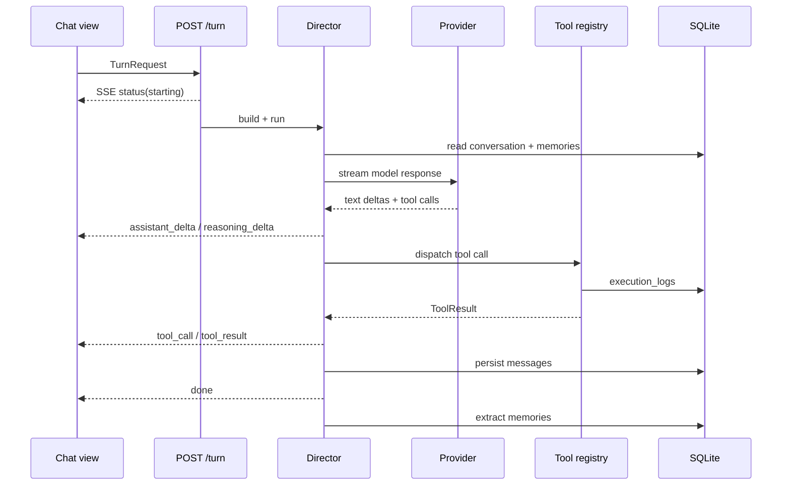
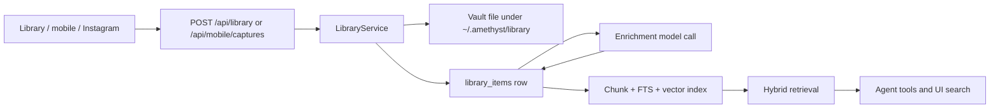
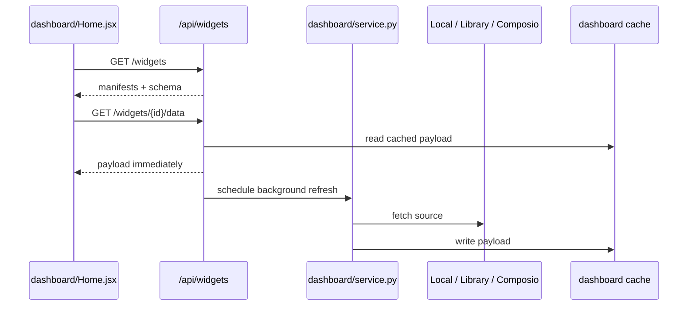
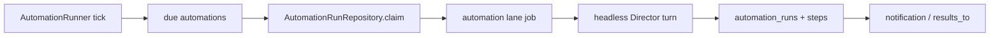
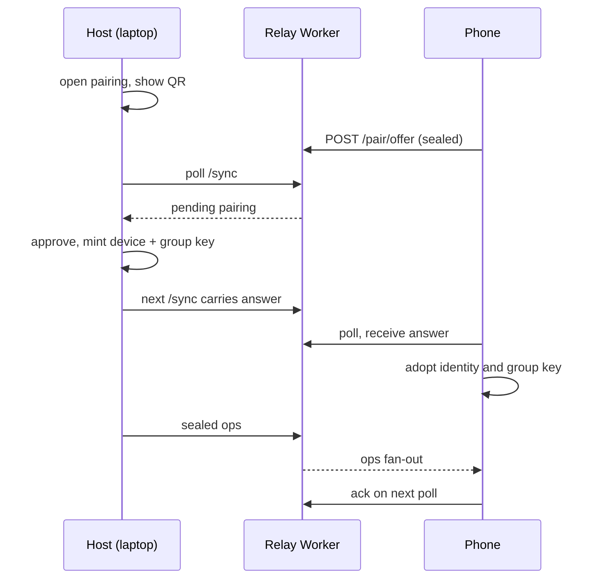

# Data Flow

End-to-end paths through the system. Each section names the entry point, the
modules that handle it, the durable writes, and the observable result.

**Verified 2026-10-31 · commit `3c363b7` · dirty working tree.**

Related: [ARCHITECTURE.md](ARCHITECTURE.md), [AGENT-SYSTEM.md](AGENT-SYSTEM.md),
[DATABASE.md](DATABASE.md), [systems/sync.md](systems/sync.md).

## 1. Chat turn

The central flow. One HTTP request streams one agent turn.



### Entry

`POST /api/conversations/{conversation_id}/turn` in `backend/api/main.py`.
Body is `TurnRequest`; the fields that matter are `message`, `mode`, `guard`,
`effort`, `provider`, `model`, `variant`, `workspace` and `depth`.

Preconditions enforced before the stream opens:

- Conversation must exist (404).
- `mode` must be a known turn mode (400).
- No other active turn on the conversation (409). Two directors would
  interleave transcript writes and bill two model streams.
- A remote device may not weaken the guard: `guard` is limited to `guard` or
  `read-only` for device-authenticated callers (403).

### Stream

The response is `text/event-stream`. Frames are JSON with an event name and
data. `status` is emitted before any slow work so the browser has bytes
immediately. Heartbeat `ping` frames cover connector startup.

Terminal frames are `done`, `error` and `guard`. The memory extraction call
happens after `done` and is not part of the turn.

Event types currently emitted:

```text
assistant_delta  assistant_text  reasoning_delta
tool_call  tool_result  confirmation_required
status  plan  step_started  step_done  warning  guard  error  done
memory  artifact_open  artifact_delta  artifact_done
question_required  question_settled  widget  connector_failed
```

Turn phases (`backend/agent/state.py`):

```text
preparing  reasoning  acting  awaiting_approval  awaiting_input
awaiting_connection  completed  stopped  cancelled  failed  interrupted
```

### Inside the Director

`backend/agent/director.py`:

1. Builds the provider and tool registry for the requested mode and workspace.
2. Reconciles connectors with a shorter deadline when they are already warm.
3. Assembles the prompt from `backend/agent/prompt.py`: system rules, memory,
   skills catalogue, visible tool schemas, conversation history.
4. Streams model output. Text deltas become `assistant_delta`; reasoning deltas
   become `reasoning_delta`.
5. Dispatches each tool call through `ToolRegistry.dispatch`, which applies the
   permission gate, timeout, result truncation and audit row.
6. Suspends on interactive events when needed: approval, question, or missing
   connector. The turn stays registered and resumes on the matching POST.
7. Persists messages and run metadata; emits `done`.

Guards are evaluated between iterations. A hung tool cannot be stopped by a
guard, so the registry enforces its own timeout.

### Cancellation

- `POST /api/conversations/{id}/turn/stop` sets the cancel event.
- A client disconnect is detected by a watcher polling
  `request.is_disconnected()` every 500 ms and cancels the turn.
- Cancellation yields a `guard` frame with `reason="Turn stopped by user."`.

### Persistence

- `messages` — user, assistant and tool messages.
- `conversation_runs` — run row with provider, model, tokens, timing, status.
- `execution_logs` — one row per tool dispatch.
- `memories` — extracted facts, superseded rather than deleted.

## 2. Library capture and retrieval



### Capture entry points

| Source | Entry |
|---|---|
| Library UI | `POST /api/library` (`backend/api/main.py`) |
| URL capture | `LibraryService.capture_url` |
| Manual note | `LibraryService.log_manual` |
| Phone | `POST /api/mobile/captures` (202, durable job) |
| Instagram reel | `backend/library/reels.py`, fed by the relay runner |
| Browser bookmarks | `amethyst bookmarks sync` |
| Agent tool | library tools in `backend/tools/` |

The mobile endpoint validates `title`, `text`, `url`, and requires
`approved: true`. It enqueues a `mobile_capture` job on the
`mobile-captures` lane. The job re-checks that the capturing device still has
`library` permission before writing.

### Processing

`backend/library/service.py` owns item creation and status. Status values are
`received`, `processing`, `enriching`, `ready`, `failed`.

- Text lives in a Markdown file in the vault; the database holds metadata and
  the path.
- `backend/library/enrich.py` produces summary, tags, resources and category.
  Enrichment is best-effort: a failed enrichment leaves a usable item.
- `backend/library/runner.py` sweeps unsummarized items in the background and
  wakes immediately when nudged.
- `backend/retrieval/indexer.py` chunks Markdown and writes `chunks_fts` and
  `chunk_vectors` (created in `backend/retrieval/store.py`).
- `backend/retrieval/search.py` combines keyword and vector results.

### Read paths

- `GET /api/library` — filtered list.
- `GET /api/library/{id}` — item detail.
- `POST /api/library/{id}/enrich` — explicit re-enrichment.
- `POST /api/library/{id}/reindex` — rebuild chunks and vectors.
- Agent retrieval tools query the same index.

The filesystem is the source of truth for text. Re-indexing can rebuild the
database from vault files; the reverse is not true.

## 3. Today widgets



- Manifests come from `backend/dashboard/registry.py`, validated against a JSON
  Schema. An invalid manifest disables that widget instead of crashing startup.
- `frontend/src/dashboard/registry.js` must stay in parity with the backend
  registry; `scripts/check-widget-map.py` checks the mapping.
- `GET /api/widgets/{id}/data` is cache-first. It returns the cached payload and
  schedules a refresh in the background.
- Refresh is bounded by a semaphore of four, with per-widget backoff and
  quiet-hour suppression.
- `PUT /api/layout` validates widget ids and allowed sizes before writing.
- Widget actions go through `POST /api/widgets/{id}/actions/{action}`. Actions
  marked `gate: true` require confirmation.
- Source types are `local`, `library` and `composio`. A `requires` entry such as
  `connector:googlecalendar` hides or disables the widget when absent.

Cache and settings live in the dashboard tables in `backend/dashboard/schema.sql`.
The vault is not involved.

## 4. Automation run



- Definitions live in `automations`; runs in `automation_runs`.
- `backend/automation.py` computes the next run from daily/weekly schedules and
  validates actions.
- The runner claims a due automation atomically, so two ticks cannot run it
  twice.
- Execution reuses the agent Director in a headless context. Interactive gates
  cannot park an unattended run; refused tools are reported as blocked.
- Steps and the final answer are recorded on the run.
- `results_to` routes the result (for example a notification or a library
  entry).
- `POST /api/automations/{id}/run` triggers a manual run; `retry` re-runs a
  failed run.
- A separate stateless path exists for CI: `backend/automation_worker.py` runs
  one automation in an ephemeral `AMETHYST_HOME`, driven by
  `.github/workflows/automation-runner.yml`.

The scheduler is in-process. It does not require cron, but the machine must be
running for scheduled runs to fire. The GitHub Actions path is the alternative
for a machine that is off.

## 5. Pairing, sync and remote control



### Pairing

- `backend/sync/devices.py` owns device identity, pairing state, permissions,
  revocation and the group key handshake.
- The host opens a pairing window; the QR payload carries the relay URL and a
  pair secret. Pairing is open for a bounded time.
- Direct LAN pairing is also supported through `POST /api/pair/claim` and
  `GET /api/pair/claim?request_id=...`. These are the only public paths besides
  `/api/ping`.
- Approval creates a device row with a token hash and a permission map. The
  token is shown once; only its hash is stored.
- Permissions are per capability (`library`, remote control features, and so
  on). `backend/security/remote_access.py` checks them at call time.

### Ops

- Every synced write emits an op into the outbox in the same transaction as the
  write.
- `backend/sync/service.py` seals outgoing ops with the group key and reads
  incoming ones.
- `backend/sync/registry.py` is the allowlist: entity name, table, key column,
  exact synced fields. A new column does not sync until it is listed.
- `backend/sync/ops.py` merges per field using HLC stamps. Concurrent edits to
  different fields both survive. Concurrent edits to the same field resolve by
  total order. Deletion is a field (`superseded_at`, `archived`, `revoked_at`),
  not an op type.
- `backend/sync/hlc.py` provides the monotonic clock.
- Applied op ids are remembered in `sync_seen` for 30 days, making re-delivery
  harmless.
- Ops are acknowledged on the next poll, not the one that delivered them. A
  crash re-offers; a duplicate is refused.

### Transcript projection

`backend/sync/project.py` sweeps messages, conversations, runs and library items
using watermarks instead of emitting an op at every write site. This keeps
`backend/agent/` unaware of sync. Watermarks are stored in `app_settings` and
are deliberately not synced.

### Relay

`relay/` is a Cloudflare Worker with D1. It stores sealed ops and pairing
offers, fans ops out to live devices, and prunes acknowledged rows. It also
holds Instagram webhook deliveries. The relay is never trusted with plaintext:
it stores ciphertext and cannot forge an op.

### Remote control

`backend/remote/router.py` exposes `/api/remote/*` for screen, camera, input,
files, clipboard, media, power and command. Every route requires an
authenticated device token and the matching permission. `RemoteCallerGuard`
rejects non-loopback callers that do not present a device token.

## 6. Preference sync

`PATCH /api/preferences` is the reference implementation of a synced write:

1. Validate names against `SYNCED_PREFERENCES`.
2. Write `app_settings` and emit a `settings` op in one transaction.
3. Other devices apply the op through the ordinary merge.

Per-device preferences (`panelWidth`, `sidebar`, `textSize`, `activeId`,
`workspace`) are deliberately excluded. Syncing a phone's text size onto a
desktop is a bug, not a feature.

## 7. Mail and task reads

- Mail routes proxy through the active connector (local Gmail MCP or Composio).
  `GET /api/mail/threads` lists; `POST /api/mail/threads/{id}/reply` sends.
  Nothing is mirrored into a local mail table.
- Tasks have a local table and an optional Microsoft To Do mirror.
  `POST /api/tasks/sync` pulls remote lists and reconciles local rows.
  `backend/sync/microsoft_todo.py` maps remote items to local tasks and
  categories.

## Failure behaviour

| Failure | Result |
|---|---|
| Provider unreachable | `error` frame; run marked failed |
| Tool timeout | Error `ToolResult`; model may retry or report |
| Connector auth lost | Turn parks on `connection_required`, then resumes or times out |
| Client disconnect | Turn cancelled; partial messages remain |
| Relay unreachable | Ops stay in outbox; next poll retries |
| Duplicate op | `sync_seen` refuses; no second write |
| Widget source down | Cached payload served with an error/stale state |
| Enrichment model fails | Item stays usable, status records the failure |

_Last verified: 2026-10-31 · commit `3c363b7` · dirty working tree._
