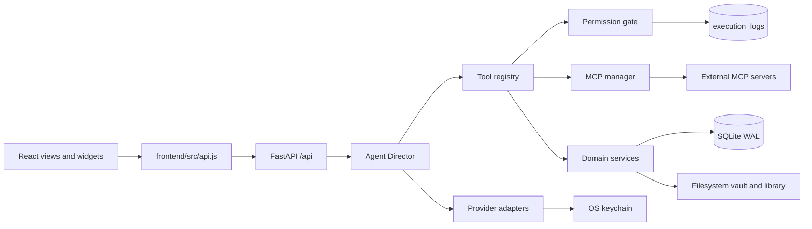

# Amethyst — Agent Context

Navigation layer for AI coding agents working in this repository. Read this
file first, then only the documents for the subsystem you are changing.

**Verified against the working tree on 2026-11-04 at commit
`f52a7d1db9de7bde43d6815dcb6a845023f48732`.** The working tree was dirty at
verification time, so these documents describe the code as checked out then, not
only the named commit. Re-check the source before relying on a detail.

Source code is authoritative. These documents are a map, not a substitute for
reading the implementation. The deeper architectural record remains in
[`../architecture/overview.md`](../architecture/overview.md) and the ADRs under
[`../architecture/decisions/`](../architecture/decisions/).

## Start here

| Need | Read |
|---|---|
| One-page system shape | [ARCHITECTURE.md](ARCHITECTURE.md) |
| Build, run, test, change safely | [DEVELOPMENT-GUIDE.md](DEVELOPMENT-GUIDE.md) |
| A specific screen or workflow | `sections/` below |
| A cross-cutting mechanism | `systems/` below |
| Shared UI pieces | `components/` below |
| How a request moves end to end | [DATA-FLOW.md](DATA-FLOW.md) |

## Document directory

### Core

| Document | Covers |
|---|---|
| [ARCHITECTURE.md](ARCHITECTURE.md) | Process model, layers, boundaries, repository layout |
| [FRONTEND.md](FRONTEND.md) | React shell, routing, state, API client, styling, mobile entry |
| [BACKEND.md](BACKEND.md) | FastAPI surface, lifespan, service modules, configuration |
| [DATABASE.md](DATABASE.md) | SQLite schema, repositories, migrations, storage invariants |
| [AGENT-SYSTEM.md](AGENT-SYSTEM.md) | Director loop, turn state, prompt assembly, streaming, subagents |
| [MCP-INTEGRATIONS.md](MCP-INTEGRATIONS.md) | MCP lifecycle, OAuth, Composio, skills, connector ownership |
| [DATA-FLOW.md](DATA-FLOW.md) | Chat turn, capture, sync, automation, widget and pairing flows |
| [DEVELOPMENT-GUIDE.md](DEVELOPMENT-GUIDE.md) | Setup, verification, change recipes, documentation maintenance |

### Application sections

| Document | Route / surface |
|---|---|
| [sections/chat.md](sections/chat.md) | `/chat` — agent conversation workbench |
| [sections/today.md](sections/today.md) | `/today` — widget dashboard |
| [sections/tasks.md](sections/tasks.md) | `/tasks` — task board, buckets, Microsoft To Do sync |
| [sections/mail.md](sections/mail.md) | `/mail` — Gmail and AgentMail reading/reply |
| [sections/library.md](sections/library.md) | `/library` — capture, reading queue, retrieval |
| [sections/memory.md](sections/memory.md) | `/memory` — extracted long-term facts |
| [sections/automations.md](sections/automations.md) | `/automations` — scheduled agent turns |
| [sections/capabilities.md](sections/capabilities.md) | `/capabilities` — skills, connectors, MCP servers |
| [sections/converter.md](sections/converter.md) | `/converter` — local file and media tools |
| [sections/code.md](sections/code.md) | `/code` — coding-agent placeholder |
| [sections/remote-mobile.md](sections/remote-mobile.md) | `/remote`, `/pair`, Capacitor companion |
| [sections/settings.md](sections/settings.md) | `/settings` — preferences, providers, devices, permissions |
| [sections/install.md](sections/install.md) | `/install` — packaged-app installers |
| [sections/logs.md](sections/logs.md) | `/logs` — tool-call audit trail |
| [sections/status.md](sections/status.md) | `/dash` — machine and service status |

### Cross-cutting systems

| Document | Covers |
|---|---|
| [systems/auth.md](systems/auth.md) | Local trust boundary, device tokens, pairing, keychain, OAuth |
| [systems/state.md](systems/state.md) | React store, turn state, durable state, preference sync |
| [systems/sync.md](systems/sync.md) | Host/control model, HLC ops, relay, device permissions |
| [systems/background-jobs.md](systems/background-jobs.md) | Lifespan runners, lanes, durable jobs, schedules |
| [systems/model-providers.md](systems/model-providers.md) | Adapters, routing, fallback, tiers, embeddings |
| [systems/tool-execution.md](systems/tool-execution.md) | Registry, risk gate, sandbox, audit, result shaping |
| [systems/storage.md](systems/storage.md) | `~/.amethyst`, SQLite, vault, keychain, config files |
| [systems/desktop.md](systems/desktop.md) | Electron and Python desktop shells, packaging, updates |

### Components

| Document | Covers |
|---|---|
| [components/shared.md](components/shared.md) | App shell, navigation, markdown, artifacts, approvals |
| [components/design-system.md](components/design-system.md) | Tokens, themes, bento primitives, motion, accessibility |
| [components/widget-system.md](components/widget-system.md) | Widget manifests, registry, cache, layout, renderers |

## Task routing

Find the task, then read the listed documents in order.

| Task | Read |
|---|---|
| Add or change a page | [FRONTEND.md](FRONTEND.md) → [sections/](sections/) for the nearest page |
| Change navigation, shortcuts, command palette | [FRONTEND.md](FRONTEND.md) → [components/shared.md](components/shared.md) |
| Change chat streaming or approvals | [sections/chat.md](sections/chat.md) → [AGENT-SYSTEM.md](AGENT-SYSTEM.md) → [DATA-FLOW.md](DATA-FLOW.md) |
| Change the agent loop, prompt or guards | [AGENT-SYSTEM.md](AGENT-SYSTEM.md) → [systems/tool-execution.md](systems/tool-execution.md) |
| Add or change a tool | [systems/tool-execution.md](systems/tool-execution.md) → [AGENT-SYSTEM.md](AGENT-SYSTEM.md) |
| Add a provider or change routing | [systems/model-providers.md](systems/model-providers.md) → [BACKEND.md](BACKEND.md) |
| Change the database schema | [DATABASE.md](DATABASE.md) → [systems/storage.md](systems/storage.md) |
| Add an MCP server or connector | [MCP-INTEGRATIONS.md](MCP-INTEGRATIONS.md) → [sections/capabilities.md](sections/capabilities.md) |
| Change a widget or the Today layout | [components/widget-system.md](components/widget-system.md) → [sections/today.md](sections/today.md) |
| Change tasks or calendar behavior | [sections/tasks.md](sections/tasks.md) → [DATABASE.md](DATABASE.md) |
| Change Library capture or search | [sections/library.md](sections/library.md) → [DATABASE.md](DATABASE.md) |
| Change mail | [sections/mail.md](sections/mail.md) → [BACKEND.md](BACKEND.md) |
| Change automations or background work | [sections/automations.md](sections/automations.md) → [systems/background-jobs.md](systems/background-jobs.md) |
| Change memory extraction | [sections/memory.md](sections/memory.md) → [AGENT-SYSTEM.md](AGENT-SYSTEM.md) |
| Change pairing, devices or remote control | [systems/sync.md](systems/sync.md) → [systems/auth.md](systems/auth.md) → [sections/remote-mobile.md](sections/remote-mobile.md) |
| Change the mobile app | [sections/remote-mobile.md](sections/remote-mobile.md) → [FRONTEND.md](FRONTEND.md) |
| Change settings or preferences | [sections/settings.md](sections/settings.md) → [systems/state.md](systems/state.md) |
| Change desktop packaging | [systems/desktop.md](systems/desktop.md) → [DEVELOPMENT-GUIDE.md](DEVELOPMENT-GUIDE.md) |
| Investigate a failed turn | [AGENT-SYSTEM.md](AGENT-SYSTEM.md) → [DATA-FLOW.md](DATA-FLOW.md) → [sections/logs.md](sections/logs.md) |
| Update documentation | [DEVELOPMENT-GUIDE.md](DEVELOPMENT-GUIDE.md) |

## Dependency navigation

Use this when a change crosses a boundary.

| Boundary | Contract | Check |
|---|---|---|
| Frontend → backend | JSON over `/api`, SSE for turns and control | `frontend/src/api.js`, `backend/api/main.py` |
| Agent → provider | Normalized `ModelResponse`, `ToolCall`, `ToolSchema` | `backend/runtime/types.py` |
| Agent → tool | One flat registry; one dispatch path | `backend/tools/registry.py` |
| Tool → permission | Risk floor plus operation-level confirmation | `backend/security/confirmation.py` |
| Backend → data | Repositories only; no SQL above them | `backend/db/repositories.py` |
| Sync → relay | Sealed ops, HLC order, allowlisted fields | `backend/sync/`, `relay/src/ops.ts` |

## Exploration fallback

If this documentation does not identify the relevant code:

1. Search the route or label in `frontend/src/nav.js` and `frontend/src/views/registry.js`.
2. Search the endpoint string in `frontend/src/api.js`; then search the same path in `backend/api/main.py` or a dedicated router.
3. Search the database table in `backend/db/schema.sql`; then find its repository in `backend/db/repositories.py`.
4. Search the service name under `backend/<domain>/`.
5. Read the matching document in [`../architecture/`](../architecture/) for design rationale.
6. If the code and documentation disagree, trust the code and update the document.

Do not recursively read the whole repository first. The backend API file is
large; start from a route string, a service import, or a table name.

## Status and known drift

These are verified observations, not plans.

- `/today` renders `frontend/src/dashboard/Home.jsx`, not `frontend/src/views/Today.jsx`. The latter and `frontend/src/views/today/` are not referenced by the router and appear legacy.
- `/code` is an “In Development” placeholder. It has no backend API.
- `frontend/src/views/Memory.jsx` shows `SAMPLE_FACTS` when the API returns no facts or fails. This is demo data, not persisted memory.
- The root `README.md` says the lifespan starts five runners. The code starts eight runners plus two job lanes and a connector boot task. Trust `backend/api/main.py`.
- ADR-0024 is marked “Proposed”, but sync, pairing, device permissions and the relay are implemented in the working tree.
- Two desktop shells exist: the Electron app (`electron/main.cjs`, `electron-builder.yml`) and the Python tray/webview app (`backend/desktop.py`, `amethyst desktop`). Their release relationship is not documented here.
- `docs/ui-design-system.md` describes an earlier bento token set; current visual tokens live in `frontend/src/index.css`, `frontend/src/globals.css` and `frontend/src/motion.js`.

## Maintenance

Every change that alters architecture, routes, APIs, schema, data flow or
component ownership must update the affected document and this index. Follow
[DEVELOPMENT-GUIDE.md](DEVELOPMENT-GUIDE.md#documentation-maintenance). Keep the
verification line current when you re-verify a document.

_Last verified: 2026-10-31 · commit `3c363b7` · dirty working tree._
