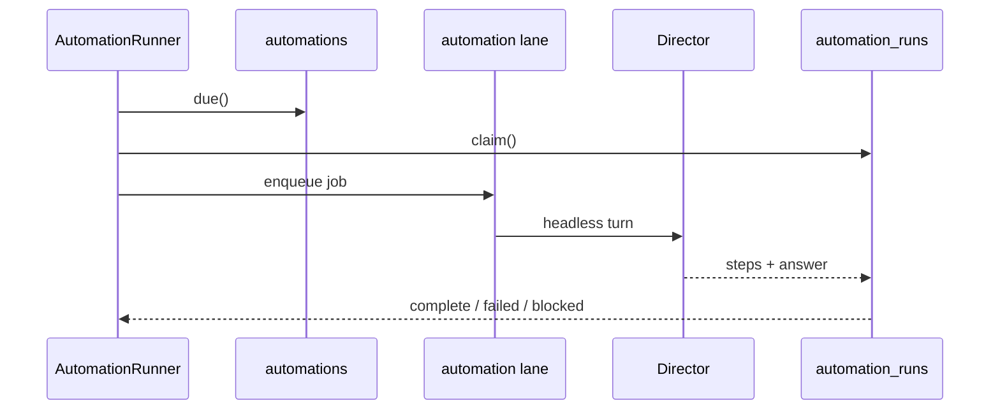

# Automations

Scheduled agent turns at `/automations`. A prompt, a schedule, an optional set
of granted tools, and a run history.

**Verified 2026-10-31 · commit `3c363b7` · dirty working tree.**

## Entry points

| Layer | Path |
|---|---|
| View | `frontend/src/views/Automations.jsx` |
| UI modules | `frontend/src/components/automations/` |
| Client | `frontend/src/api.js` → `api.automations`, `api.createAutomation`, `api.updateAutomation`, `api.runAutomation`, `api.recentRuns`, `api.automationStats` |
| Routes | `backend/api/main.py` `/api/automations*` |
| Domain | `backend/automation.py` |
| Templates | `backend/automation_templates.py` |
| Runner | `AutomationRunner` in `backend/automation.py` |
| Job lane | `_automation_lane` in `backend/api/main.py` |
| Tables | `automations`, `automation_runs` |
| Cloud path | `backend/automation_worker.py`, `.github/workflows/automation-runner.yml` |

## UI structure

Four tabs:

- **Automations** — list, stats chart, enable/disable, edit, run now, delete.
- **Runs** — recent runs across all automations, click for detail.
- **Calendar** — scheduled occurrences.
- **Templates** — curated starting points.

Editor fields: name, description, prompt, schedule type, time/day/timezone,
provider/model, notification mode, granted actions, `results_to`, and
continuity settings.

## Scheduling model

Supported schedule types:

- `interval` — `every_minutes`.
- `daily_at` — `daily_at_time` plus timezone.
- `weekly_at` — `weekly_day` plus time.

`next_run_for` computes the next occurrence. `_validate_schedule` rejects an
invalid combination. `AutomationRunner` ticks, asks for due automations, and
enqueues each on the automation lane.

The scheduler is in-process. The machine must be running. The GitHub Actions
path runs one automation in an ephemeral `AMETHYST_HOME` for a machine that is
off.

## Run lifecycle

- `claim` is atomic, so two ticks cannot run the same automation twice.
- The run executes a headless Director turn. Interactive gates cannot park an
  unattended run; refused tools are recorded as blocked.
- `tool_steps` extracts the tool trace from the conversation.
- `deliver` routes the result according to `results_to`.
- `notification` selects app, email or none.
- `continuity` can carry the previous run's answer into the next prompt.

## Granted actions

`actions` is a JSON list of tool names. `decode_actions` never raises: a
malformed column reads as no grants. `UnattendedGate` enforces the list. A tool
not granted is refused, not prompted.

`GRANTABLE_ACTIONS` is the curated set the UI offers. `unavailable_actions`
reports grants that the machine cannot currently satisfy, usually because a
connector is missing.

## API

| Method | Path | Purpose |
|---|---|---|
| GET/POST | `/api/automations` | List / create |
| PATCH/DELETE | `/api/automations/{id}` | Edit / delete |
| POST | `/api/automations/{id}/run` | Run now |
| POST | `/api/automations/{id}/retry` | Retry a failed run |
| GET | `/api/automations/{id}/runs` | Runs for one automation |
| GET | `/api/automations/runs/recent` | Recent runs |
| GET | `/api/automations/runs/{id}` | Run detail |
| GET | `/api/automations/runs/stats` | Aggregate stats |
| GET | `/api/automations/due` | Due list (external scheduler) |
| POST | `/api/automations/tick` | Trigger a due check |
| GET | `/api/automations/actions` | Grantable actions |
| GET | `/api/automations/templates` | Templates |

## Modification guide

| Change | Touch |
|---|---|
| Add a schedule type | `_validate_schedule`, `next_run_for`, editor, `AutomationRunner` |
| Add a template | `backend/automation_templates.py` |
| Change grantable tools | `GRANTABLE_ACTIONS`, `UnattendedGate` |
| Change delivery | `deliver`, `results_to` validation |
| Change run recording | `AutomationRunRepository` |
| Change the UI | `Automations.jsx`, `components/automations/` |
| Change cloud execution | `backend/automation_worker.py`, workflow file |

Rules:

- An unattended run must never wait on a human. Refuse and record.
- A malformed `actions` value grants nothing.
- Keep claim atomic. A duplicated scheduled run sends the same email twice.
- Validate timezone and time before writing.
- Do not add a tool to `GRANTABLE_ACTIONS` unless it is registered and safe to
  run without a person present.

## Known issues

- The in-process scheduler only runs while the app runs. There is no OS-level
  cron fallback in the default install.
- Cloud execution is a separate code path with its own environment. A change to
  the local runner does not automatically apply there.
- `automation_worker.py` prints emoji badges in its Markdown summary. Keep that
  file's output conventions if editing it.
- A run can be `blocked` rather than failed when a required connector is
  missing. The UI must distinguish these.

## Related

- [systems/background-jobs.md](../systems/background-jobs.md)
- [DATA-FLOW.md](../DATA-FLOW.md) — automation flow
- [AGENT-SYSTEM.md](../AGENT-SYSTEM.md)
- [DATABASE.md](../DATABASE.md)
- [sections/capabilities.md](capabilities.md)

_Last verified: 2026-10-31 · commit `3c363b7` · dirty working tree._
