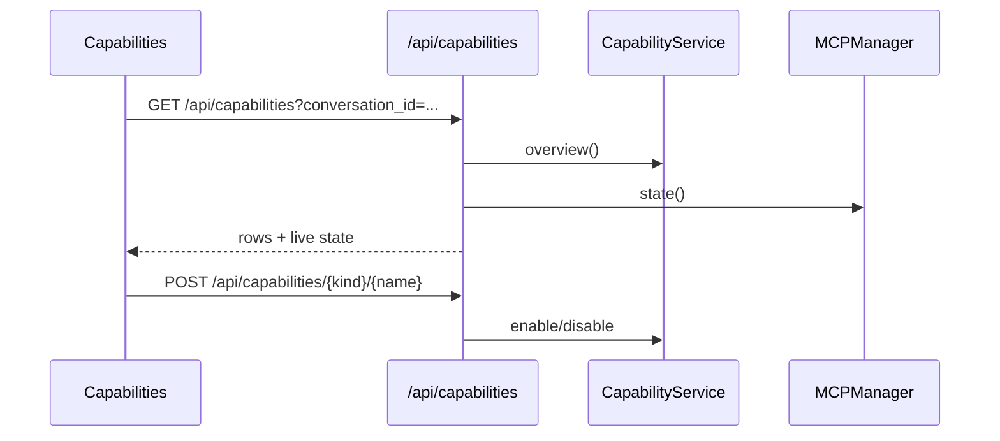

# Capabilities

The skills and connectors page at `/capabilities`. One page, two tabs: what the
agent can read, and what it can reach.

**Verified 2026-10-31 · commit `3c363b7` · dirty working tree.**

## Entry points

| Layer | Path |
|---|---|
| View | `frontend/src/views/Capabilities.jsx` |
| Tabs | `frontend/src/views/capabilities/SkillsTab.jsx`, `ConnectorsTab.jsx` |
| Client | `frontend/src/api.js` → `api.capabilities`, `api.toggleCapability`, `api.capabilityProfiles`, `api.skills`, `api.mcpServers` |
| Routes | `/api/capabilities*`, `/api/skills*`, `/api/mcp/*`, `/api/connectors/*` |
| Service | `backend/capabilities.py` |
| Skills | `backend/skills/` |
| MCP | `backend/mcp/` |
| Connectors | `backend/mcp/composio_service.py` |

## UI structure

Top bar: tab switch, search, add action.

**Skills tab**

- Installed skills with name, description, version and tags.
- Catalogue search and install.
- Create a skill.
- Delete.
- Per-conversation enable/disable where applicable.

**Connectors tab**

- One row per connector: local MCP server, Composio toolkit, or builtin.
- Derived state and the single next action.
- Tool count and live connection state.
- Add from catalogue, custom MCP server, import config.
- OAuth sign-in, API key, environment variables, logout, remove.
- Profiles: named sets of connectors applied to a conversation.

The page deliberately merges “add” and “manage”. They used to be separate
surfaces, which produced two cards for one connector with different controls.

## Capability model

`backend/capabilities.py` defines a `Capability` with a `Kind`:

- `SKILL`
- `CONNECTOR`
- `TOOL` (where relevant)

`CapabilityService.overview(conversation_id)` returns grouped rows. Connector
rows are merged with live `MCPManager.state()` in `GET /api/capabilities`, so a
row's `live` field is authoritative about what is running now.

Profiles are stored in `capability_profiles`. Applying a profile enables or
disables the listed connectors for a conversation, which is cheaper than
toggling each one by hand.

## Connector states

`backend/mcp/lifecycle.py` derives one state and one action per connector:

```text
Adding -> Setting up -> Authenticating -> Syncing -> Ready
                                       \-> Failed (retry)
```

Actions: `connect`, `sign_in`, `credentials`, `sync`, `retry`, or `None` when
waiting is correct. `backend/mcp/status.py` defines the lower-level states
(`connected`, `auth_required`, `token_expired`, `account_mismatch`, and so on).

The UI must render the derived state, not recompute it from five booleans.

## Skills

- A skill is a directory with `SKILL.md`.
- Discovery caches name, description and path; the body is read on demand.
- Install, create and delete go through `/api/skills/*`.
- Skills grant no execution authority. Tool calls still pass the registry and
  permission gate.

See [MCP-INTEGRATIONS.md](../MCP-INTEGRATIONS.md) for the full skill contract.

## Data flow



Adding a server is a multi-step flow:

1. `POST /api/mcp/servers` writes `mcp.yaml`.
2. If OAuth is required, `POST /api/mcp/servers/{name}/login` starts the
   loopback flow and returns 202.
3. The UI polls `GET /api/mcp/authorizations` for the provider URL or state.
4. `POST /api/mcp/servers/{name}/connect` or `/api/mcp/reconcile` brings the
   tools in.
5. `GET /api/capabilities` shows the derived state.

Composio toolkits use `/api/connectors/{slug}/authorize` instead.

## Modification guide

| Change | Touch |
|---|---|
| Add a capability kind | `backend/capabilities.py`, API, both tabs |
| Change connector state derivation | `backend/mcp/lifecycle.py`, `status.py` |
| Change a connector card | `ConnectorsTab.jsx`, `settings/Integrations.jsx` |
| Change skills install | `backend/skills/install.py`, `catalogue.py` |
| Add a profile action | `CapabilityService`, profile routes, UI |
| Change the catalogue | `backend/mcp/catalogue.py` |

Rules:

- Derive state on the server. Two screens must not disagree.
- Keep one next action per state. A card with no action and no explanation is
  the bug this page was built to fix.
- Do not show “connected” without live evidence.
- A skill is not a connector. Do not merge their storage or permissions.

## Known issues

- `Integrations.jsx` under Settings also manages Composio and notifier settings.
  Connector management is split between `/capabilities` and
  `/settings?section=integrations`.
- The connector catalogue and the Composio catalogue are different lists. A
  provider can appear in both; provider ownership decides which one is active.
- A connector may be `ready` with zero tools if the server connected but
  exposed nothing. The state derivation reports tool count, so read it.
- OAuth sign-in holds a single loopback port. Two simultaneous sign-ins queue.

## Related

- [MCP-INTEGRATIONS.md](../MCP-INTEGRATIONS.md)
- [systems/auth.md](../systems/auth.md)
- [systems/tool-execution.md](../systems/tool-execution.md)
- [sections/settings.md](settings.md)
- [sections/chat.md](chat.md)

_Last verified: 2026-10-31 · commit `3c363b7` · dirty working tree._
