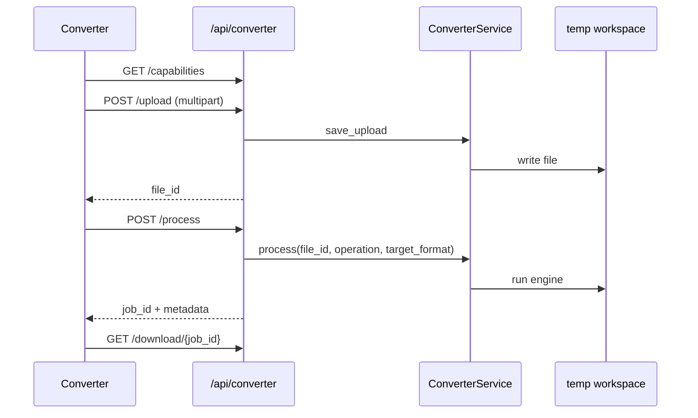

# Converter

The local file workbench at `/converter`. Documents, images, audio and video
are processed on this machine. Nothing is uploaded to a third party.

**Verified 2026-10-31 · commit `3c363b7` · dirty working tree.**

## Entry points

| Layer | Path |
|---|---|
| View | `frontend/src/views/Converter.jsx` |
| Sub-tools | `frontend/src/views/converter/` |
| Client | `frontend/src/api.js` → `api.converterCapabilities`, `api.converterUpload`, `api.converterProcess`, `api.converterDownloadUrl` |
| Router | `backend/converter/router.py` under `/api/converter` |
| Service | `backend/converter/service.py` |

## UI structure

Studio directory with categories:

```text
all  image  pdf  media  developer  utilities
```

Tools:

- Universal file converter.
- PDF suite.
- Image studio.
- Media/audio workshop.
- OCR.
- QR generator.
- Color converter.
- Code formatter.
- Text tools.
- Unit converter.
- Timezone converter.

Each sub-tool owns its form and calls the shared converter API. The page also
has a file list with thumbnails, sizes and download links.

## Backend capabilities

`GET /api/converter/capabilities` reports which engines are actually installed
and which formats and operations are available. The UI must render from this
response, not from a hardcoded format list.

Engines used by `backend/converter/service.py`:

- PyMuPDF
- Pillow
- python-docx
- openpyxl
- ffmpeg / ffprobe
- ImageMagick
- LibreOffice

Missing binaries reduce the capability set. They do not crash the page.

## Data flow



- Upload limit is 500 MB (`MAX_CONVERTER_UPLOAD_BYTES`).
- Uploads are written to a local temp workspace under `AMETHYST_HOME`.
- `process` accepts one file (`file_id`) or many (`file_ids`), an operation, an
  optional target format, and options.
- Outputs are addressed by `job_id`; downloads are served by the router.
- `DELETE /api/converter/files/{file_id}` removes an uploaded file.
- Preview and thumbnail endpoints serve derived artifacts.

There is no model call and no network dependency in the normal path.

## Modification guide

| Change | Touch |
|---|---|
| Add a format | `service.py` extension sets, capability map, UI picker |
| Add an operation | `service.process`, `ProcessRequest`, the relevant sub-tool |
| Add a studio | `ALL_TOOLS_CATALOG`, a component under `views/converter/` |
| Change upload limits | `MAX_CONVERTER_UPLOAD_BYTES` |
| Change cleanup | `ConverterService` temp workspace handling |
| Change download headers | `router.py` |

Rules:

- Keep processing local. A cloud conversion is a different product decision and
  a different privacy statement.
- Validate the operation against `capabilities`. Do not run an engine that is
  not installed.
- Enforce the upload limit before writing the whole body.
- Clean temp files. The converter is not a second library.
- Never serve a path outside the converter workspace.

## Known issues

- Capability detection is binary-based. A binary present but broken is reported
  as available until a process call fails.
- Large media conversions can take minutes; the request is synchronous from the
  client's perspective.
- Output files expire; a stale download link returns 404.
- Some formats depend on LibreOffice or ImageMagick being installed by the
  user. The UI should explain a missing engine instead of offering a dead
  option.

## Related

- [BACKEND.md](../BACKEND.md)
- [systems/storage.md](../systems/storage.md)
- [FRONTEND.md](../FRONTEND.md)
- [sections/library.md](library.md)

_Last verified: 2026-10-31 · commit `3c363b7` · dirty working tree._
