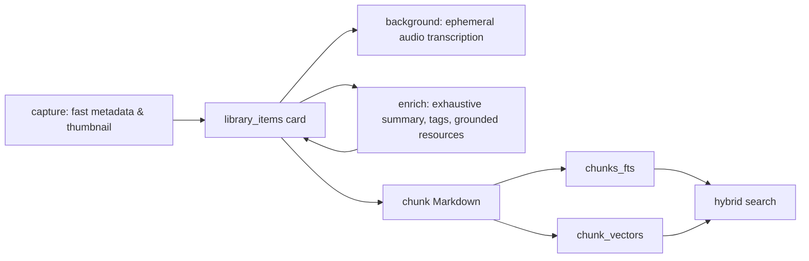

# Library

The knowledge vault at `/library`: capture anything with a URL, store the text
as a Markdown file, enrich it, index it, and search it by keyword or meaning.

**Verified 2026-11-04 · Zero video download & Smart Lists pipeline.**

## Entry points

| Layer | Path |
|---|---|
| View | `frontend/src/views/Library.jsx` |
| UI modules | `frontend/src/views/library/` |
| Client | `frontend/src/api.js` → `api.library`, `api.libraryItem`, `api.addLibraryItem`, `api.enrichLibraryItem`, `api.reindexLibraryItem` |
| Routes | `backend/api/main.py` `/api/library*` |
| Service | `backend/library/service.py` |
| Enrichment | `backend/library/enrich.py` |
| Link Harvester | `backend/library/links.py` |
| Semantic Clustering | `backend/library/clustering.py` |
| Reels | `backend/library/reels.py` |
| Background sweep | `backend/library/runner.py` |
| Store | `backend/library/store.py` |
| Retrieval | `backend/retrieval/` |
| Tables | `library_items`, `library_lists`, `library_list_members`, `library_extracted_links`, `library_tags` |

## UI structure

- Capture box: paste a URL and press Enter. The same box searches when the
  input is not a URL.
- “More capture options”: upload/drop a file, type a note, resolve a Wikipedia
  topic.
- Smart & Curated Lists Shelf (`frontend/src/views/library/LibraryListsShelf.jsx`):
  switch between "All Items", smart clustered lists (`✦ AI Tools`, etc.) and custom lists,
  with "+ New List" and "⚡ Auto-Group" actions.
- Grid and list views.
- Tag rail, kind filter, category filter, sort order.
- Detail modal with summary, tags, resources, harvested outbound links, source, reading progress, notes
  and actions.
- Shelves/collections, playlist export, merge lists.
- Ask/search panel.
- Shortcuts modal.
- Share panels for bookmarklet and phone capture.

## Smart lists & link harvesting

- Embedded URLs and Markdown links are automatically extracted, stripped of tracking
  parameters (`utm_*`, `fbclid`, `igsh`, etc.), normalized, and stored in `library_extracted_links`
  with zero duplicates per item.
- `library_lists` and `library_list_members` support grouping items and extracted links with
  database-level `UNIQUE(list_id, item_id)` and `UNIQUE(list_id, link_id)` constraints.
- `backend/library/clustering.py` automatically synthesizes thematic smart lists using
  shared tags, semantic vector representations, and domain analysis.
- Detail modals feature a "Referenced Outbound Links" card allowing single-click external navigation
  and list assignment.

## Capture paths

| Source | Path |
|---|---|
| Library page | `POST /api/library` |
| URL | `LibraryService.capture_url` |
| Note | `LibraryService.log_manual` |
| File upload | library upload path |
| Phone | `POST /api/mobile/captures` (durable job) |
| Bookmarklet | `/library?url=...`, then capture |
| Browser bookmarks | `amethyst bookmarks sync` |
| Instagram | relay → `backend/library/reels.py` |
| Agent | `log_library_item` tool |

Every path ends in the same service. A capture that partly fails still writes an
item and records `capture_note`, because an item with no text and no
explanation is indistinguishable from a bug.

## Storage model

- Text: Local `~/.amethyst/library/{id}-{slug}.md` or Google Drive (`Amethyst/Library/articles/`, etc.).
- Media: Local `~/.amethyst/library/media/` or Google Drive (`Amethyst/Library/media/`).
- Cache: `~/.amethyst/cache/library/` for on-demand cloud caching and offline access.
- Metadata: `library_items` row with `storage_provider` (`local` | `google_drive`), `external_id`, `cached_locally`, `sync_state`.
- Provider layer: `backend/library/storage/` (`StorageProvider`, `LocalStorageProvider`, `GoogleDriveProvider`, `FileContentAccessor`, `MigrationEngine`).
- Index: `chunks_fts` and `chunk_vectors`, created in `backend/retrieval/store.py`.
- Status: `received`, `processing`, `enriching`, `ready`, `failed`.

The filesystem is the source of truth for text (ADR-0004). Re-indexing can
rebuild the database from files. The reverse is not true.

## Processing pipeline

- `capture_url` normalizes the URL and rejects private addresses through
  `backend/mcp/ssrf.py`.
- It tries Instagram, X, YouTube, Pinterest, Reddit and Threads handlers, then
  plain readable text.
- Video and reel captures use zero video download (`dest=None`), immediately creating
  the item card and thumbnail within ~1 second while deferring ephemeral audio transcription
  to background workers (with no persistent `.mp4` video downloads or Google Drive video sync).
- Playback uses responsive platform iframe embeds (YouTube nocookie, Instagram, TikTok) or remote streaming URLs.
- Legacy video files can be cleaned up using `POST /api/library/purge-media`.
- `backend/library/enrich.py` generates exhaustive, technically dense summaries and
  grounds resource links against `<known_links>` to avoid hallucinated URLs.
- Polling in `Library.jsx` simultaneously updates grid cards and any open detail modal
  the moment background processing finishes.
- `backend/library/runner.py` sweeps unsummarized items in the background.
- `backend/retrieval/indexer.py` chunks and indexes. `search.py` combines
  keyword and vector candidates.
- `POST /api/library/{id}/reindex` rebuilds one item.
- `POST /api/library/{id}/enrich` re-runs enrichment.

## Search

`SearchService.search` returns `SearchHit` rows with content, path, heading
path, score, source and title. Candidate pools are wider when a source or path
filter is applied, because filtering happens after ranking.

Library search and the agent's `search_documents` use the same index. A saved
article is found exactly like a vault note.

## Modification guide

| Change | Touch |
|---|---|
| Add a capture source | `backend/library/service.py`, possibly `backend/web/reader.py` |
| Change enrichment prompt or fields | `backend/library/enrich.py` |
| Change indexing | `backend/retrieval/indexer.py`, `chunking.py` |
| Change search ranking | `backend/retrieval/search.py`, `store.py` |
| Change the library UI | `frontend/src/views/library/` |
| Change item fields | schema, `LibraryStore`, `LibraryService`, detail modal |
| Change the background sweep | `backend/library/runner.py` |

Rules:

- Write the file first, then the row. A row without a file is a broken item.
- Keep partial captures. Record why text is missing.
- Do not index content that failed SSRF checks.
- Do not search the filesystem per request; use the index.
- Keep `capture_note` user-readable.

## Known issues

- Enrichment and indexing are asynchronous. A new item may be searchable before
  it is enriched, or enriched before vectors are written.
- A paywalled or blocked page produces a partial item. The detail view must
  show `capture_note` rather than an empty body.
- Vector search depends on a configured embedder. Without one, keyword search
  still works.
- The library UI is split across many components; check `Library.jsx` for which
  one owns a given state before editing a child.
- `backend/library/service.py` is the only writer. Routes that write items
  directly would bypass file creation and indexing.

## Related

- [DATABASE.md](../DATABASE.md)
- [DATA-FLOW.md](../DATA-FLOW.md) — capture and retrieval
- [sections/today.md](today.md) — library widgets
- [systems/storage.md](../systems/storage.md)
- [AGENT-SYSTEM.md](../AGENT-SYSTEM.md)

_Last verified: 2026-11-04 · Zero video download & Smart Lists pipeline._
