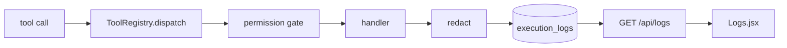

# Activity Log

The audit page at `/logs`. Every tool call, with the decision that allowed it.

**Verified 2026-10-31 · commit `3c363b7` · dirty working tree.**

## Entry points

| Layer | Path |
|---|---|
| View | `frontend/src/views/Logs.jsx` |
| Client | `frontend/src/api.js` → `api.logs(limit)` |
| Route | `GET /api/logs?limit=` |
| Repository | `ExecutionLogRepository` in `backend/db/repositories.py` |
| Writer | `ToolRegistry.dispatch` in `backend/tools/registry.py` |
| Table | `execution_logs` |
| Redaction | `backend/secrets.py` → `redact` |

## What is recorded

Each dispatch writes one row:

| Column | Meaning |
|---|---|
| `conversation_id` | Originating conversation, or null |
| `message_id` | Originating message, or null |
| `tool_name` | Registered tool name |
| `tool_source` | Builtin, MCP, or other source |
| `arguments` | Redacted JSON arguments |
| `result_summary` | Redacted result, truncated to 2000 chars |
| `error` | Redacted error string |
| `risk_level` | `low`, `medium` or `high` |
| `confirmation_decision` | Gate outcome |
| `duration_ms` | Wall time |
| `created_at` | Row timestamp |

Redaction runs before insert. Arguments and results are not stored raw.

## UI structure

- Lens filters: all, asked first, refused, low risk, medium/high risk.
- Search across tool name, source, risk, decision, result and error.
- Limit selector: 50, 100, 200, 500.
- Table on desktop; stacked cards below the mobile breakpoint.
- JSON viewer for arguments.
- Copy a row as text.
- Detail expansion.

Decision values come from the server. `blocked_by_mode` and `gate_error` are
refusals; `error` is a column, not a decision. `isRefusal` in `Logs.jsx`
matches the `denied` prefix plus those two values.

## Data flow

A denied call is still logged. A gate error is logged. A tool that never ran
because the model was blocked by mode is logged with the decision, so the page
answers “why did nothing happen” as well as “what happened”.

## Retention

`ExecutionLogRepository.prune(keep=5000)` keeps the newest 5000 rows. Nothing
else retires them. An unattended automation can write roughly a hundred rows a
day, so unbounded growth is a real concern.

The page reads only the first page (max 500). It is an audit trail, not an
analytics database.

## Modification guide

| Change | Touch |
|---|---|
| Add a logged field | `execution_logs` schema, `record`, `Logs.jsx` |
| Change redaction | `backend/secrets.py` |
| Change decision names | `backend/security/confirmation.py`, `Logs.jsx` labels |
| Change retention | `prune` call site |
| Change the table layout | `Logs.jsx` |

Rules:

- Never write unredacted arguments or results.
- A new refusal reason must be added to the UI's refusal set, or it will look
  like an ordinary decision.
- Keep the audit row even when the tool fails.
- Do not use this table as the source of truth for run status; use
  `conversation_runs` or `automation_runs`.

## Known issues

- The page reads a single page with a limit. There is no cursor pagination.
- Arguments can be large; the viewer is the only way to inspect them.
- The table is pruned, so an old incident may no longer be answerable from the
  UI.
- `result_summary` is truncated. The full result is not retained.

## Related

- [systems/tool-execution.md](../systems/tool-execution.md)
- [DATABASE.md](../DATABASE.md)
- [sections/chat.md](chat.md)
- [sections/status.md](status.md)

_Last verified: 2026-10-31 · commit `3c363b7` · dirty working tree._
