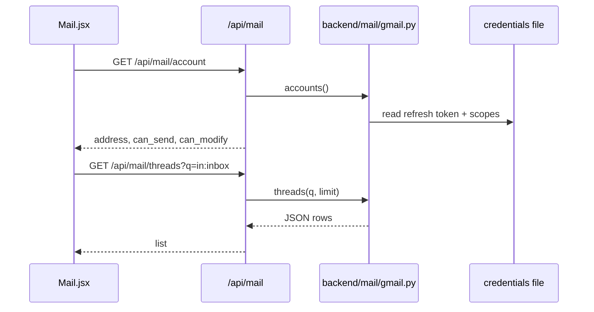

# Mail

The mail reader at `/mail`. It reads Gmail directly using the account the
Google connector signed in, and it also exposes AgentMail for the agent's own
inbox through tools.

**Verified 2026-10-31 · commit `3c363b7` · dirty working tree.**

## Entry points

| Layer | Path |
|---|---|
| View | `frontend/src/views/Mail.jsx` |
| Client | `frontend/src/api.js` → `api.mailAccount`, `api.mailThreads`, `api.mailThread`, `api.mailReply`, `api.mailLabels`, `api.mailModifyLabels` |
| Routes | `backend/api/main.py` `/api/mail/*` |
| Gmail client | `backend/mail/gmail.py` |
| AgentMail client | `backend/mail/agentmail.py` |
| Agent tools | `backend/tools/builtin/mail.py` |
| Today mail cache | `backend/api/today.py`, `backend/today_sync.py` |

## Why direct Gmail

The `google-gmail` MCP connector returns prose written for a model:

```text
Found 2 messages matching 'in:inbox':
📧 MESSAGES:
  1. Message ID: ...
```

A screen built on that would be a regular expression over someone else's help
text. `backend/mail/gmail.py` calls Gmail's JSON API with the credentials
`workspace-mcp` stored at
`~/.google_workspace_mcp/credentials/<address>.json`. It reads that file and
never writes it. Access tokens live in memory for the process only.

Consequences:

- The Google connector must have signed in at least once.
- The file shape is an external contract; every call checks it.
- Scopes are whatever that sign-in was granted. A call needing more returns a
  sentence, not a bare 403.

## UI structure

Mailboxes:

```text
in:inbox  is:unread  is:starred  in:sent  in:anywhere
```

- Thread list with sender, subject, snippet and time.
- Thread detail with plain-text bodies.
- Reply composer.
- Label add/remove; archiving is removing `INBOX`.
- Account row showing the address, send/modify capability and any other
  signed-in accounts.

HTML mail is reduced to text on the server. The page states when a message was
reduced, so a mangled layout reads as a choice. The view never executes inbound
HTML.

## Data flow



- `GET /api/mail/account` answers with `address: null` and a sentence when
  nobody is signed in. It does not raise.
- `GET /api/mail/threads` and `/threads/{id}` return 409 when mail is
  unavailable, with the reason.
- `POST /api/mail/threads/{id}/reply` rejects an empty body (400).
- `POST /api/mail/messages/{id}/labels` takes `add` and `remove` label lists.

The Today page has a separate cached mail source (`/api/today/mail`) used by the
legacy Today view. It is not the Mail page's data path.

## AgentMail

`backend/mail/agentmail.py` gives the agent its own `@agentmail.to` identity.
Credentials come from `AGENTMAIL_API_KEY`; the module reads it and never writes
it. Tools: `search_agentmail`, `read_agentmail`, `send_agentmail`,
`reply_agentmail`, `draft_agentmail`.

AgentMail is a separate mailbox, not a second view of Gmail. Do not merge the
two in the UI without a product decision.

## Modification guide

| Change | Touch |
|---|---|
| Add a mailbox | `Mail.jsx` `BOXES`, verify the Gmail query |
| Change thread rendering | `Mail.jsx`, server-side HTML reduction in `gmail.py` |
| Change reply behaviour | `gmail.reply`, the reply route, `Mail.jsx` |
| Change labels | `gmail.labels` / `modify_labels`, the routes |
| Add an AgentMail tool | `backend/tools/builtin/mail.py`, registry, tool selector |
| Change Today mail cache | `backend/api/today.py`, `backend/today_sync.py` |

Rules:

- Never render inbound HTML. Reduce to text server-side.
- Never write the connector's credentials file.
- Treat `MailUnavailable` as a user-facing state, not a crash.
- Do not route the Mail screen through the MCP connector. The connector is for
  the agent; the screen needs structured JSON.
- Reply and label changes are writes. They must remain explicit user actions.

## Known issues

- Mail depends on the Google connector's credential file layout. A connector
  update can break the screen even when the connector itself still works.
- Multiple signed-in Google accounts are reported but the screen cannot always
  say which one a given request used. `others` exists to make that visible.
- The Today mail cache and the Mail page can disagree; they refresh on
  different schedules.
- AgentMail and Gmail have different capabilities. A feature added to one is
  not automatically available in the other.

## Related

- [BACKEND.md](../BACKEND.md)
- [DATA-FLOW.md](../DATA-FLOW.md)
- [MCP-INTEGRATIONS.md](../MCP-INTEGRATIONS.md)
- [sections/today.md](today.md)
- [sections/capabilities.md](capabilities.md)

_Last verified: 2026-10-31 · commit `3c363b7` · dirty working tree._
