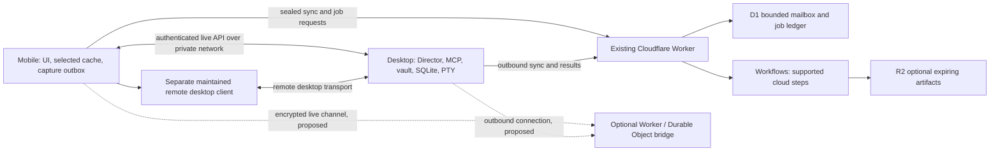

# Astra: Amethyst mobile companion research and implementation plan

Research date: 2026-10-29. Status: proposed architecture; no application implementation or deployment performed.

## 1. Decision and evidence boundary

Build a mobile client of Amethyst, retaining its Python Director, SQLite/vault authority, permission service, widget providers, and Cloudflare relay. Prefer **Capacitor around the existing React/Vite frontend**, with a deliberately mobile navigation and native capture/storage integrations. Tauri 2 is a credible second choice and offers substantially more Amethyst UI reuse than adopting Happy's Expo client. Neither shell makes the desktop Python runtime available on a phone.

Do not fork all of Happy or introduce its server as a second Amethyst backend. Its code is useful for studying session handoff, reconnect, approval presentation, native credentials, and notifications. Its application state and protocol are tightly integrated with its own backend. For this repository, importing those systems would replace infrastructure that already exists while leaving Today and Library to be rebuilt.

The recommendation is conditional on a short, measured native integration spike: inbound sharing with the main app terminated, secure credentials, durable capture, xterm keyboard behavior, and background/resume behavior on both platforms. If Capacitor cannot meet those gates, evaluate Tauri against the same gates; select Expo only if demonstrated native interaction benefits justify rewriting the DOM UI. No desktop shell migration is needed.

Evidence reviewed:

- Amethyst commit `f92603d379657aaf0f82c2ba6ff3b68e4cd3a8a4`; source, relevant tests, manifests and architecture documents. Working tree was clean at inspection.
- Happy commit `832e7eee863fea33888191a169e974d5400fc471`, checked out from its public repository; latest inspected commit dated October 29.
- HAPI commit `730dfcb22e31ec5572446d066cbb5e92d6a6254d`, release 0.33.2, October 29.
- Official Tauri and portal documentation, public project repositories, and Cloudflare documentation source. External links and revision pins appear below.

“Implemented” below means code exists and its path was traced. It does **not** mean deployed, exercised on this user's devices, independently security-audited, or proven reliable under load. No provider credentials, live cloud deployment, mobile signing environment, or physical-device behavior were inspected. Existing tests were read, not run: this task changes documentation only. The supplied attachment ends at “Keep the remote” in §4.8; no requirements beyond that fragment are assumed.

## 2. What Amethyst already has

| System | Source evidence | Actual status and mobile reuse |
|---|---|---|
| Desktop shell | `package.json`, `electron/main.cjs`, `electron/preload.cjs` | Electron desktop, not Tauri. Keep it. Phone must not load desktop IPC assumptions. |
| Frontend | `frontend/package.json`, `frontend/src/App.jsx`, `frontend/src/api.js` | React 19/Vite, DOM components, existing API origin/device-token handling. High reuse in a webview; React Native does not directly render these components. |
| Today widgets | `backend/dashboard/router.py`, `registry.py`, `service.py`, `schema.sql`; `frontend/src/dashboard/` | Real manifests, size validation, per-mode layouts, cached data, refresh and draft/action routes. Reuse providers and contracts; mobile layouts need adaptation. Header comments in the router are older than its action implementation. |
| Knowledge | `backend/library/service.py`, `store.py`, `runner.py`, `enrich.py`; `backend/retrieval/` | Captured text lives in files; SQLite indexes metadata; existing hybrid retrieval and enrichment. Capture records partial failures. Reuse library service, search and dedup; no full cloud knowledge replica exists. |
| Director and traces | `backend/agent/director.py`; `backend/api/main.py:3939` | Existing conversation IDs, model/provider selection, tool events, SSE turn stream, stop route, run records and confirmation endpoints. Direct connection can use these; replayable multi-subscriber event delivery needs additional work. |
| Provider routing, MCP, memory | `backend/runtime/router.py`, `backend/runtime/providers/`, `backend/mcp/`, `backend/memory/` | Existing host-side owners. Phone selects supported options and displays outcomes; it does not run a second agent or inherit every desktop credential. Configured provider/integration availability must be queried. |
| Permission service | `backend/security/confirmation.py`; `backend/api/main.py:4195` | Risk floors, MCP trust, preferences and pending confirmation callbacks exist. This does not automatically protect the separate remote-control routes. |
| Device pairing and sync | `backend/sync/devices.py`, `crypto.py`, `registry.py`, `ops.py`, `service.py`; `frontend/src/lib/sync/` | QR secret, desktop approval, per-device tokens, AES-GCM envelopes, field allowlists and HLC merge. Reuse protocol and identities, but harden permissions, key storage and revocation. |
| Offline companion | `frontend/src/lib/sync/client.js`, `replica.js`, `remote.js` | Local replica/outbox already exists, using browser storage. Conversations, selected metadata and intents survive network loss; this is not a transactional native document cache. |
| Remote agent requests | `backend/sync/intents.py`; `backend/api/main.py:172` | Allowlisted `turn`, `new_conversation`, `stop` intents; turn becomes a local durable job, then transcript sync. Not a live streaming relay. New conversations choose host defaults; intent protocol does not currently express arbitrary provider selection or remote approval. |
| Durable local work | `backend/jobs/`; `backend/automation.py`; `docs/architecture/jobs.md` | State machine, leases, step ledger, retry and crash checks exist. Interactive direct turns and queued remote turns use different execution paths; preserve that distinction. |
| Cloudflare | `relay/src/index.ts`, `jobs/`, `auth.ts`, `ops.ts`, `pairing.ts`, `relay/wrangler.jsonc` | Worker, D1 mailbox/job state, Workflow adapter and optional R2 artifacts exist. Config contains a placeholder D1 ID, so source is not deployment evidence. No live session/PTY/video bridge was found in this relay. |
| Execution routing | `backend/workers/router.py` | Separates provider choice from execution host; requires local resources to remain local, limits relay routing to known kinds, checks configured lanes. Reuse this decision point, not a new universal cloud scheduler. |
| Terminal | `backend/terminal.py`; `frontend/src/views/remote/RemoteTerminal.jsx`; xterm dependencies | Interactive Unix PTY, resize, multiple sessions, byte streaming and bounded memory scrollback exist. Manager and session registry are process-local; disconnect survival is not restart persistence. |
| PC control | `backend/remote/router.py`, `system.py`, `input.py`, `screen.py`, `power.py`; `frontend/src/views/remote/` | Telemetry, process actions, app launching, shell execution, files, input, screen and power routes exist. Several are broad or bypass the Director gate. Treat as an unfinished security boundary. |
| Screen and files | `backend/remote/screen.py`, `files.py` | Screen uses ffmpeg `x11grab`/MJPEG, not a Wayland portal or efficient WAN remote desktop. Files are scoped to a transfer directory, not a workspace browser. |
| Launcher | `frontend/src/components/damon/DamonModes.jsx`, `searchCache.js`, `views/` | Existing library/tasks/web/media search modes and in-memory search cache. Reuse relevant search presentation; the cache is not durable offline storage. Keep desktop launch/IPC/global shortcuts on desktop; mobile gets contextual project/device actions. |

Relevant existing verification assets: `tests/test_api_remote_access.py`, `test_remote_control.py`, `test_terminal.py`, `test_terminal_frames.py`, `test_sync_devices.py`, `test_sync_remote_control.py`, `test_sync_convergence.py`, `test_sync_interop.py`, `test_durable_jobs.py`, `tests/test_dashboard_*.py`, `frontend/tests/sync.mjs`, and `relay/test/{pairing,ops,jobs,workers,cors}.test.ts`. They provide useful starting coverage, not proof of the proposed end-to-end system.

### Release-blocking findings in existing code

1. **Remote authorization is incomplete.** `RemoteCallerGuard` in `backend/api/main.py:828` conditionally runs based on binding/address, checks a set of path prefixes, and defaults missing permission values to true. A valid token can pass other API routes. `/api/remote/command` and application/process mutation routes lack equivalent capability checks there. `/api/remote/ws` multiplexes input/audio without corresponding per-message checks. The router's token argument is not itself validation; the outer guard matters. Replace this with explicit remote allowlisting, deny-by-default capabilities, resource scope and message-level authorization. Test loopback proxies and tunnels: a remote caller must not become trusted local merely because a proxy connects from loopback.
2. **Power and direct commands bypass the confirmation owner.** Remote routes directly call power helpers and `run_terminal_command`; `backend/remote/system.py` uses `shell=True` and supports elevation. Existing device authentication is not per-action consent. Route sensitive actions through the existing confirmation/audit service; separate explicitly authorized interactive terminal input from agent shell actions. Do not retain a broadly exposed elevated command shortcut.
3. **The browser key-storage promise is contradicted by implementation.** `frontend/src/lib/sync/keystore.js` imports non-exportable keys but also writes raw base64 key material to `safeStorage` as `amethyst.gk`; identity tokens are read from localStorage by `api.js`. Native clients need Keychain/Android Keystore-backed storage, legacy migration and removal of raw fallback copies. Do not claim these browser secrets are non-extractable.
4. **Revocation is not cryptographic erasure.** `devices.revoke` tombstones the token and refuses pending intents, but does not rotate the shared group key. A removed device retains already received content and keys. Mirror revocation promptly, invalidate active connections/accepted work as appropriate, and implement versioned key rotation for future data. Full-disk encryption and revocation do not provide forward secrecy for previously captured ciphertext.
5. **Queued agent transport has incomplete parity.** Sync messages cap content at 8,000 characters, omit full tool-call details, and settle after host execution. `_remote_director_for` supplies a callback returning no approval; the current intent path cannot simply reuse direct API approval UX. Add an explicit host-owned approval bridge and full-history fetch; never silently lower the gate to make remote writes work.
6. **PTY and GUI lifecycle limits are real.** PTYs are in-memory, X11 capture does not establish Wayland support, and `get_wake_info` merely lists interfaces/MAC addresses. Do not advertise reboot-persistent terminals, universal GUI control or working remote wake based on these functions.
7. **Workflow dispatch can misclassify errors.** `relay/src/jobs/dispatch.ts` catches every `JOBS.create` failure as “already dispatched.” Quota, authentication and network failures are not duplicates. Classify failures and prove reconciliation/retry before relying on this for captures while the host is offline.

These are source-derived findings for the implementation backlog, not live exploitation results. Resolve them before public remote access. Broad direct access cannot be made safe solely by choosing a mobile framework.

## 3. Framework and reusable project comparison

H/M/L describe fit to this repository, not general framework quality. “Native work” means platform code/configuration still required.

| Criterion | Happy Expo adaptation | Tauri 2 + Amethyst React | Capacitor + Amethyst React | HAPI adaptation |
|---|---|---|---|---|
| Android / iOS | Both; Expo plus separate native clients now exist | Both supported | Both supported | Both native clients plus web/PWA |
| Existing code reuse | M for JS logic, L for Amethyst DOM UI | H for React/CSS and xterm | H for React/CSS and xterm | M web, L native; different hub/protocol |
| Knowledge-first customization | New Today/Library and backend adapters | Existing views adapted | Existing views adapted | New product surfaces and adapters |
| Agent control/streaming | Mature patterns, Happy protocol coupling | Amethyst SSE/WS reuse | Amethyst SSE/WS reuse | Hub REST/SSE, CLI Socket.IO coupling |
| Offline | Happy persistence needs replacement | Native DB/cache work | Native DB/cache work | Own session cache, not Amethyst knowledge sync |
| Share capture / mic / files / push | Expo modules; inbound iOS extension still work | Swift/Kotlin plugins and extension work | Native plugins and extension work | Platform-specific implementations to port |
| Background workflows | Server jobs; OS still suspends app | Same | Same | Hub/runner must be reachable |
| Terminal | Adapt established renderer and agent routing | Existing xterm fits | Existing xterm fits | Web terminal; native parity is not complete |
| Hosting | Existing server optional, but replacement substantial | Existing relay | Existing relay | Adds hub/relay unless replaced |
| Maintenance | Large fork and frequent protocol/UI changes | Rust + native glue + existing frontend | JS + native glue + existing frontend | AGPL obligations and multiple stacks |
| Performance | Native lists; still measure | Webview; virtualize lists and terminal | Webview; virtualize lists and terminal | Native or web, depending adopted client |
| Security | Useful design, requires independent integration audit | Narrow native commands + hardened backend | Narrow native bridge + hardened backend | Different auth/trust model; cannot inherit guarantees |
| Recommendation | Selective reference; fallback only after measured need | Strong alternative | Preferred first spike | Reference or optional separate coding-agent integration |

Capacitor adds a mobile bridge to the existing web frontend without making Rust a new application layer. Its official project explicitly supports existing web applications, Swift/Kotlin plugins and Android/iOS. It does not require adopting Ionic UI or paying for hosted builds. Tauri's official documentation likewise supports HTML/JS/CSS frontends and Swift/Kotlin mobile plugins. Its Rust core is useful when needed, but there is no existing Tauri core here to share. Native share, secure storage and background uploads remain explicit deliverables in either option.

### Happy: concrete reuse boundaries

The inspected monorepo contains `happy-app` (Expo 55, React Native 0.83, Expo Router), `happy-cli`, `happy-agent`, `happy-wire`, `happy-server`, `happy-server-self-host`, and separate `happy-ios`/`happy-android` clients. The older description “an Expo app and a CLI” is incomplete.

| Component inspected | Reuse decision and actual work |
|---|---|
| `happy-app/sources/app/_layout.tsx`, `(app)/_layout.tsx` | Navigation/lifecycle reference. If Expo is selected, adapt safe-area/keyboard/navigation structure, replacing product routes with Today/Library/Agent/Activity/Devices. Not portable unchanged to a DOM shell. |
| `sources/components/Item.tsx` | Small UI candidate for an Expo branch only. Imports typography, translations, modal helpers and Unistyles; replace these with Amethyst tokens and presentation props. Not dependency-free. |
| `sources/components/MessageView.tsx`, `components/tools/ToolView.tsx` | Reuse interaction ideas, not the component wholesale. They depend on Happy message types, metadata, global sync/settings and agent-specific renderers. Amethyst already has transcript/tool presentation. |
| `sources/sync/apiSocket.ts`, `sync.ts`, `ops.ts` | Do not transplant. Socket.IO, RPC/session-machine semantics, encrypted payloads, reducers, receipts, global stores and server APIs are coupled. `sync.ts` also imports billing, telemetry and social/feed systems irrelevant to this product. |
| `sources/auth/tokenStorage.ts` | Native SecureStore pattern is useful. Interface stores Happy `{token, secret}` and uses localStorage on web; replace identity model and web fallback. Not direct Amethyst authentication. |
| `sources/sync/encryption/`, `happy-agent/src/encryption.ts` | Study per-data-key encryption and interoperability tests. Happy has AES-GCM payloads and key-tree/box machinery; it is not wire-compatible with Amethyst's group-key envelope/AAD. Retain Amethyst interop and fix its lifecycle; no second encryption protocol. |
| `sources/sync/pushRegistration.ts`; server `app/push/` | Adapt token lifecycle, focus suppression and stale-token handling concepts. Replace registration routes and routing with Amethyst devices; strip content from notifications by default. |
| `happy-wire/src/` | Small, MIT, explicit schema boundary useful as a pattern. Its session/control/message schemas are Happy-specific; retain only if implementing a deliberate Happy adapter, not as Amethyst's canonical schema. |
| `happy-cli` / `happy-agent` | Useful reference for coding-agent startup, resume IDs and permission forwarding. Do not wrap the Amethyst Director in another agent daemon. Optional external CLI adapters belong on the desktop. |
| Server and self-host package | Discard from core architecture. Main server uses Fastify/Prisma with PostgreSQL schema; Redis streams are conditional on `REDIS_URL`. Self-host README describes embedded PGlite without mandatory Redis/S3. Thus extra hosting is not inherently required by Happy, but integrating its state authority still duplicates Amethyst. |

**Direct-copy shortlist for the recommended web client: none.** Existing Amethyst UI and crypto are the closer fit. MIT permits selected reuse with notices, but copying a large dependency closure is not savings. If a later Expo spike copies a bounded component, pin the upstream commit, retain copyright/license, list modified files, add adapter tests, and assign an upstream/security-update owner. Do not import Happy analytics, billing, social feeds or model credentials implicitly. Maintain a small vendor manifest instead of tracking all upstream app changes.

Happy was active on October 29 and is MIT at the inspected root. Its app contains Expo, sodium/native crypto, MMKV, Unistyles, Skia, WebRTC/LiveKit, voice, telemetry and purchases dependencies. This creates meaningful native upgrade and privacy-review work even if unused screens are removed. E2EE does not hide traffic metadata or secure a compromised endpoint; recovery, token revocation, key distribution and push payloads still need review.

### HAPI and additional foundations

HAPI currently has a Bun/Hono/SQLite hub, CLI/runner, React web client, shared protocol/fixtures, and independent SwiftUI/UIKit and Kotlin Compose clients. Its documented flow is CLI/runner → Socket.IO hub → REST/SSE clients; it also describes an optional WireGuard/TLS relay. The native apps do not inherit web terminal/realtime voice parity. Native store distribution is described as paid; source can be built. These details matter when estimating reuse.

The scoped-workspace browser, native client contract/golden fixtures, approvals and handoff behavior are strong references. Copying HAPI code into this MIT project requires deliberate AGPL-3.0-only compliance review, including derivative/distribution and network-use obligations; it is not an MIT drop-in. Prefer studying its contracts or interoperating with an independently installed hub through a narrow optional adapter. Do not add its hub as a requirement for Amethyst chat.

Capacitor is MIT, with repository activity on October 28, and materially reduces work by packaging the existing DOM frontend. Goose was also active October 28 and Apache-2.0, but introduces another agent runtime rather than solving this client's missing capture/transport/security layers; no core adoption recommended. Neither activity timestamp alone establishes maintenance quality or compatibility.

## 4. Target ownership and connectivity

Authoritative state stays at its current owner: desktop knowledge files/index, executing host's runs, existing connector authorities, and the relay's bounded jobs/mailboxes. Phone owns unsent captures/drafts and selected offline content. D1 is not a permanent knowledge store; R2 is optional transfer staging with explicit retention. Do not synchronize SQLite files or physical paths between devices.

Use two transports with different guarantees:

1. **Durable sync/control:** existing `/pair`, `/ops`, `/jobs`, `/sync` flow; authenticated, idempotent and bounded. Appropriate for captures, metadata and explicitly queued prompts. Do not put keystrokes, pointer movement or video into D1 operations.
2. **Live transport:** existing REST/SSE/WebSocket contracts over authenticated HTTPS on an approved private network first. An outbound desktop connection to a new Worker/Durable Object bridge is an optional no-VPN path for agent events and terminal bytes. This is new code, not a capability of today's relay. Use an established authenticated E2EE transport/session library, peer identity binding, reconnect cursors, backpressure and resource limits; subject the integration to review. Do not invent a cryptographic handshake or blindly proxy the whole local API.

The initial private-network option can use a user-managed VPN/overlay; no router port exposure or new paid service is necessary. Cloudflare continues coordinating durable jobs/sync. If VPN installation is unacceptable, the bridge becomes a release prerequisite, with its cost and security review included. Cloudflare Tunnel alone is not end-to-end encryption from phone to desktop when TLS terminates at the edge; do not describe it as equivalent to opaque sync.

Add negotiated `protocol_version`, server/host identity and supported capabilities. Extend existing responses where possible; a small proposed capability endpoint is justified by actual platform differences. Capabilities describe permission **and** availability, such as `terminal.read`, `terminal.write`, `workspace.read`, `agent.approve`, `screen.view`, `input.control`, `power.restart`; they do not authorize themselves. The desktop always enforces the effective grant.

## 5. Mobile product and offline behavior

Use five destinations: **Today, Library, Agent, Activity, Devices**. Settings lives behind a profile/menu entry. Today opens first; capture is available from Library and the OS share surface. Devices is first-class, and an active agent session has a direct device/workspace link. Reuse existing theme tokens, accessible labels and focus conventions; no copied chatbot landing page.

| Area | Mobile behavior | Desktop unavailable |
|---|---|---|
| Today | Compact S/M cards, expand to detail; reuse manifests/data states; separate `mobile` layout mode avoids breaking desktop layout | Local clock; cached widgets show last sync and stale state. No fabricated connector updates. |
| Library | Search cached metadata/text, browse available collections/tags, open saved links/summaries, edit notes, select offline downloads | Cached search/read, durable captures and pending edits. Full semantic search and uncached documents clearly require host. |
| Agent | Existing session IDs, streamed events, tool visibility, approval, attachments, configured model options | Read cached transcript; optionally queue a clearly labelled prompt. Never imply host tools are available. |
| Activity | Runs, jobs, schedules, trace details, retry/cancel where supported; owner/host/source visible | Cached host state plus genuinely live relay jobs. Cancellation says requested until owner acknowledges. |
| Devices | My Desktop: connectivity, sessions, workspace, processes, approvals, Terminal, Files, Desktop and quick actions | Last-seen time, unavailable capabilities, supported wake method if configured. |

Reuse `GET /api/widgets`, widget data/refresh/action routes and `/api/layout?mode=mobile`. Clock can be local; connector widgets remain data-provider driven. Mirror only opted-in widget snapshots/configuration through sync after adding explicit registry fields; the existing layout endpoint alone does not make layout available offline. Preserve loading/empty/not-connected/error/stale states and show actual sync time. Calendar/email/message summaries appear only when their configured source returns real data.

Native storage needs a transactional cache/outbox rather than localStorage: selected document bytes plus SQLite metadata/FTS where practical, encrypted at rest using a key held by native secure storage. Use the existing HLC merge for compatible metadata. For document edits, carry a base revision/hash; reject or present conflicts instead of applying field-level last-writer-wins to entire text. Keep local pending edits on failure. Define cache size, downloads-on-Wi-Fi, per-collection opt-in, eviction and deletion; never evict an unacknowledged capture. Exclude credentials and sensitive caches from insecure backups.

When both phone and desktop lack connectivity, local cache, drafts, notes and capture remain useful. With relay online and desktop offline, URL acceptance and currently cloud-capable fetch steps work. **Full Director execution is not currently cloud-capable.** If future cloud conversation is required, package the existing Director for an explicitly restricted execution host and reuse session/run contracts; prove credential isolation and no local-resource dependencies first. Do not substitute a separate cloud chatbot in the initial release.

## 6. Capture and durable ingestion

Android receives `ACTION_SEND`/`ACTION_SEND_MULTIPLE`, text and content URIs. Copy ephemeral URI content promptly into private staging, enforce type/size limits and use platform background work for deferred upload. iOS uses a real Share Extension with an App Group inbox and narrowly scoped shared credentials. Keep the extension short: store capture atomically and acknowledge “Saved to device”; do not require the main app or a long model call to stay alive. Use supported background transfer facilities; execution timing remains OS-controlled.

Capture flow: OS share → mobile outbox transaction → upload/submit with stable capture UUID → durable receipt → supported cloud steps or `waiting_for_host` → desktop library import → sync result → cleanup. A receipt is not completed ingestion. Display stage, owner and errors, not a synthetic percentage.

| Input | Existing support and required extension |
|---|---|
| URL / YouTube | Relay `url_ingest` accepts and fetches limited metadata; desktop library owns extraction/transcripts/enrichment. Do not equate relay job completion with saved transcript. |
| Instagram / authenticated links | Relay deliberately skips known login-wall hosts; desktop collectors may require authorized sessions. Preserve link and reason; no login bypass or cookie export into Cloudflare. |
| Text | Store text locally immediately; add typed capture payload and library import using existing service conventions. |
| Image / PDF / audio / files | Existing local services and relay document/media fetching are not an arbitrary mobile upload pipeline. Add authenticated size-bounded multipart/staged upload, MIME validation, checksum, quotas and expiration. OCR/transcription run only on an available capable host/provider. |
| Unsupported / blocked content | Preserve source, metadata and failure explanation. Offer retry, open source or supply file; never fabricate summaries. |

Current relay `url_ingest` dedups by URL. Preserve a per-submission UUID for delivery retry and a separate canonical-source/content identity for library dedup; decide how repeat captures with new notes attach rather than silently dropping them. Upload retry must not duplicate ingestion. Add recoverable intermediate states, bounded exponential backoff, source-specific failure classification and explicit user retry for permanent failures. Apply existing SSRF validation plus redirect/DNS checks to all new fetch paths.

To offer genuinely complete cloud ingestion for simple public text, extend the existing job registry with bounded extraction/summary steps and encrypted temporary output, then import through the same library service. This is an optional later capability; current metadata-only fetch cannot be presented as it. Cloud processing sees any plaintext it processes, whereas opaque sync does not: disclose that distinction in controls. Keep native captures usable without enabling R2; large files can wait locally for desktop reachability.

## 7. Remote PC control: required release scope

### Agent sessions and approvals

Use existing conversation and run identities across clients. Reuse list/messages/run, turn SSE, stop and confirmation APIs. Add idempotent command IDs and host-owned event sequence/cursors to support reconnect and simultaneous viewers; a disconnected HTTP stream must not duplicate a turn. The transcript remains canonical; a replayed delta must not append twice. Large history is paginated/fetched, not silently limited to the sync excerpt.

Queued commands include originating device, target host/session, creation time, expiry and capability requirements. Revalidate on execution, including revocation. One executing owner per session prevents desktop/mobile prompts racing; either queue per session or return busy explicitly. Host acknowledgment distinguishes accepted, running, waiting for approval, completed, failed and cancelled. A stop request is not a stopped run until the execution owner records it.

Persist approval identity, action/argument digest, originating device, target workspace, expiry and outcome. Resolve exactly once; stale, altered, replayed or already resolved requests fail closed. Bind the decision to the same gate used by the Director. On host restart, recover only approvals whose execution context remains valid; otherwise invalidate and regenerate. Push is a hint to open the request, not an authorization token. Host-side MCP credentials and provider secrets remain on their authorized execution host.

### Interactive terminal

Keep xterm.js and the existing PTY/WebSocket framing. Native shell clients can host the terminal view in their webview; a touch toolbar supplies Esc/Ctrl/Tab/arrows, paste confirmation and a visible read/write mode. Fit/resizes need debouncing and bounds; retain binary terminal data rather than treating it as arbitrary JSON text.

Extend `backend/terminal.py` with device/workspace/session authorization, a read-only subscription path, connection limits, bounded output queues and revocation checks. Reconnect uses the same session ID and bounded scrollback. For persistence across backend restarts, attach to named **tmux** sessions and keep a small durable mapping; tmux survives backend process loss, not power loss. Expose that distinction. The OS shell can own command history; avoid pretending every PTY byte stream can be reliably parsed into commands. Redact secrets in audit metadata and do not log all keystrokes by default.

“Confirm each command” cannot safely be imposed on arbitrary interactive PTY input: shells and full-screen programs interpret bytes differently. Offer two explicit policies: read-only terminal, or time-bounded authorized interactive session; separately offer structured command execution through the permission gate with argv/workspace constraints. Agent-generated shell commands always retain their own tool approval policy. Reboot/shutdown is never queued as stale terminal input.

### Desktop applications and windows

Advertise capabilities from actual runtime detection. Prefer desktop entries and explicit application IDs, D-Bus/MPRIS and application APIs. Replace arbitrary `shell=True` app targets with allowlisted launch/open operations. Opening files and project directories uses approved roots. No generic “launch any string” capability.

X11 can support window enumeration/input/capture through suitable installed tools, but requires session authorization. Wayland has no universal unrestricted window enumeration or input injection API. Use XDG ScreenCast/RemoteDesktop portals, PipeWire capture, and supported RemoteDesktop/EIS input paths after user consent; persistent restore tokens depend on portal/backend support. A global-shortcut portal does not grant arbitrary key injection. GNOME, KDE and wlroots environments need separate capability tests; compositor-specific APIs are optional adapters, not assumed portable behavior. Do not silently disable Wayland or install privileged input daemons.

### Visual desktop technology choice

| Technology | Android/iOS and Linux | Network/performance/cost | Integration and license | Decision |
|---|---|---|---|---|
| RustDesk | Existing mobile clients; Linux host; official docs still label Wayland experimental and login-screen access X11-dependent | Direct paths when possible; rendezvous/relay when needed; self-host relay incurs bandwidth/availability costs | AGPL-3.0; full embedding is a substantial Rust/Flutter/platform integration, not an assumed stable SDK | Preferred initial handoff for general remote desktop, after actual compositor test |
| Sunshine + Moonlight | Linux host, Android/iOS clients; capture backend and GPU dependent | Hardware encoding favors low latency; direct/private-network connectivity preferred; not a general automatic TURN solution | GPL-3.0 projects; embedding adds codec/input/lifecycle work | Optional high-performance profile for suitable hardware; secure handoff |
| WebRTC desktop implementation | Web/native rendering possible; desktop capture/control still must be implemented via portals/backend | ICE/STUN plus TURN fallback, congestion handling; TURN bandwidth can dominate cost | WebRTC is a transport, not a complete remote desktop product; component licenses vary | Do not build first; revisit only if embedding is a demonstrated requirement |
| RDP / VNC, e.g. existing Linux desktop service or browser gateway | Depends on desktop service and mobile client; may create a different login session | VPN/direct or gateway; VNC compression often less suitable for high-motion use; gateway adds operations | Audit chosen implementation/license; protocols do not imply safe defaults | Useful existing-installation integration, especially managed GNOME/KDE environments |

Initial implementation: a **Desktop** tile in Devices launches an installed maintained client using only a documented and verified deep link where supported. Otherwise show/open the client and provide the non-secret connection identity; do not invent URI schemes or put passwords in URLs/clipboard. Keep credentials and actual session approval inside that client. The tile must clearly indicate that control occurs in another app and offer return navigation. Test touch pointer, scroll, keyboard, monitor selection, quality and disconnect in the selected client; availability is client/platform-dependent. Show unsupported capabilities honestly.

This is part of the remote-control release, not an indefinite future feature. Embedded video is deferred because a maintained handoff satisfies the requested unified launch surface with much lower maintenance. If seamless in-app video is later made mandatory, it is a separate decision and measured integration project. Do not tunnel MJPEG/video through D1 or assume Cloudflare's existing Worker is a general TURN server.

### Development and files

Devices → My Desktop → Workspace exposes repository status, paginated diffs, file previews, registered coding-agent sessions, test/build tasks, service restart tasks and logs. Reuse the Director/tool machinery and existing dashboard Git provider where semantics fit; separate read-only Git data from mutations. Fixed task definitions carry cwd/argv/environment policy, timeout and cancellation; test runs can execute project code and require the relevant grant.

For external coding CLIs, use their supported session/continuation APIs and retain both Amethyst session ID and native agent ID. Happy/HAPI show useful patterns but do not guarantee every CLI supports attaching to a process started elsewhere. Unknown sessions can be read/imported only where supported; label unavailable continuation. Do not implement another coding agent or send autonomous replies to other sessions by default.

Extend the transfer area with a deliberately scoped workspace service. Each device has approved roots; resolve canonical paths, enforce containment after symlinks, reject traversal and handle TOCTOU with descriptor-relative safe operations where available. Set byte/page/upload limits and use safe previews; source/HTML is text, never executed inside a privileged webview. Editing carries an expected revision/hash, creates recoverable history, and passes write authorization. Downloads/uploads are authenticated, resumable where needed and integrity checked. Git writes, process kills and service restarts go through the same action policy and audit owner. A device filesystem grant is not an unrestricted shell grant.

### Power, presence and lifecycle

Distinguish **app closed**, **host service disconnected**, **machine sleeping**, and **machine powered off/unknown**. A tray/background service may keep serving when the window closes; if backend lifecycle follows Electron exit, it will not. A separately supervised user service is necessary for reliable unattended host availability and must be explicitly enabled.

Use timestamped authenticated heartbeats with boot/session IDs and server-observed expiry. A missed heartbeat means unreachable, not proof of shutdown. Reconnection refreshes capabilities, verifies keys and resumes event cursors before enabling actions.

Wake-on-LAN requires supported firmware/NIC settings, network topology and a sender that can reach the target broadcast/domain. A sleeping desktop cannot send its own magic packet. An always-on router/LAN helper or suitable VPN path may provide wake; Cloudflare cannot broadcast into a private LAN by itself. `get_wake_info` is discovery only. Restart/shutdown requires an explicit fresh confirmation; show request accepted separately from observed disconnect/reconnect. Expire these requests rather than executing hours later. No configured wake path means “Cannot wake this device remotely.”

## 8. Background execution, privacy and cost

Neither iOS nor Android guarantees permanent sockets or continuous background JS. Suspend live streams on background, preserve cursors/outbox atomically, schedule allowed upload work and reconnect on foreground. APNs/FCM notifications carry an opaque event/device reference or encrypted minimal payload, not terminal output or document content. They can be delayed or dropped; fetch authoritative state after opening. Add device-token rotation, uninstall invalidation, opt-in preferences, per-topic controls and rate limits. Existing desktop notification code is not proof that native push exists.

Privacy boundaries: opaque sync contents remain encrypted through the relay; metadata such as timing/device routing remains visible. Cloud fetch/processing reveals submitted URLs/content to that processor and any selected model service. Large offline caches need native at-rest protection. Local-only sources never become cloud inputs without explicit selection. Revoking a device stops future access after propagation but cannot erase content already copied to it.

Free-first deployment uses the current Worker/D1 mailbox, optional Workflows, local phone cache and existing desktop. No mandatory PostgreSQL, Redis, paid vector database or second agent host. Keep R2 opt-in with bounded retention, storage quotas and a delete-after-ack/expiry sweeper. Explicitly account for native signing/distribution, macOS iOS build access, LLM usage, optional relay/TURN bandwidth and operational time; a free framework does not make these zero-cost.

Cloudflare's documentation inspected on this date lists Workers Free at 100,000 requests/day and 10 ms CPU/invocation; Workflows Free shares the request allowance and lists 3,000 steps/day and 1 GB-month storage. Workers Paid starts at $5/month; step/storage billing is now relevant, rather than an old “Workflows entirely free” assumption. Recheck published quotas at rollout. Free CPU limits constrain parsing/encryption/processing; they are not a license to run a Python agent or media pipeline inside Workers.

For scale intuition, three clients polling every 15 seconds continuously produce 17,280 requests/day before writes/job traffic. This is an illustrative budget, not measured usage, and D1 queries per request, CPU and other account traffic also count. Prefer foreground activity-aware polling and push hints. Report quota exhaustion as a retryable blocked state; never silently discard captures or automatically enable billing. Existing inline fallback without Workflow binding is useful but not equivalent to all Workflows durability guarantees.

## 9. Implementation sequence and acceptance gates

Estimated ranges below are planning estimates for one experienced implementer with access to Android, iPhone and macOS build/signing; security and device review require additional participation. They are not delivery commitments. Each increment is independently reviewable. No feature implementation is included in this research task.

| ID | Scope, owner in existing architecture | Dependencies | Acceptance evidence | Estimate |
|---|---|---|---|---|
| A0 | Native shell spike; frontend shell and native capture/storage bridge | None | Both platforms: killed-app share, secure credential round-trip, durable outbox after force-stop, keyboard/terminal usable, resume reconnect. Compare Capacitor/Tauri only where spike fails. | 3–5 days |
| A1 | Harden `RemoteCallerGuard`, remote routes, device policy and confirmation/audit integration | None; before network release | Missing/expired/revoked token denied over HTTP/WS; each capability denied independently including multiplexed frames and proxy paths; command/power confirmation cannot be bypassed. | 1–2 weeks |
| A2 | Protocol/capability negotiation, native key/cache storage, versioned revocation | A0, A1 | Python/JS/native crypto vectors, key migration removes legacy copies, device revocation terminates access; offline writes survive crash; schema rollback preserves pending records. | 1–2 weeks |
| A3 | Today, Library and OS capture using current providers/jobs | A2 | Real widget states; selected offline document reading/search; repeated share/import dedups; offline upload resumes; unsupported source has visible reason. | 2–3 weeks |
| A4 | Same-session Agent, event replay and remote approvals | A1, A2 | Desktop-to-phone continuation retains ID; stream reconnect has no duplicate turn/text; competing inputs serialized; stale approval rejected; queued intent stays queued while host absent. | 1–2 weeks |
| A5 | Devices, persistent terminal, workspace/Git/task controls | A1, A2, A4 | Read-only WS cannot write; multi-session resize works; tmux survives backend restart; approved-root traversal/symlink tests; permitted test/build cancellation and audit. | 2–3 weeks |
| A6 | Desktop handoff, app actions, presence/wake/power | A1, A5 | Real Android/iOS remote-screen handoff; GNOME/KDE/X11 capability matrix; denied portal permission handled; fresh power confirmation; no unsupported wake claim. | 1–2 weeks |
| A7 | Activity, native push, reconnection, retention and release hardening | A3–A6 | Notification tap revalidates state; relay quota/failure recovery; expired staging removed; desktop offline and phone airplane-mode journey complete; accessibility/device checks. | 1–2 weeks |
| A8 | Optional outbound live bridge if no-VPN operation required | A1, A2; before A4/A5 public no-VPN use | NAT/reconnect/flow control, peer binding, no arbitrary local API proxy, disconnect revocation, measured latency/CPU/quota and reviewed E2EE integration. | additional 2–4 weeks |

The main scope is roughly 9–15 engineer-weeks including the spike, with uncertainty highest around native sharing/background behavior, security hardening and host/compositor support. A8 adds work if required. A small single-user private-network beta can arrive earlier, but a chat-only beta is not completion of the requested remote-control product.

Do not migrate desktop Electron, replace the Director, rebuild the widget provider system, introduce a second global database, or implement custom terminal/video protocols during these phases. Add a shared frontend protocol/client module only when extracting concrete code used by desktop and mobile; avoid a generic SDK scaffolding exercise.

### Required proof during implementation

- Extend existing touched tests for guard scopes, paired-device roles, replay/expiry, path confinement, outbox crash recovery, dedup and same-session continuity. Add relay dispatch failure/quota tests, not just happy-path mocks.
- Test protocol compatibility with an older desktop/mobile peer; additive fields and schema versions must preserve queued work. Unsupported operations fail clearly; rollback must not erase outbox entries.
- On real devices test iOS extension time limits, Android content-URI lifetimes, app termination, revoked notifications, denied microphone/file permissions, keyboard overlap, screen readers and large-text layouts.
- Test desktop online, service stopped, sleeping and power-off separately; simulate relay available while host absent, host available while relay absent, expired credentials and a revoked device with an open socket.
- Exercise slow terminal consumers and large output, partial attachment upload, crash between an external effect and ledger write, duplicate deliveries, concurrent approval decisions and interrupted tmux attachment. Do not claim exactly-once external effects merely because a step ledger exists.
- Measure foreground reconnect, stream latency and battery/network usage before promising performance. No screenshots are required; use functional assertions and device observation.

## 10. Sources and reproducibility

Repository paths above are relative to the Amethyst root. External source pins are for reproducible inspection; do not execute upstream install scripts merely to read them.

| Source | Verified material |
|---|---|
| [Happy pinned source](https://github.com/slopus/happy/tree/832e7eee863fea33888191a169e974d5400fc471) | Package boundaries, MIT license, app imports, crypto/auth, Socket.IO server, self-host README, native clients |
| [HAPI pinned source](https://github.com/tiann/hapi/tree/730dfcb22e31ec5572446d066cbb5e92d6a6254d) | AGPL license; `docs/guide/how-it-works.md`, native client guides, web/hub/shared package manifests |
| [Tauri introduction](https://v2.tauri.app/start/) and [mobile plugin development](https://v2.tauri.app/develop/plugins/develop-mobile/) | Both mobile platforms; frontend reuse; Swift/Kotlin plugin work |
| [Capacitor source](https://github.com/ionic-team/capacitor) | MIT license; existing-web-app integration; native plugin interface; Android/iOS |
| [XDG RemoteDesktop portal](https://flatpak.github.io/xdg-desktop-portal/docs/doc-org.freedesktop.portal.RemoteDesktop.html) | Session/device selection, user consent, restore behavior and EIS API; actual compositor support still requires testing |
| [RustDesk source](https://github.com/rustdesk/rustdesk) and [Linux documentation source](https://github.com/rustdesk/doc.rustdesk.com/blob/master/content/client/linux/_index.en.md) | AGPL, client/host model, experimental Wayland and login-screen limitations |
| [Sunshine source](https://github.com/LizardByte/Sunshine), [Moonlight Android](https://github.com/moonlight-stream/moonlight-android), [Moonlight iOS](https://github.com/moonlight-stream/moonlight-ios) | GPL licenses, low-latency host/client model, Linux/GPU backend constraints |
| [Goose](https://github.com/aaif-goose/goose) | Apache-2.0 agent foundation; not a direct Amethyst mobile client replacement |
| [Workers pricing](https://developers.cloudflare.com/workers/platform/pricing/), [Workflows pricing](https://developers.cloudflare.com/workflows/reference/pricing/) | Current pricing/quotas checked via the [official documentation repository](https://github.com/cloudflare/cloudflare-docs/tree/production/src/content/docs); rendered endpoints rejected automated fetch |

No Happy, HAPI, Capacitor or Tauri build was run. No native app, push registration, remote desktop handoff, cloud deployment or compositor integration was exercised. These remain the explicit acceptance gates above. Public research establishes available foundations; it cannot certify this user's deployment or OS permissions.
