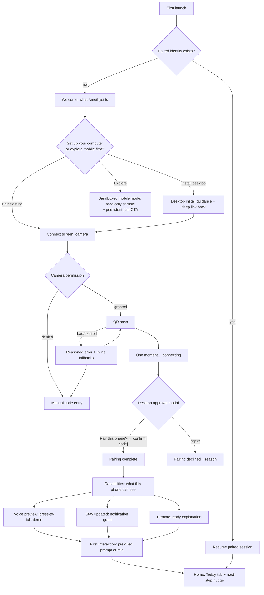
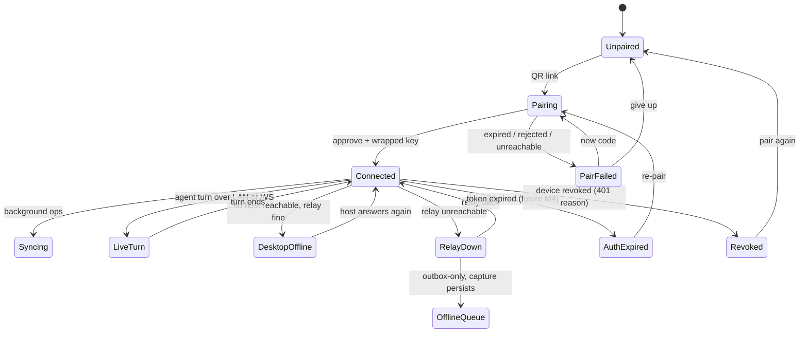
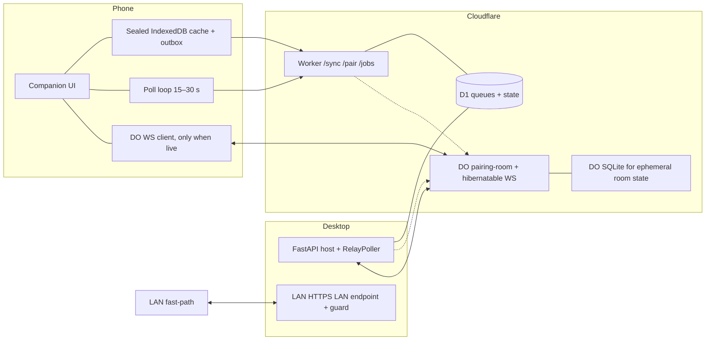

# Mobile onboarding, desktop pairing and complete setup architecture — research report

Research date: 2026-11-05. Status: research and proposal only. No application
implementation, deployment or code change was performed for this report.

Head of working tree at research time: `b18ab230` (merge
`feat/library-gdrive-migration`). The agent-context documentation set was last
verified at commit `3c363b7`; the pairing/mobile-relevant code checked below
matches those documents, with the drift noted inline.

Evidence boundary. Everything labelled **[verified]** was read directly in this
repository's source or in an official vendor document cited by URL. Everything
labelled **[recommended]** is this report's proposal grounded in that evidence.
Everything labelled **[inferred]** or **[unresolved]** is an open point that
requires confirmation before it should drive an implementation decision. Prior
research in [`astra-mobile-research.md`](astra-mobile-research.md) is treated as
a base; this report does not repeat its remote-control/capture findings, and
where it does touch them it cites them.

---

## A. Executive summary

1. **The pairing spine already exists and is good.** QR → 160-bit secret →
   HKDF/AES-256-GCM sealed offer/answer → desktop approval → device token
   (SHA-256 stored) + wrapped group key → sealed ops over the Cloudflare relay,
   with a direct-LAN `/api/pair/claim` shortcut. Measured end-to-end pairing
   time was 7.2 s against the deployed relay (ADR-0024 amendment). The job is
   not to replace it; it is to close four named gaps and wrap it in a real
   onboarding experience, which today does not exist on the phone.

2. **The phone's first launch is currently unguided.** `PhoneApp` with no
   identity lands on a bare `Pair` idle screen ("Connect to your computer");
   after pairing the user is dropped into `Companion` with standard tabs.
   There is no welcome, no explanation of the desktop relationship, no
   permission priming, no first-success moment. The desktop has a
   `SplashScreenWizard` (Welcome / AI Models / Cloud Sync / Phone Sharing /
   Connected Apps / Ready) but it is never reachable from the phone frame.
   **[verified — `App.jsx`, `Pair.jsx`, `SplashScreenWizard.jsx`]**

3. **Four pairing-protocol upgrades are needed before this is defensible for a
   distributed app**: (M1) never auto-approve a real device; (M2) a 6-digit
   co-location confirmation code shown on the desktop and confirmed on the
   phone (the RFC 8628 §3.3.1 pattern) — this closes the QR-screenshot hole,
   which is structurally open while the QR carries a bearer secret; (M3) an
   offer-nonce echo to defeat a backing offer/answer race; (M5) group-key
   epoch rotation on revocation (today a revoked device keeps the group key
   forever — the one documented cryptographic known issue). PAKEs are not
   needed with a 160-bit uniform secret; that is settled (RFC 9382/9383
   context). **[recommended, see F/G]**

4. **Architecture decision: hybrid connection model.** Keep the current
   15–30 s sealed-ops relay poll as the always-works default (fix the D1
   cursor indexing bug that caused the 10.5 M rows-read/day incident), add a
   Durable Object with hibernatable WebSockets per pairing room used **only
   during pairing and live agent turns**, and keep direct-LAN as a local
   fast-path. That keeps the free plan comfortable (<10 % of every cap) and
   buys push latency where it matters. **[recommended, see H]**

5. **Platform gaps to fix for a one-minute path**: iOS has no in-app QR
   scanner today (web `BarcodeDetector` is unavailable in WKWebView) → need a
   scanning plugin (ML Kit engine on Android, AVFoundation on iOS);
   `amethyst://` is the only deep link (no App Links/Universal Links, no
   `assetlinks.json`, no AASA in tree); iOS `NSLocalNetworkUsageDescription`
   and `NSBonjourServices` are missing — LAN pairing will silently fail on
   iOS 14+ without them; notifications do not exist at all (no FCM, no APNs,
   no `POST_NOTIFICATIONS`), so "desktop is waiting to approve" and "agent
   finished" have no push surface. **[verified — manifests and tree greps]**

6. **Permissions policy: contextual, not upfront.** Camera at the scan screen
   with specific copy; notifications on first valuation of "tell me when
   something happens"; mic only inside the existing push-to-talk affordance;
   everything else stays platform-granted-by-context. No ATT, no background
   mic, no silent-push-as-transfer-trigger. **[recommended, see I]**

7. **Voice posture.** What exists is push-to-talk phone-mic → PC speakers
   over direct LAN, plus a PC→phone intercom path in backend code. There is
   **no** speech recognition, no TTS, no wake word on the phone. The right
   mobile baseline is system-keyboard dictation (zero permission) and on-
   device recognizers later, gated behind explicit user activation. Do not
   promise background voice. **[verified — `audio.py`, `RemoteMedia.jsx`]**

8. **Roadmap** (Phase 0–5) is at O. Phase 0 is a bounded audit+fix sprint
   (auto-approve semantics, D1 index, comment drift); Phase 1 is the pairing
   security + scanner + deep-link sprint; Phase 2 is connection lifecycle; the
   onboarding surfaces ship across Phases 1–3 with the advertised one-minute
   target gated by Phase 1's acceptance criteria.

---

## B. Existing Amethyst architecture audit

### B.1 Runtime shape [verified]

One FastAPI process owns API + agent loop + background runners; SQLite WAL +
filesystem vault + OS keychain; no multi-tenancy. Two desktop shells exist
(Electron `electron/main.cjs`; Python tray/webview `backend/desktop.py`).
The Capacitor companion (`app.amethyst.companion`, Capacitor 8.6.0) packages
the same React bundle with a mobile frame. Full map:
`docs/agent-context/ARCHITECTURE.md`, `docs/agent-context/systems/desktop.md`.

Companion plugin surface is deliberately minimal today: `@capacitor/app`
(deep links/state) and `@aparajita/capacitor-secure-storage` only. No camera,
no push, no haptics, no local-notifications, no SQLite plugin. **[verified —
`frontend/package.json`, `frontend/src/mobile/native.js`]**

### B.2 Pairing, step by step (as implemented)

Sequence (current relay path; direct-LAN differs only in transport):

```mermaid
sequenceDiagram
  participant D as Desktop (host, authority)
  participant V as Pair screen (QR)
  participant R as Relay (CF Worker, D1)
  participant P as Phone (Pair.jsx)

  D->>V: new_pair_secret() 160-bit, TTL 300 s, one open code
  V->>V: draw QR (segno SVG) payload{ s, r, h }
  P->>P: parse link (camera app → /pair#…, amethyst://, in-app scan, manual)
  P->>P: pair_key = HKDF-SHA256(secret, info="amethyst-pair-v1")
  P->>R: sealed offer (AES-256-GCM, AAD op_id∥device_id)
  D->>R: poll (RelayPoller; nudge → 1 s tick while code open)
  R->>D: offer (opaque bytes; relay sees ciphertext only)
  D->>D: unseal → PendingPairing → user approves (PairingApprovalModal)
  D->>R: approve → mint device row + token(sha256-stored) + wrap group key
  R->>P: sealed answer (wrapped key)  [~7.2 s measured, ADR-0024]
  P->>P: store key (secure storage / non-extractable IndexedDB)
  D->>P: project.rewind → transcript history arrives in 50-row batches
```

Facts worth pinning down exactly [verified — `backend/sync/devices.py`,
`relay/src/pairing.ts`, `frontend/src/lib/sync/client.js`]:

- Payload: `https://<app>/pair#s=…&r=…&h=…` (h = LAN host, present when
  `prefer_lan` or app URL not https), fallback `amethyst://pair?…`. Relay TTL
  is 240 s vs the host's 300 s deliberately ("this side gives up first").
- `accept()` refusal branches: `pending_approval` if a pairing is already
  pending; deterministic replay from the approved-answer map for a repeat;
  `{request_id, refused: "expired"}` plaintext marker when nothing is open;
  **silent `None`** when unsealing fails or no request_id (wrong secret stays
  silent — deliberate anti-probing, and there is a note about a
  remotely-triggerable lockout that once came from counting these).
- One open code at a time: opening a second replaces the first, so a left-
  on-screen code stops working. Multiple pending pairings can coexist.
- Pairing window lives in memory by design; restart invalidates it.
- Token: `token_urlsafe(32)`, stored as SHA-256 only, shown once. Group key is
  wrapped to the phone under the pair key; relay never sees either.
- On approval the host rewinds transcript watermarks so the new replica gets
  full history in 50-row batches.
- Direct LAN: `POST /api/pair/claim` (public path), then `GET` polling with
  410 expired / 403 rejected / pending passthrough; `auto_approve=False`.
  Phone tries LAN first, falls back to relay, 120 s cap.
- Phone crypto storage: identity (incl. token) in `@aparajita` secure storage
  with `whenUnlockedThisDeviceOnly`; group key as non-extractable AES CryptoKey
  in IndexedDB; legacy `localStorage` raw key copies are still *read* and are
  removed once re-stored **[verified]** — the browser `safeStorage` identity
  copy has no such purge path for the direct-handoff token case **[inferred
  gap, small]**.

### B.3 Authorization and guard [verified]

`RemoteCallerGuard` is a bare ASGI middleware (http + websocket), registered
on the app. Public under non-loopback bind: static files, `/api/ping`,
`/api/pair/claim`. Everything else is 403 without a valid device token whose
permission is mapped by `backend/security/remote_access.py`; proxies are
distinguished by `forwarded`/`x-forwarded-*` headers and cannot inherit local
trust; sockets re-check permissions per message/frame. Permission defaults are
deny for invasive capabilities (`terminal root screen webcam mic audio files
input power clipboard system`) and allow for `agent library dashboard`.
Auth rate limiting: 50 failures / 300 s, process-global.

### B.4 Sync and relay [verified]

Host polls; every poll carries outgoing sealed ops, incoming ops, acks,
pairing envelopes, config mirror (device ids, token hashes, share token,
Instagram settings) — so revocation reaches the relay within one poll.
Relay limits: `SYNC_BATCH 100`, `MAX_OP_BYTES 64 KB`, `MAX_OPEN_OPS 5000`,
`KEEP_SECONDS 24 h`, ack retention 8 days, pairing envelope cap 8 KB,
max 8 pending pairings. Merge is per-field last-write-wins by HLC with
`sync_seen` dedup + placeholder rows for missing-parent updates; transcript
projection is a watermark sweep with the `(updated_at, id)` cursor shape.
Entities synced: settings (ui.* only), memories, conversations, tasks,
agent_runs (phase/link/error), subagent_sessions, messages (8 KB cap),
intents, library metadata.Remote intents are only `turn`,
`new_conversation`, `stop` — anything else is refused at the handler table.

### B.5 The companion today [verified]

- Tabs: `today / library / agent / activity / devices`. Devices tab sub-views:
  overview, PC controls, Terminal, Files, Media — permission-gated by
  `connection.permissions`. 30 s refresh loop; snapshot record on success.
- Offline layer: IndexedDB `amethyst.mobile` with a single `records` store;
  every record is **sealed with the group key** (AAD `id∥owner`), so the cache
  races unpair correctly. Snapshot = ≤100 library items + jobs + syncedAt.
  Capture queue posts to `POST /api/mobile/captures` (202, durable job,
  idempotency key `mobile:{owner}:{id}`, re-checks `library` permission).
- Live turn: **absent on the phone**. No `/api/remote/sse`; phone sees turns
  only via sync. ADR-0024 names the Durable-Object upgrade for this.
- Push: absent everywhere (no FCM/APNs/`@capacitor/push`/SW anywhere in
  tree). Updates: in-app APK self-update (`GET /api/mobile/update`, sha256-
  verified download).
- Voice: phone mic push-to-talk → PC speakers over direct-LAN `ws` with
  `mic` frame permission; PC intercom→phone exists backend-side. No STT/TTS
  on the phone beyond desktop-only `speechSynthesis` in chat components.
- Android manifest: only `INTERNET`, `CAMERA` (+ non-required camera
  feature), `REQUEST_INSTALL_PACKAGES`. Deep link is the custom scheme
  `amethyst://pair` only. singleTask launch mode, FileProvider present.
- iOS Info.plist: `CFBundleURLSchemes [amethyst]`, `NSCameraUsageDescription`
  and `NSMicrophoneUsageDescription` present. **Missing**:
  `NSLocalNetworkUsageDescription`, `NSBonjourServices`, push entitlements,
  associated domains. No `assetlinks.json` or AASA anywhere in the tree.

### B.6 Audit findings to carry into the plan

| # | Finding | Severity | Where |
|---|---|---|---|
| B-1 | Companion has no onboarding whatsoever; `onboardingDone` flag only drives the desktop wizard | Product gap | `store.jsx:722`, `SplashScreenWizard.jsx` |
| B-2 | No push surface at all; pairing-approval and agent-finish are invisible when app closed | Product gap | tree greps |
| B-3 | No in-app scanner on iOS (`BarcodeDetector` unsupported in WKWebView) and none as native plugin anywhere | Blocker for the core flow | `Pair.jsx:40–44` |
| B-4 | iOS missing Local-Network keys; LAN pairing and LAN URL fast-path will fail silently on iOS | Blocker for LAN fast-path | `Info.plist` |
| B-5 | No App Links / Universal Links; only custom `amethyst://`, which QR camera apps cannot act on directly (the reason the https link exists) | Gap | `AndroidManifest.xml`, no AASA |
| B-6 | Relay offer path still seeds from `accept(..., auto_approve=True)` default while the LAN path passes `auto_approve=False`; the modal exists, but which transports auto-mint without user action must be re-verified per path before release | Security | `devices.py:510`, `main.py:1038` |
| B-7 | Revoked device keeps group key; no key rotation exists (documented known issue) | Security, biggest crypto gap | `sync.md` known issues |
| B-8 | D1 cursor incident (10.5 M rows-read/day) was an indexing bug; the fix belongs in schema/index regardless of any DO/WS upgrade | Reliability | ADR-0024 final amendment |
| B-9 | Comment drift only: `crypto.js:15` "localStorage", `replica.js:26` "8 days", `ops.ts:201` "eight days" vs `KEEP_SECONDS=24 h`; docs otherwise match code | Hygiene | subagent verbatim quotes |
| B-10 | Phone browser copy: identity in `safeStorage` (localStorage) persists a handoff token without the legacy-copy purge applied to the group key | Minor | `client.js:45–83` |

---

## C. Competitive product onboarding analysis

Evidence is shipped-product behavior read from official help/docs/release
sources on 2026-11-05 (full citation list in Q). Summary table; the patterns
extracted below it are the actionable part.

| Product | Pairing mechanism | Initiator | Approval step | Permission timing | Failure recovery |
|---|---|---|---|---|---|
| WhatsApp Linked Devices | QR from desktop/web; companion-phone inverts (phone shows QR); 8-digit phone-number code as fallback | Either | Biometric/PIN on phone before scanner; "unrecognized device" confirm | None beyond camera | Re-scan (code auto-rotates); code fallback; device list logout |
| Telegram | QR `tg://login?token=…` from desktop; 30 s token, auto-rotate | Desktop requests | Phone's in-app scanner = approval | None beyond camera | `AUTH_TOKEN_EXPIRED` → rescan; phone-number fallback; 2FA password |
| Phone Link | MS account + QR (manual code fallback); iOS path = iPhone camera → BLE | PC | "Grant permissions" checklist on phone; both-side pairing-code confirm (iOS) | **During flow** (camera, notifications, contacts, battery) plus rationale | >3 code mismatches → lockout; unlink/relink; battery-optimization docs |
| KDE Connect | UDP 1716 broadcast/mDNS discovery; no QR, mutual Accept prompts | Either | Accept/Reject prompt | Per-plugin at feature use | Add-by-IP fallback; firewall docs; LAN-only by definition |
| Tailscale | Auth URL in browser; QR of the auth URL for headless; optional admin device approval | Client | IdP sign-in (+ optional admin approval) | None on phone | Auth keys skip human steps; key expiry re-auth |
| 1Password | Setup-Code QR from existing device; manual email+Secret Key fallback | New device | **Mandatory confirmation code/prompt** on existing device; Noise-framework E2E channel | None | Manual entry; web-profile revoke |
| Signal | QR with provisioning address + Curve25519 key from the new device | New device | Phone biometric/device-unlock gate → scan; explicit Transfer/Don't history choice | None beyond camera | Error strings per mode ("QR couldn't load"…); firewall doc |
| ChatGPT (Codex remote) | QR on desktop; phone scans; same-account host pick | Desktop | Host selection in app | Mic at first voice use | "Host must stay awake/online" docs |
| Raycast iOS / Notion / Claude | No pairing; account + sync | — | — | Mic/camera at first feature use | Re-login |

Extracted patterns Amethyst should adopt verbatim [recommended, each
traceable to the cited row]:

1. **Approval happens in the app of the person who owns the trust, gated by
   device auth.** WhatsApp/Signal open the scanner only behind biometric/PIN.
   Amethyst's equivalent is the desktop-side `PairingApprovalModal`; the
   phone-side gate is the pairing code itself. Keep both; never auto-mint.
2. **Short, visibly-refreshing pairing tokens.** Telegram's token expires in
   30 s with auto-rotate; WhatsApp regenerates continuously. Amethyst's 300 s
   window is fine, but the UI should *say* "code refreshes in 4 minutes — take
   your time" and refresh the code on demand.
3. **The failure state offers the fallback in place.** WhatsApp surfaces the
   phone-number code beside a failing QR; Phone Link pairs manually with a
   code. Amethyst already has a manual-entry toggle in `Pair.jsx`; it must be
   *shown* in the failure states, not only behind a disclosure.
4. **Per-feature permission requests.** Claude/ChatGPT/KDE/Phone-Link all
   request mic, camera, contacts at the moment those features are first used.
   Amethyst: camera at scan screen; notifications on first value moment; mic
   inside push-to-talk first press.
5. **Rationale text before each system prompt.** Phone Link tells you *why*
   notifications before Android 13 prompts. iOS protected-resource copy
   should likewise be pairing-specific (the current `NSCameraUsageDescription`
   text already is).
6. **Device list as the trust surface.** Every serious product (WhatsApp,
   Signal, Telegram, Tailscale, 1Password) exposes a device list with last-
   seen and per-device terminate. Amethyst has the `devices` table and
   settings UI; the phone side should show *its own* pairing details and the
   desktop the device manager (already mostly built).
7. **Time decay and caps are scheduled, not user bookkeeping.** WhatsApp:
   30-day auto-disconnect; Signal: 45-day; Tailscale: key expiry; all cap
   devices (4–5). Amethyst already auto-revokes at 14/28 days unseen
   (`prune_stale_devices` — verify these windows are surfaced in UI copy).
8. **A post-pair "unrecognized device" tripwire.** WhatsApp/Telegram notify
   older devices on new-session creation. Amethyst's analog: when a new
   device is approved, the desktop shows a confirmation and (once push
   exists) other devices get a notification — cheap, high-trust dividend.

---

## D. Recommended onboarding UX flow

Target: install → paired → first meaningful result in **under 60 seconds** on
Wi-Fi, with graceful degradation paths that never strand the user in a dead
end. The flow is desktop-anchored (the desktop is the authority and the
product's home), phone-initiated, and includes an honest "explore without a
desktop" lane.



Decisions on stages (numbering follows the brief):

| Stage | Treatment | Why |
|---|---|---|
| 1 Welcome | **Mandatory, skippable copy (3 screens max, no carousel)** | Time-to-value > education |
| 2 Desktop relationship | Folded into Welcome screen 2, one diagram-like line | Not surfaces-as-features |
| 3 Desktop-install check | **Deferred** — offered in CHOICE, not enforced | Users may pair later |
| 4 QR connect | Mandatory path for pairing intent | Core flow |
| 5 Manual fallback | Visible in failure states only | Not a first-class screen |
| 6 Device authorization | Mandatory confirmation code (M2) inside Wait step | Security without friction |
| 7 Success confirm | Full-screen "Connected" with device name + permissions summary | The trust moment |
| 8 Capabilities | Single screen, list of the 3 default-granted + hint to expand later | Not a settings tour |
| 9 Voice preview | **Deferred CTA** on the input affordance (first mic press) | Mic prompt at use |
| 10 Notifications | Single opportunistic ask at stage 12's end (or on first agent approve event once push exists) | POST_NOTIFICATIONS value moment |
| 11 Remote connectivity explainer | One card in capabilities screen | Honest scope |
| 12 Privacy/local-vs-cloud | One screen, three bullets, no legalese | Trust, cheap |
| 13 Basic preferences | Zero screens; carried by existing app defaults | Avo pattern: no signup quiz |
| 14 Complete | "Connected" is the completion beat | |
| 15 First AI interaction | Pre-filled first prompt + mic option; no fake typing demo | |

Separate experiences required by the brief:

- **No desktop installed yet:** CHOICE → Install screen explains the desktop
  means (existing `/install` installers and repo instruction page are already
  shipped surfaces); mobile stays useful in sandboxed mode with clear copy
  that agent actions need a host. The desktop's `SplashScreenWizard`
  "Phone Sharing" step should deep-link to the same QR flow the phone sees.
- **Already paired (reinstall / returning):** Skip to `RESUME`; if the
  identity survives in secure storage but the desktop is gone → name the
  state ("This device was removed from your computer…"), offer Pair again —
  current revoked flow already does this. **[verified — `RemoteOnly.jsx:40–77`]**
- **Multiple desktops:** each host pairs separately today (device rows are
  per-host). First release stays one-host-at-a-time on the phone with the
  Devices tab naming its host explicitly; multi-host replication is
  **deferred** (it is the second-host trigger named in ADR-0024 for key
  migration) — list as a P-risk, not a Phase-1 promise.
- **Multiple phones / phone replacement:** new phone = new device row =
  clean identity (no recovery-key machinery; see G.8). Old phone shows
  "removed" state on next poll.
- **Explore-only:** sandboxed mode shows Today widgets with local-accessible
  data only and a persistent "Connect your computer" card; label every
  unconnected affordance as needing a host (no dead buttons — the same rule
  the Wayland capability note already applies on desktop).
- **Migration from old phone:** re-pair on the new phone; cleanest possible;
  the group-key slot will be re-wrapped because a paired device row is a
  fresh identity (this is exactly what "the token exists exactly once, in the
  QR code shown at pairing" buys).

### Connection-state model (mobile, user-visible) [recommended]



UI rules per state [recommended]: Connected shows quiet status strip (existing
"Checking desktop connection…"); DesktopOffline shows last-seen as a *time*
plus capture-safe actions only; LiveTurn streams (post-Phase 2) with cancel;
Revoked is terminal copy (already implemented); RelayDown must say "will send
automatically" with the outbox badge, not a red error.

---

## E. Screen-by-screen specification

Design language: premium, restrained, typographically led. Reuse the existing
design system tokens (`frontend/src/index.css`, `globals.css`, `motion.js`) —
**[verified]** the token layer exists; no new gradient/box vocabulary. One
surface per screen; no boxed-cards-in-cards; actions are one primary + one
text-level secondary.

| # | Screen | Purpose | Headline / copy | Primary action | Secondary | Visual direction | States |
|---|---|---|---|---|---|---|---|
| 1 | Welcome | Orient in 2 sentences | "Your personal AI, here and on your desk." / sub: "Amethyst runs on your computer. This app gives you its hands and voice in your pocket." | "Connect my computer" | "Look around first" | Full-bleed wordmark on token background; light motion (logo settle 300 ms) | — |
| 2 | What pairing is | Demystify | "One scan links this phone to your Amethyst desktop." / bullets: host keeps files & brain; phone commands it; works from anywhere via the relay | Continue | — | Simple two-node line diagram, no icon soup | — |
| 3 | Connect | Scan | "Connect to your computer" / step list mirroring desktop copy: 1. On the desktop open **Devices → Pair device**. 2. Point the camera at the code. | Open scanner | "Enter code instead" / "Use the desktop interface" (escape, exists today) | Camera viewport with corner reticle; desktop-illustration ghosted | Camera-denied → in-place rationale + settings deep link; scanning; connecting |
| 4 | Manual code | Fallback | "Enter the code instead" | Paste code | Back to scanner | Two fields (relay/host URL optional — prefilled from `r`/`h` when present), 16+ chars gate as today | Validation inline |
| 5 | Waiting | Bridge confirmation | "Found your computer. Just confirm it." / **M2 six-digit code**: "Does your computer show 6 8 3 1 4 0? Type it here." | Enter code | Cancel pairing | Desktop mock with matching code block; connection spinner localized below | Reject → reason state |
| 6 | Declined / expired | Honest failure | Copy per reason (already exists per `trouble` map: insecure/expired/invalid/offline/relay/timeout) + "Ask your computer for a new code" | Open scanner again | Manual code / desktop help | Same as Connect | — |
| 7 | Connected | The beat | "You're connected." / "{device name} is now part of your Amethyst." + chips of granted capabilities (Agent · Library · Dashboard) | "Next: notifications" | "Explore first" | Big affirmative moment, single serif-leaning headline | — |
| 8 | Capabilities | Set expectations | "What your phone can do" — Agent ask/stop, Library capture/search, Today widgets; "Terminal, files, screen and camera live in Devices — they're permissions your desktop grants, and off by default." | "Get notified" | "Skip for now" | List with small inline glyphs; no cards | — |
| 9 | Notifications | Value moment | "Say 'Done' once and mean it. Get a nudge when your computer wants you to confirm something." | Turn on notifications | "Not now" | — | Android 13+ system prompt appears here (API 33+); iOS `UNUserNotificationCenter` here |
| 10 | Privacy | Trust | "Your stuff stays yours." Three bullets: vault and knowledge live on your desktop; the relay carries sealed bytes it can't read; cloud extras are opt-in and named | Done | Review details (link) | — | — |
| 11 | Voice preview | Voice affordance exists | "Talk to Amethyst by holding the mic button." → first press triggers mic permission with rationale copy | Try voice | Not now | — | Prompt-at-use only |
| 12 | First interaction | Chosen success | Prefilled prompt: "Ask something. I'll answer using your computer's brain." + voice chip | Send / hold mic | — | Companion Agent tab frame; streams when host reachable — else "sent to your desktop; it's away; you'll get it when it's back" | Desktop-away variant is a first-class state |
| 13 | Home / Today | Landing | Continuous life; next-step nudge card ("Connect more devices", "Try voice", per completion) | — | — | Today tab as shipped | — |

Animation/transitions [recommended]: 200–300 ms ease-out slides between
steps (respect `prefers-reduced-motion`); camera-open = fade+scale reticle;
Connected = one subtle haptic + state change only (no confetti); all
permission-denied states are content-first, never a system-blame.

Empty/error inventory per screen: Connect (camera denied, no codes rendered,
`BarcodeDetector` unavailable → show manual-first with a note), Waiting
(reject reason from `trouble` map), Home (host offline variant), Devices
(never paired state), Voice (mic denied → inline "keyboard works great too").

QR-and-Connected screens get extra care [recommended]: (a) the QR viewport
shows a live reticle and reads link payloads with the exact same `pair()`
cache as the in-app scanner; (b) after scan success, the Waiting screen
**displays the co-location code the desktop shows (or asks the user to type
it)** — this is the M2 UX surface; (c) the success screen names the device
exactly once with capability chips; (d) both new screens inherit the pair
flow's existing reasons so error copy needs no new taxonomy.

---

## F. QR pairing architecture (recommended)

### F.1 Decision among A–D

| Option | Security | Latency | Reliability | Complexity | Privacy | Cost | Offline | Remote | NAT | Multi-device | Verdict |
|---|---|---|---|---|---|---|---|---|---|---|---|
| A. Direct LAN only | Good if TLS/pinned; else MITM risk | lowest | fails cross-network | low | highest | zero | host-local only | no | no | per-host | Insufficient |
| B. Cloud-mediated only | Strong E2EE via relay | one poll | good | low | relay sees opaque metadata | worker cost ~0 | works | yes | irrelevant | native | Feasible but slower |
| C. Existing relay-based | as shipped | ~1 poll (7 s during pairing thanks to nudge) | depends on relay health | already built | opaque bytes | free-tier ok | limited | yes | irrelevant | best | Keep as-is |
| D. Hybrid LAN + relay (+ DO live channel) | as shipped + LAN TLS decision needed | LAN pursuits: ms | LAN fast path + relay fallback | LAN keys + reconnection logic | LAN beats relay | same | best of both | yes | NAT must stay tunnel-free | best | **Recommended** |

**Recommendation D** — exactly what already exists conceptually ("Both ways
in… phone tries LAN first, falls back to relay" **[verified]**), upgraded
with the six pairing-security closures below, a Durable-Object live channel
for agent turns (H), and the explicit rule that the desktop never exposes
ports: LAN is only ever reachable when the user's network is already the
user's, and the QR's LAN URL is an optimization, never a trust anchor.

Never-expose rule: `--host 0.0.0.0` remains enabled-by-guard rather than
encouraged; documentation should stop suggesting it as the phone path and
point to `Devices → Pair` or the relay path instead. Remote wake stays
capability-honest (`wake_available` already says false) — Fantasy
wake-from-Winternet claims are a no.

### F.2 What the QR contains (unchanged, plus two notes)

Keep `{s, r, h}` as built (verified shapes above). Notes:
1. If/when the host identity key ships (G.9, OPTIONAL tier), the QR gains a
   `p` field for the host's Ed25519/X25519 public key. Until then, extra
   fields buy nothing (security subagent's reasoning applies directly).
2. The fragment (`#s=…`) choice is correct and must be preserved — it never
   reaches a server log or a Referer. **[verified design, ADR-0024]**

### F.3 Verify-and-authorize loop (upgrade targets)

| # | Upgrade | Mechanism | Cost | Tier |
|---|---|---|---|---|
| M1 | Never auto-approve a real device | B-6 first: re-verify per transport that both relay and LAN paths surface `PairingApprovalModal` with device name, permission preview, and "window opened 42 s ago"; make auto-approve impossible in product except behind an opt-in developer flag | days | MUST before public release |
| M2 | Co-location confirmation code | Desktop screen renders 6 digits derived as `HMAC(pair_key, "amethyst-confirm-v1")[0..2]` (stack-local transcript binding, no new wire format); phone repeats it back inside the sealed offer (or verifies it typed before approval). Absorbs RFC 8628 §3.3.1's cross-display check. The screenshot attacker has s but not the *screen the human is looking at*; the transferred fake prompt breaks | days | MUST before public release |
| M3 | Offer nonce echo + consume race fix | Offer carries phone-generated nonce; answer must echo it; host keeps short "consumed at unseal" race window. Kills the one real replay surface (double-offer race where an attacker wins token mint by racing the real phone) | hours | MUST before public release |
| M4 | Token lifecycle | `expires_at` on tokens, default 30 days with short grace overlap; rotation on permission change and on any revoke; inactivity auto-revocation already exists (`prune_stale_devices`) — surface its windows in UI/model copy | days | MUST for stolen-phone exposure |
| M5 | Epoch key rotation on revoke | Per-op `key_id`; host wraps the new epoch key to each remaining device (O(devices) per revoke, not per message; no WhatsApp-style client fan-out — right-hostology). Retention: relay 24 h + `project.rewind`-style catch-up covers devices offline at rotation time | ~1 day | MUST — removes the one documented crypto known-issue |
| S2 | Constant-refusal anti-enumeration | Uniform text + jittered delay for expired/silent/etc. on host and relay; relay-side per-IP rate limit for pairing posts | days | SHOULD |
| S3 | Device surface/List | Last-seen list, per-device rename/terminate, "permission preview" shown at approval | exists partly; days | SHOULD |
| S4 | LAN transport decision | Either LAN pairing runs over a pinned HTTPS endpoint (self-signed host cert, TOFU'd at scan time — the QR can carry the fingerprint once identity keys exist), or the QR stops advertising the LAN URL and the `h` field goes away. Do not ship LAN URLs on hostile network scenarios (G.7) | decision + days | SHOULD |
| O1 | Host identity keys + safety-number-style fingerprint | QR/public-key + 60-digit sorted-4x15 concatenated display + per-device verify screen ("scan the desktop's QR"/compare codes) — the WhatsApp-whatsapp-Automatic-V; a screenshot alone then is useless (signing needs the private key) but does not replace M2's physical prompt for browsers | weeks | OPTIONAL next wave |
| O2 | Noise_XX + PSK replacement of the offer/answer sealing | psk = HKDF(secret); forward secrecy + transcript binding + key confirmation built in. WhatsApp client↔server ships Noise today, so the pattern is field-proven | weeks | OPTIONAL (pairs with O1) |
| O4 | PAKE (SPAKE2/SPAKE2+) | **Not needed** with a 160-bit uniform secret; RFC 9382/9383 exist because typed codes are low-entropy | — | NOT RECOMMENDED (revisit only if secret ever shortens for typing) |

### F.4 Leak handling: screenshots, shoulder-surfing, QR replay

What a leaked QR can do today [verified reasoning]: within TTL, anyone who
reads the secret can produce a sealed offer and — depending on M1's fix —
potentially get a device token + group key with no user action. M2 is the
structural fix: possession of the secret is no longer sufficient, physical
viewing of the same screen is. An odd fact is the current, clever silence:
`accept` already refuses state enumeration attempts unsealing garbage, and
regenerates on a brute-force window (`_rate_limited` — 50/300 s). Additional
hygiene (M6): QR window shows the code only while the user is on the paired
screen and closes it on blur; expiry says itself ("new code" refresh).

---

## G. Authentication and security model

### G.1 What is already right (keep) [verified]

- 160-bit uniform secret; HKDF-SHA256 with stack-local `info`; AES-256-GCM;
  AAD binds `op_id` and `device_id` so envelopes can't be re-carried.
- Token stored ONLY as SHA-256; group key wrapped to phone under pair key;
  relay never sees either.
- Dual separation: bearer authenticates to the relay; group key decrypts ops.
- Deny-by-default permission map; route->capability explicit allowlist; WS
  frames re-checked per message; proxies can't inherit trust.
- `sync_seen` + stamp-tie-break + same-bytes triple idempotency on ops.
- Revocation refuse-same-transaction for pending intents; dispatch-time
  re-check (relay mirror is one poll stale by design, host is authority).

### G.2 Threat model (attacks → mitigations)

| Attack | Impact today | Mitigation |
|---|---|---|
| QR screenshot leak | Token + group key possible without user action if auto-mint exists; future ops readable forever (no rotation) | M1 + M2 + M5 |
| Shoulder-surfing | Same path, harder | M2 |
| Stolen phone | Bearer token never expires; group key decrypts future ops | M4 + M5 + strong storage class (already `whenUnlockedThisDeviceOnly` on phone) |
| Desktop compromise | Local boundary is the OS account (documented); group key in memory | Host is authority by design; M5 limits *future*-op blast radius after attacker is evicted |
| Relay compromise | Sees ciphertext + metadata (ids, sizes, timing); can't forge (AAD) or read; can DoS | nothing more to add cryptographically; treat as semi-trusted; keep retention metadata-poor |
| Malicious Wi-Fi MITM on the LAN URL | Could intercept the `claim` post or swap host identity | S4: TLS+pinned LAN or drop `h` from QR |
| Phishing "scan this to pair my desktop" | User might approve an attacker desktop | M2 code mismatch breaks it; device-name + permission preview in modal reinforce |
| Browser XSS on pairing page | Could read QR secret from DOM | Keep secret backend-memory-only; render QR as SVG; don't leak through state |
| Replacement device persists old data | Old phone kept everything it already saw (inherent to E2E replicas) | accepted; document "revocation stops future access, does not erase past" (phrased in astra research, still true) |
| D1/relay data leak | Ciphertext at rest; hashes only of tokens | none needed beyond M-tier hygiene |

### G.3 Session, expiry, revocation policy [recommended]

| Object | Today | Target |
|---|---|---|
| Pairing window | 300 s / 240 s relay | keep; UI says so |
| Device token | never expires | 30-day default, 24 h overlap-rotation, event-rotate, inactivity auto-revoked at 14/28 days (existing) |
| Group key | single, forever | epoch per rotation event (revoke, key expiry sweep, manual) |
| Approval surface | modal exists; path-wise mint semantics vary (B-6) | single modal contract on both transports, no auto mint |
| Recovery of a lost phone | "Pair again" from Devices | Unchanged; old row tombstones, new row is fresh |
| Lost DESKTOP recovery | re-pair needed anyway | Unchanged |

### G.4 Credential storage per the platform [verified + one gap]

- Phone today: identity in `@aparajita/capacitor-secure-storage`
  (`whenUnlockedThisDeviceOnly`); group key as a non-extractable keyed CryptoKey
  in IndexedDB; legacy raw local copies purged on re-store. Adopt this —
  upgrades per M-tier: no extracted token to browser-safeStorage on the phone.
- Capacitor `Preferences` is plain storage — never for secrets. Jetpack
  `EncryptedSharedPreferences` is deprecated for new code. Stay on the
  aparajita plugin (or duplicate with keystore-wrapped ciphertext).
  **[verified]** — params from official platform docs.
- iOS Keychain class: `kSecAttrAccessibleWhenUnlockedThisDeviceOnly` is the
  right floor; it blocks the migration/transfer resurrection problem and the
  iCloud-Keychain exfil path. Consider `WhenPasscodeSetThisDeviceOnly` only
  if we later add per-op biometric consent.
- Backup exclusion: set `android:dataExtractionRules` to exclude secrets
  from cloud backup **and** D2D migration (rename your signing key; the
  manifest's current state does not declare extraction rules at all — gap to
  fix when the secrets layer lands).

### G.5 What we will NOT do [recommended]

No per-device data fan-out (WhatsApp-style: wrong topology at O(n) wrap);
no new AEADs; no PAKE; no trust-of-relay permissions; no auto-approve any
longer; no `amethyst://` as a security-relevant deep link (it's a
convenience alias with exactly-zero cryptographic binding, so keep copies
out of any trust path and prefer the https route which can later carry
`assetlinks.json`-bound identity).

---

## H. LAN, remote and relay connection architecture

### H.1 Current topology [verified]

- Pairing: dual-transport (LAN first, relay fallback).
- Steady state: phone polls the relay every 30 s idle / 3 s active-suspicion
  window (visibility-aware; off when hidden). Desktop polls every 15 s
  (nudged to 1 s while a pairing code is open).
- Live turns: none remote — LAN direct SSE only for the desktop browser
  (`/api/control/stream`), phone uses transcripts via sync.

### H.2 Target topology [recommended]



Rules:
- **Never** `--host 0.0.0.0` as the phone path in docs; the LAN fast-path
  exists because users' own routers are safe, not because the server should
  be exposed.
- The DO is per **room** (pairing-group + host), used only during pairing
  windows and live agent turns; otherwise it hibernates for free and the
  poll path is primary.
- Live turn stream over DO WS carries **sealed** frames (the same envelope
  family as ops; `key_id` ready for M5) so Cloudflare stays unreadable;
  terminal/PTY/video never ride D1 (astra research constraint stands).

### H.3 Transport capability matrix [recommended]

| Operation | LAN direct | Relay sealed ops | DO WS live | Cloud-only (future, explicit) |
|---|---|---|---|---|
| Pair (confirm+approve) | ✅ | ✅ | ✅ (interactive) | — |
| Ask agent / stop | ✅ | ✅ intent → job | ✅ streaming | — |
| Watch a turn | ✅ SSE | transcripts only | ✅ | — |
| Capture to library | ✅ | ✅ queued/local | — | explicit opt-in fetch (documented astra) |
| Approve history/prune | ✅ | ✅ | ✅ | — |
| Read files/screen | ✅ | — (files blocked by allowlist) | ✅ if permitted | — |
| Terminal | ✅ WS | ✗ | ✅ permission-gated | — |
| Notification "nudge" | iPad push absent | — | ✅ signal→APNs/FCM later | — |

### H.4 Failure behavior (carries over existing table + adds)

| Failure | Result |
|---|---|
| Relay unreachable | Ops stay in outbox; pending acks/answers restored; UI: "will send automatically" |
| Host unreachable | Capture queue persists; UI shows last-seen; only local-capable actions offered |
| Both | Local cache + drafts + capture continue; no fabricated sync |
| D1 rows-read cap hit (regression) | Report retryable blocked state, never silently drop; phase 0 fixes the cursor index (B-8) |
| Revoked device | next request 401 → terminal "removed" screen (done today) |
| DO room loss | fall back to poll within one cycle; no behavior change visible beyond latency |
| Phone offline | outbox durable (IndexedDB sealed), flush resumes; capture idempotent server-side |

---

## I. Android and iOS permission matrix

Everything here is sourced from official docs (links in Q). Verdicts apply
to Amethyst specifically, not general best practice.

| Permission / area | Platform | Amethyst needs it for? | When to request | If denied | Notes / limits |
|---|---|---|---|---|---|
| Camera | Android `CAMERA`, iOS `NSCameraUsageDescription` present today | QR pairing (core) | In Connect screen, immediately before scanner; rationale copy targets pairing | Manual-code fallback remains; iOS needs Settings deep link to re-enable | Should remain declared; keep `<uses-feature required=false>` so camera-less devices can still pair manually **[needs Play change: current manifest notes non-required feature — verified]** |
| Camera engine | Android ML Kit Barcode (unbundled ≈ +200 KB, bundled 2.4 MB); iOS `AVCaptureMetadataOutput` | In-app scan on iOS where web `BarcodeDetector` is absent (today pairing on iPhone relies on system camera → https link) | n/a (technical) | n/a | iOS currently depends on camera-app + universal link — acceptable only with AASA asset (B-5) **[verified gap]** |
| Microphone | Android `RECORD_AUDIO`; iOS `NSMicrophoneUsageDescription` present | Push-to-talk to PC (and, later, voice input) | At first mic press inside the existing PTT affordance. Never at onboarding | Voice hide; show "keyboard works" alternative | iOS background recording generally not allowed (App Review 2.5.4) — **do not build push-to-talk/background mic**; Android background mic requires FGS `microphone` type + FGS permission — **do not build** |
| Speech recognition | — | **Not required**. Desktop already has speechSynthesis for reading; phone adds dictation first (system keyboard) and optionally `SFSpeechRecognizer`/`SpeechRecognizer` later for a voice input feature | If built: inside voice feature, after mic | — | Apple quotas ~1000 requests/hr; limited on-device languages; Android `isOnDeviceRecognitionAvailable`/API 33 gating — treat as OPTIONAL, not a dependency |
| Notifications | Android `POST_NOTIFICATIONS` (API 33+); iOS UNUserNotificationCenter | "Desktop wants to confirm X" and "agent finished" (once push exists); urgency channel for approvals | After pairing success + one value moment; not during first launch | Poll path still works (just less immediate); offer Settings deep link later | Provisional (quiet) iOS option available; Time-Sensitive **avoid for now** (HIG: in-the-hour only); Android channel importance fixed at creation; OEM alarm-of-kill reality means never promise instant delivery (dontkillmyapp-style caveat in docs) |
| Local network (iOS) | `NSLocalNetworkUsageDescription` + `NSBonjourServices` | LAN fast-path reachability; **missing today** so LAN pairing will silently fail on iOS 14+ | First LAN connection attempt (system prompt) | LAN path unavailable → relay path continues | Kernel-enforced; add plist keys before any LAN feature ships; **no Bonjour-required key means zero-discovery errors — silent failure mode** |
| Local network (Android) | Socket use requires `INTERNET` only; Android 17 introduces `ACCESS_LOCAL_NETWORK` for some flows | LAN connection today; NSD discovery later | n/a today | — | mDNS on Android: `NsdManager` no runtime permission for basic discovery; **defer discovery开店 — QR `h` + last-known-IP + relay fallback already work** |
| Background execution | Android WorkManager; iOS BGTask/`beginBackgroundTask` | Capture queue flush when app closed (already persistent via `captures.js`) | n/a (technical) | Retry next open; capture safe | **Do not request battery-optimization exemption** in onboarding; docs may mention it as honest troubleshooting. iOS: no guaranteed background window; never promise delivery timing |
| Files / photos | Android SAF; iOS photo add-only | Capture (share-in) and photo attach to captures | At capture time (already the pattern) | Silence capture of that type | `PHPhotoLibraryAddOnly` sufficient; iOS photo prompt is per-kind; avoid read-all photo |
| Contacts / location | — | **Not needed**. No product surface in Amethyst companion uses contacts or location; astra research also declines them | — | — | Phone Link's location rationale doesn't transfer; do not copy its broad grants |
| Bluetooth | — | **Not needed**. Phone Link's iOS BLE path is specific to its messages-sync product | — | — | Do not add |
| ATT / tracking | — | **Not needed** (no cross-company tracking) — skip `NSUserTrackingUsageDescription` | — | — | Apple's criteria list what is excluded; pairing is app-internal |
| App Links / Universal Links | assetlinks.json (Android) + AASA (iOS) | So the phone camera-app can open `https://<app>/pair#…` **in the app** (currently it can only open in a browser, then the page must hand in) — partially works today because the `/pair` page exists and can deep-link back; with AASA, one tap lands in-app on iOS and Android | n/a | falls back to web page (current state) | Requires owning the host (the `app` URL is already configured in devices payload); publish both files; iOS fragment matching works via AASA `components` per current docs; keep `amethyst://` as alias |

Permission-denied UX pattern (both platforms) [recommended]: rationale
**in-product** before the system prompt; after denial, show the feature
without it plus a one-line "Turn on X in Settings" affordance that jumps to
the correct panel (`UIApplication.openSettingsURLString` on iOS;
`NotificationManager.areNotificationsEnabled` check on Android to decide
whether to even ask). Never trap the user in a denied dead end.

---

## J. Mobile AI capability architecture

What the phone can do, mapped to how [verified current state; second column
from astra research is repeated only where it changes]:

| Capability | Needs host? | Mechanism today | Target |
|---|---|---|---|
| Conversational AI | Host for execution; relay for delivery | intents (`turn`/`new_conversation`/`stop`) → durable job → transcript sync (poll) | Same; add DO WS live-streaming during active turn |
| Voice commands | Host for any action | none on phone (PTT is a mic-passthrough, not STT) | System-keyboard dictation into the same intent path; later on-device STT → local transcript→intent |
| Push-to-talk | Host LAN presence | phone mic → PC speakers over direct-LAN WS frame (existing) | Keep as-is; optional PC→phone intercom already backend-side |
| Remote desktop commands | Host + permission | `Devices → PC controls` tab (processes, apps, input, clipboard, screenshot, files, power, terminal) — exists | Keep; capability matrix prevents dead buttons; security subagent's remote-control hardening (astra A1) still applies |
| MCP tools | Host only | host-side registry; phone has no tool surface | no change (intents only) |
| Actionable notifications | — | absent | Phase 4: FCM/APNs tap → intent deep-link into the right Companion screen; payload references only, sealed/no content in push |
| Knowledge-base access | Host for full library; relay snapshot offline | snapshot of ≤100 library items + search against it (sealed cache) | Keep 100 as snapshot basis; explicit add to downloads per item later |
| Capture | Host prefers, cloud-fetch optional | share → capture queue → durable job → library | unchanged (astra) |
| Task/workflow monitoring | Host state | Activity tab + jobs in snapshot with retry/cancel | unchanged |
| Session continuity | Host sessions | same conversation ids; phone attaches as viewer | unchanged; DO WS removes the poll-lag only |
| Streaming responses | Host LAN now; none remote | desktop-only SSE paths | Phase 2: DO WS sealed frame stream |
| Long-running jobs | Host | queued jobs already host-owned; progress through sync | unchanged |
| Offline interactions | — | capture, drafts, notes, notes on snapshot | unchanged (astra): **cloud chat during host downtime is deliberately out of scope** — do not add a second chatbot |
| Cloud vs local execution | — | desktop decides via its provider config | unchanged |

**Two deliberately-not-capabilities:** (1) the phone will never become a
chat-only product: the whole point of the frame is "it's among this phone and
your machines"; (2) "Silent push as a transfer trigger" is structurally
unreliable (iOS docs: no delivery guarantee; Android Doze/OEM pragmatic
adverse). Both are named as anti-goals so they don't creep back in.

---

## K. Data synchronization and device management

Where authority lives [verified]:
- Host: SQLite, vault, library files, provider credentials, agent session
  authority, device registry (rows + hashed token), permission map.
- Phone: sealed snapshot (≤100 library items + jobs), capture queue with
  idempotency keys, its own identity/token, HLC clock.
- Relay: bounded queues (ops, pairing envelopes, jobs/mailboxes), no
  subscription store, no knowledge store; optional R2, never as source of
  truth (astra constraint kept).

Device management UX [recommended additions only]:
- Desktop: Devices panel already lists devices (`devices.new_pair_secret()`,
  pending-list routes, revoke) — add last-seen + token-age columns, rotate
  notice after M4, and an explicit "revoked at {time}" state.
- Phone: Devices tab names the host it is attached to today; unchanged for
  multi-host (deferred); add a "This device" sheet (token age, push state —
  once push ships, model says "Patched/Legacy/None"), and a clear "Pair
  again" from the revoked screen (exists).

Migration/new-phone flow [recommended]: new phone = fresh identity; old one
pairing row tombstoned by the user on the desktop; no recovery-secret
machinery unless a no-desktop-present replacement flow ever becomes a
requirement (G.8 — deliberate decision, not an omission).

---

## L. Failure-state and recovery matrix

| Scenario | Expected UI | Recovery | Backend behavior |
|---|---|---|---|
| Desktop not running during pairing | Waiting screen says "Computer not answering. Amethyst running?" | Retry / manual code / instructions | Offer sits at relay until 240 s TTL then refuses with `{request_id, refused}` marker |
| QR expired | Waiting → error state per reason | "Get new code" → scan again | 410/expired refusal; renderer picks next attempt |
| Invalid QR (wrong app scanned it) | "Invalid code" state | Manual entry / ask desktop | Unseal-fail stays silent (no oracle) |
| Camera permission denied | In-place rationale | Settings jump / manual code | none |
| Pairing rejected by user | Waiting → reason "rejected" | New code later | 403 on GET status at claim route; regular offer discarded |
| Network unavailable during scan | Error state | Retry when back; manual code | none yet |
| Relay unavailable during pairing | Error names relay | LAN path first anyway (phone tries LAN first) | Hopless-only when host also unreachable |
| Desktop sleeps during pairing | "not answering" | wake + retry | Relay wait expires |
| Auth failure (wrong token) | revoked look only when actually revoked device; wrong device 403 | Pair again | Rate limit (50/300 s) is host-side |
| Phone disconnected mid-turn | Turn continues on host; Activity shows state | Play resumes automatically | Outbox preserved |
| Desktop disconnected mid-turn | Agent state on host; running until finish | Phone rejoins and sees result | Transcript same |
| Desktop upgraded (new schema) | nothing on phone | Old-device case is per-poll additive; new allowlist fields just don't cross until both sides bump (`registry.py`-only) | **[verified design]** |
| Phone replaced | New pairing on new phone; old removed via desktop | Instruments a fresh row + tokens |project.rewind gives it full history |
| Device revoked (from desktop by user) | Terminal Companion screen "removed… pair again" | Pair again | 401 `reason: revoked` — already shaped |
| Multiple pairing attempts | second offer refused `pending_approval`; two pendings OK | resolve/abandon | Single open code (second open replaces first) **[verified]** |
| Cloud sync total failure | "will send automatically" + outbox badge | Retry naturally | captures stay queued server-side idempotent |
| Revocation with stale queued intent | nothing runs | desktop tombstones its pending asks in the same tx as revoke | same-transaction refusal + dispatch-time recheck **[verified]** |

---

## M. Recommended technologies and dependencies

Every row: what, why, Amethyst equivalently exists (or not), complexity,
platforms, maintenance, cost.

| Need | Recommendation | Why | Existing equivalent? | Complexity | Notes |
|---|---|---|---|---|---|
| QR generation (desktop) | **keep `segno`** | pure-python, no deps, SVG, active (1.6.6 2025-03), used in stack | yes | none | **[verified]** |
| QR scanning (phone) | Android: **ML Kit Barcode** (unbundled, +200 KB); iOS: **AVFoundation MetadataOutput** | Current in `BarcodeDetector` web-path only exists on Android; iOS needs native; ML Kit is the official 2026 engine; ZXing is maintenance-mode | no | native plugin each, medium | Plugin candidate `@capacitor-mlkit/barcode-scanning` (works both platforms, ML Kit/AVFoundation engines, active) |
| Secure storage (phone) | **keep `@aparajita/capacitor-secure-storage`** | native Keychain + Android Keystore-behind, JSON-typed, maintained, already in-tree | yes | none | Plus `android:dataExtractionRules` exclusion (needs adding) |
| Crypto (both) | **keep WebCrypto in phone, Python stdlib `crypto.py` on host** — no new library | the existing mirrored HKDF/AES-GCM stack has interop tests and works | yes | none | Only change is M-tier tweaks, not new libraries |
| Push (both) | Android **FCM** (free); iOS **APNs** direct via host or a Worker relay; later unified by a Worker route that stores tokens per device row | nothing exists today; push is required for approval nudges and "agent done" | no | medium-high (platform glue + Worker route + device-token column) | No service worker needed; push payload = opaque event reference |
| Deep links | **App Links (Android)** + **Universal Links (iOS)** via the existing `app` URL host; keep `amethyst://` alias | current mobile deep-link is custom-scheme only, which the desktop QR's camera flow can't open directly (that's why the https link exists) — publishing the AASA/assetlinks makes it one-tap into the app on both | partial (web page exists) | config + two file assets, low | AASA must be on the https host with `applinks` details; Android needs `.well-known/assetlinks.json` |
| Background work (Android) | WorkManager (native) for capture flush when app closed | WorkManager handles Doze/buckets; deterministic and free | partial (`@capacitor/background-runner` exists but is work-runner not WorkManager-class quality) | medium | Roadmap only if/when needed; captures.js already queues → flush on open + web path |
| Background work (iOS) | `BGTaskScheduler` opportunistic fetch on launch cycles | no other honest option | minus | small | Set expectations appropriately, never promise delivery timing |
| WebSocket live channel | **Durable Object per pairing-room with hibernatable WS + `setWebSocketAutoResponse` heartbeats** | co-purpose with D1: push latency during pairing/turn at near-zero quota; PartyKit precedent is exactly this shape and is shutting down, confirming own-Worker/DO is the path | no (ADR-0024 names it as the intended upgrade shape!) | medium | Re-verify free-tier request counting semantics for inbound WS frames; batch frames if needed |
| D1 cursor indexing | add proper `WHERE room_id=? AND seq>?`-style index and `db.batch()` | the 10.5 M incident is a bug of index shape, not quota necessity | no | small | Phase 0 item regardless of DO adoption |
| mDNS/LAN discovery | **defer** | QR already carries `h`; biggest win is reconnection under DHCP churn, which relay fallback already covers; Android 17 layers a new permission and iOS needs a maintained native plugin + plist keys | no | medium (custom plugins) | Revisit if churn field reports appear |
| Local-notifications (immediate/foreground) | optionally `@capacitor/local-notifications` later for approval-pending while app open | complements push | no | small | Do not block Phase 1 on it |

Cost posture [verified/ref from CF research]: all recommended infra stays on
Workers Free IF (a) D1 cursor index ships (fixes read storm), (b) DO usage
stays under 100 k requests/day with batched frames and no keep-alive timers,
(c) hybrid mode adopted (DO only during pairing/turn). Paid plan would only
be needed at sustained multi-subscriber 1 Hz streaming — out of scope.

---

## N. Database and API requirements

Schema/API deltas the plan implies [recommended; all currently absent]:

1. `devices` table: add `token_expires_at`, `rotated_from`, `last_seen_at`
   already exists; `key_id` (current epoch) on ops and config mirror.
2. `ops`: carry `key_id` (AES envelope header field, not a column) — enables
   M5 without a new table.
3. `pairing_pending` / approval: persist approval identity for audit
   (device name at approval, ip, ua, confirm-code match result) — a small
   table or reuse `execution_logs`? **open question P-6**: audit trail for
   pairing decisions needs a decision (audit rows currently exist for tools).
4. Mobile API routes to add: `POST /api/mobile/push/register` (per-device
   platform token; rotate on launch per APNs token-lifecycle rule), `GET
   /api/mobile/update` exists and stays. No new route for AASA/assetlinks
   (served by web host).
5. Relay: `state`-table pair envelopes unchanged; add WS room route after
   Phase 2 (or Phase-1 Spike) per M-tier.
6. AASA/assetlinks.json publishing once, no dynamic fields.
7. Any new sync entity: one entry in `registry.py` only **[verified rule]**.

Nothing here requires a second database, a second agent host, or paid
infrastructure. `D1 is not the read path` invariant (ADR-0024) stays.

---

## O. Implementation roadmap

Phase gating principle: each phase is independently reviewable and each has
explicit acceptance criteria; no phase ships a product claim the code cannot
back.

### Phase 0 — audit, hygiene, correctness (1 sprint)

Deliverables:
1. Resolve B-6: definitively map which transports auto-mint vs. modal
   (`accept()` default + relay `service.py` call paths). Test both.
2. Fix D1 cursor indexing (B-8) + add a regression test that a cursor
   `SELECT` never scans. Add relay `db.batch()` where multi-statement syncs
   happen.
3. Purge comment drift (B-9) and re-verify the docs trio
   (`sync.md`/`auth.md`/`remote-mobile.md`) against the header-verified
   commit; `INDEX.md` "Status and known drift" gains a check for stale
   pairing crypto comments.
4. Add `android:dataExtractionRules` exclusion for secrets and land the
   phone-side browser `safeStorage` token purge (B-10, small).
5. Decide S4 (LAN TLS vs drop `h`) **into** this phase so Phase 1 builds
   against a decided transport.

Dependencies: none.
Acceptance criteria: (a) with the audit done, no transport can mint a device
pairing without the same codepath (`pending_approval` + modal) [or an
informed exception is documented in code]; (b) D1 rows-read for a 2-device
day ≤ 100k in a soak; (c) all drift notes closed; (d) secrets are excluded
from Android cloud/D2D backup in the manifest.
Risks: D-6 resolution may force queue mechanics changes in `service.py`;
timing churn of 1 s nudge.
Testing: existing `tests/test_sync_devices.py`, `test_api_remote_access.py`,
`relay/test/pairing.test.ts` extended; regen soak test for poll volume.

### Phase 1 — secure pairing (1 sprint, ~2 weeks)

Deliverables: M1 (uniform modal contract), M2 (co-location confirm code —
desktop render + phone ask), M3 (offer nonce echo), M4 (token
expiry/rotation), M5 (epoch key rotation on revoke), `Pair.jsx` gets the
Waiting screen + confirm-code input; Devices UI gets last-seen/token
rotation/`"removed"` states; `mobile` gets the revoked→Pair-again loop copy
alignments; the phone gets an actual **in-app scanner** (Android ML Kit,
iOS AVFoundation via `@capacitor-mlkit/barcode-scanning`); App Links +
Universal Links assets publish; `NSLocalNetworkUsageDescription` +
`NSBonjourServices` land in Info.plist.
Dependencies: Phase 0.
Acceptance criteria: an attacker holding the QR screenshot from a *passive*
watch cannot complete pairing (confirm-code mismatch); a revoked device
cannot unseal a post-revocation op; a stolen phone's bearer token expires by
policy; iOS can pair entirely in-app without the camera app; camera-app-open
of `https://<app>/pair#…` lands inside the app on Android (App Links).
Risks: ML Kit size; `@capacitor-mlkit` API drift; AASA host must actually
exist and deploy; epoch rotation must line up with `project.rewind` for
offline catch-up.
Testing: extend `test_sync_devices.py` for revoke-time epoch, nonce echo,
confirm-code mismatch; `relay/test/pairing.test.ts` for confirm codes;
device tests for scanner emits same payload; iOS device camera-region manual
checks.

### Phase 2 — connection lifecycle + live channel (1–2 sprints)

Deliverables: hybrid H-2 topology — DO per pairing-room with hibernatable
WS only during active modes;.live turn: phone streams agent turns via DO WS
(sealed frames) when online and host is running; poll path unchanged as
default; connection-state machine (D) implemented in Companion UI with the
per-state UI rules; reconnection with cursor; WorkManager-based capture
flush (Android) for closed-app durability; desktop-away / airplane-mode
journeys complete.
Dependencies: Phase 1 (keys/ids stable); optional but recommended after
Phase-1 security land.
Acceptance criteria: turn start→first visible token on phone ≤ 2 s on LAN,
≤ 4 s via DO-WS path from a remote network; a 10-minute host-offline period
delivers queued captures once host returns, exactly once (idempotency keys
hold); DO stays under free tier in soak (100k req/day, duration).
Risks: WS-frame batching; iOS background retries; relaying encrypted frames
per-state code changes to both client and host; DO auth/room routing bugs.
Testing: convergence tests + field tests; explicit pair of tests for
"WS down → poll path resumes"; battery/soak scripts; airplane-mode
journey.

### Phase 3 — onboarding surfaces (1 sprint)

Deliverables: full onboarding flow (D/E): Welcome (3 screens), Connect
(scanner or manual with in-place fallbacks), Waiting + confirm code,
Connected beat, Capabilities screen, Privacy screen, Notifications
value-moment ask, Voice preview (deferred CTA), First interaction with
prefilled prompt + hosts-away copy, Desktop-not-installed lane (install
help + mobile explore), Returning-device fast path, Multiple-desk guidance
(yet single-host enforced in product). Sandbox mode for explore-only.
Dependencies: Phase 1 (scanner + confirm code) and Phase 2 (state machine)
for the always-honest connection strip.
Acceptance criteria: total time from fresh install to first paired-screen
**≤ 60 s** on same-network with desktop open to pairing screen (measured on
both physical platforms); returning user resumes in ≤ 5 s; explore-only
user gets no dead-end screen ever.
Risks: screen-mechanics bugs on iOS (WKWebView quirks around camera);
copy wording; accessibility (screen-reader labels for every new screen).
Testing: E2E device test scripts per flow; accessibility audit; demo-data
audit (no sample facts — explicitly no fake widgets; `SAMPLE_FACTS`
violation pattern in desktop Memory.jsx must not appear on phone).

### Phase 4 — AI capabilities on the phone (1–2 sprints)

Deliverables: notifications (approval-needed, agent-done, revoked-key) over
FCM/APNs with tap→deep-link route; push registration per-device +
uninstall invalidation + rotation; per-topic controls; **contextual**
permissions (mic first press); optional STT layering behind dictation
first (system keyboard), on-device recognizer later; Jobs on-device
background flush when app reopened; remote approvals bridge parity
(astra A4's remote-approval UX). **[recommended]**
Dependencies: Phase 2 live channel for the "agent-done" beat semantics;
Phase 3 for notification timing slot.
Acceptance criteria: tap on push routes into the exact screen state; a
revoked device receives nothing after propagation; payload contains no
content, only references (docs quote); notification permission denial
doesn't degrade core use.
Risks: APNs token lifecycle rules; FCM battery-optimization per-OEM
kill lists; iOS provisional vs promotion decisions.
Testing: push on real devices + Doze; per-OEM behavior checklist;
permission-denied journeys.

### Phase 5 — sync and advanced functionality (later)

Deliverables (explicit, from astra + this research): multi-host **defer**
(N-something) — document `second host` as the trigger from ADR-0024 for
primary-key migration; per-item offline library downloads; device
white-list expansion to desktop-as-control roles; deep sync of widget
snapshots per registry opt-in fields; mDNS reconnection polish
(Android-first); identity keys + safety-number fingerprint UI (O1);
optional Noise_XX+PSK (O2) replacement after O1; account recovery key
**informed alternative** only if demanded by product direction.
Dependencies: Phases 1–4 complete; explicit product decision for each
item (not carried silently).
Acceptance criteria: per-item.
Risks: complexity creep; every item has a named deferral reason in the
plan (this section is the boundary-rope).

**No phase includes**: a rewrite of the Director, a second agent runtime, a
chat-only mobile model, remote desktop video embedding (astra A6 decision
stands), or paid infra defaults.

---

## P. Risks, trade-offs, unresolved questions

Trade-offs accepted by this plan:

- Confirm code adds one manual input to pairing (fraud-trust trade). The
  60-second "one scan, one code, one button" claim absorbs it.
- Poll latency (15–30 s) stays the default for non-turn events; turns get
  the DO-WS path. Honest, and cheap.
- Multiple hosts on one phone is deferred until a real user story demands
  it; the phone shows a single host explicitly.
- Revocation does not erase what a device already saw (inherent, documented).
- Cloud chat during host downtime is explicitly out of scope (astra).

Risks:

| Risk | Phase | Mitigation |
|---|---|---|
| Free-tier regressions (D1 reads, DO duration) | 0, 2 | soak tests + quota-alarm reporting, never silent drops |
| iOS local-network prompt confusion breaks LAN fast path | 1 | excellent rationale copy; relay fallback works regardless |
| ML Kit / plugin drift | 1 | pin versions; keep a native fallback scanner task |
| AASA / assetlinks host dependency | 1 | host must be user-owned https; document hosting requirements |
| Confirm-code fatigue | 1 | the "does your computer show X" step is visually obvious and one-tap; skip only for dev flag |
| Epoch-rotation offline catch-up misses | 1 | relay 24 h retention + re-generate envelope; test offline-at-rotation case specifically |
| Onboarding screen-count creep | 3 | hard cap: 8 interaction screens max; anything else becomes in-context hints |
| Push OEM-kill behavior overpromises | 4 | docs explicitly say "Android 14 honors the request with queueing, some OEMs don't" (do not promise instant) |
| Doc drift repeats | all | Phase 0 deadline item; `re-verify docs` has a named badge |

Unresolved questions (each needs an owner decision):

1. **P-1** Exact per-path auto-approve semantics (B-6): which transport
   currently auto-mints under `devices.accept(..., auto_approve=True)?
   Is the modal shown when the code opens via relay from a `useDaemonSummon`
   path that pivots to the modal anyway? Phase 0 delivery.
2. **P-2** Is the phone-side identity in browser `safeStorage` acceptable
   permanently, or is the direct-handoff token purge enough? (S-bit).
3. **P-3** Which LAN transport end-state is chosen in Phase 0 (S4)?
   Options: pinned HTTPS TOFU with QR fingerprint, or drop `h`.
4. **P-4** Should APNs go through the Cloudflare Worker (device-relay model)
   or direct from the host (requires host to reach Apple's endpoints — a
   network dependency on user infra)? Worker route is recommended.
5. **P-5** Confirm-code digit count: 6 or 8? (WhatsApp uses 4 for one-sided
   verification; OAuth 8628-style codes are 6–8.) 6 unless entropy analysis
   argues otherwise.
6. **P-6** Audit destination for pairing decisions: `execution_logs` vs
   a dedicated pairing-audit table. Small, pick once.
7. **P-7** Does the phone get a `Browse`-style "show desktop QR" mode in
   Phase 3 (phone-side controls need the browser anyway), or is the
   desktop-only pairing surface enough? Current answer: desktop-only,
   revisit post-field.

---

## Q. Sources and references

### Amethyst internal (read during this research)

- `docs/agent-context/INDEX.md`, `ARCHITECTURE.md`, `systems/{sync,auth}.md`,
  `sections/remote-mobile.md` (verified 3c363b7; code re-checked at b18ab230).
- `docs/architecture/decisions/0024-multi-device-sync.md` (pairing protocol +
  all amendments, D1 incident, RL/upgrade ceiling).
- `docs/plans/astra-mobile-research.md` (framework/capability/capture/
  remote-control plan, ported constraints).
- Source: `backend/sync/devices.py`, `backend/sync/{crypto,service,project,intents}.py`,
  `backend/api/main.py` (guard, pair/claim, devices routes), `relay/src/{index,pairing,ops}.ts`,
  `backend/{remote/{router,audio,captures,updates}.py, terminal.py}`,
  `frontend/src/views/{Pair,RemoteOnly,Companion,SplashScreenWizard}.jsx`,
  `frontend/src/lib/sync/{client,crypto,keystore,replica}.js`,
  `frontend/src/mobile/{native,storage,captures,startup}.js`,
  `frontend/android/app/src/main/AndroidManifest.xml`,
  `frontend/ios/App/App/Info.plist`, `frontend/capacitor.config.json`,
  `frontend/package.json`, tests `tests/test_sync_devices.py`,
  `tests/test_api_remote_access.py`, `tests/test_device_pairing_origins.py`,
  `relay/test/pairing.test.ts`.

### Pairing / security references

- Signal device linking: support.signal.org/hc/en-us/articles/360007320551 ("Linked Devices")
- Signal provisioning design: signal.org/blog/a-synchronized-start-for-linked-devices/
- Signal safety numbers design: signal.org/blog/safety-number-updates/
- WhatsApp multi-device architecture: engineering.fb.com/2021/07/14/security/whatsapp-multi-device/
- WhatsApp linked devices FAQ: faq.whatsapp.com/general/download-and-installation/about-linked-devices
- WhatsApp interop Noise dataplane reference: engineering.fb.com/2024/03/06/security/whatsapp-messenger-messaging-interoperability-eu/
- Telegram QR login: core.telegram.org/api/qr-login
- OAuth Device Authorization Grant: rfc-editor.org/info/rfc8628 (§3.3.1 QR,
  §5.4 remote-phishing, §5.5 session spying)
- Device-code phishing campaigns (abuse of the 8628 UX):
  microsoft.com/en-us/security/blog/2025/02/13/storm-2372-conducts-device-code-phishing-campaign/
  microsoft.com/en-us/security/blog/2026/04/06/ai-enabled-device-code-phishing-campaign-april-2026/
- SPAKE2: rfc-editor.org/info/rfc9382; SPAKE2+ with mandatory key-
  confirmation: rfc-editor.org/info/rfc9383
- Noise Protocol Framework: noiseprotocol.org/noise.html
- Tailscale node keys (rotation/revocation model):
  tailscale.com/docs/concepts/node-keys
- NCC Group WhatsApp audits (adjacent-scope references):
  E2EE backups PDF, contacts IPLS/AKD report.

### Platform/official documentation

Android:
- Permissions model + runtime requesting: developer.android.com/training/permissions/requesting
- Keystore (TEE/StrongBox, non-extractable): developer.android.com/privacy-and-security/keystore
- `EncryptedSharedPreferences` deprecation: developer.android.com/reference/androidx/security/crypto/EncryptedSharedPreferences
- `dataExtractionRules` / backup rules: developer.android.com/identity/data/autobackup
- Notification permission + channels: developer.android.com/develop/ui/compose/notifications/notification-permission, …/channels
- Doze / app standby / buckets: developer.android.com/training/monitoring-device-state/doze-standby, /topic/performance/power/power-details
- WorkManager: developer.android.com/develop/background-work/background-tasks
- FGS types incl. `microphone` (Android 14 requirement): developer.android.com/develop/background-work/services/fg-service-types, /about/versions/14/behavior-changes-14
- App Links + assetlinks.json: developer.android.com/training/app-links/verify-applinks, /configure-assetlinks
- Deep links/custom schemes: developer.android.com/training/app-links/create-deeplinks
- NSD (mDNS): developer.android.com/reference/android/net/nsd/NsdManager, .../connect-devices-wirelessly/nsd
- SpeechRecognizer (on-device detection API 33+): developer.android.com/reference/android/speech/SpeechRecognizer
- ML Kit Barcode: developers.google.com/ml-kit/vision/barcode-scanning (bundled vs unbundled sizes; Google Code Scanner page carries the deprecation notice)

iOS:
- Protected-resource Info.plist keys: developer.apple.com/documentation/bundleresources/protected-resources
- `NSCameraUsageDescription`: developer.apple.com/documentation/bundleresources/information-property-list/nscamerausagedescription
- AVCaptureMetadataOutput / machine-readable types: developer.apple.com/documentation/avfoundation/machine-readable-object-types
- Camera authorization flow: developer.apple.com/documentation/avfoundation/requesting-authorization-to-capture-and-save-media
- Settings deep link: developer.apple.com/documentation/uikit/uiapplication/opensettingsurlstring
- Local network privacy (TN3179): developer.apple.com/documentation/technotes/tn3179-understanding-local-network-privacy
- `NSLocalNetworkUsageDescription`, `NSBonjourServices` reference pages
- NWBrowser: developer.apple.com/documentation/network/nwbrowser
- Notifications (request, provisional, Time-Sensitive, background):
  developer.apple.com/documentation/usernotifications/asking-permission-to-use-notifications,
  .../unnotificationinterruptionlevel, .../pushing-background-updates-to-your-app
- HIG on notifications (breakthrough discipline): developer.apple.com/design/human-interface-guidelines/managing-notifications
- APNs registration/token lifecycle:
  developer.apple.com/documentation/usernotifications/registering-your-app-with-apns
- Universal Links / AASA format incl. `components` fragment matching:
  developer.apple.com/documentation/xcode/supporting-associated-domains;
  legacy fragment-ignoring note: developer.apple.com/library/archive/documentation/General/Conceptual/AppSearch/UniversalLinks.html
- Background modes/limits: developer.apple.com/documentation/xcode/configuring-background-execution-modes;
  backgroundTimeRemaining pages
- Keychain accessibility classes:
  developer.apple.com/documentation/security/restricting-keychain-item-accessibility,
  .../ksecattraccessiblewhenunlockedthisdeviceonly
- Trackers: not applicable per privacy criteria
  developer.apple.com/app-store/user-privacy-and-data-use
- Photos add-only: developer.apple.com/documentation/photos/phaccesslevel/addonly

Cloudflare:
- Durable Objects availability/pricing/limits (SQLite-backed on Free since
  2025-04-07; subscriptions; 20:1 WS message billing on Paid; free-tier caps;
  idle hibernation not billed):
  developers.cloudflare.com/changelog/post/2025-04-07-durable-objects-free-tier/,
  .../durable-objects/platform/pricing/, .../durable-objects/platform/limits/,
  .../durable-objects/best-practices/websockets/,
  .../durable-objects/concepts/durable-object-lifecycle/
- DO WS message-size limits: .../durable-objects/release-notes/
- D1 pricing/limits: developers.cloudflare.com/d1/platform/pricing/, .../platform/limits/
- Storage options guidance ("D1 for lightweight SQL, DOs for real-time WS"):
  developers.cloudflare.com/workers/platform/storage-options/
- Workers pricing + WS-not billed-as-requests footnote: developers.cloudflare.com/workers/platform/pricing/
- Precedent repos: cloudflare/workers-chat-demo, tldraw/tldraw-sync-cloudflare,
  PartyKit → PartyServer migration guide (PartyKit closure 2026-10-23).

Capacitor:
- App plugin / deep links: capacitorjs.com/docs/apis/app,
  capacitorjs.com/docs/guides/deep-links
- Secure storage plugin (aparajita): github.com/aparajita/capacitor-secure-storage
- `@capacitor/mlkit/barcode-scanning` plugin: npmjs.com/package/@capacitor-mlkit/barcode-scanning
- `@capacitor/preferences` is plain storage: capacitorjs.com/docs/apis/preferences

Other products (competitive evidence):

| Product | Primary doc used |
|---|---|
| WhatsApp Linked Devices | faq.whatsapp.com/en/887084088859510, 1317564962315842 |
| Companion phones / passkey linking | faq.whatsapp.com/en/site/topics/linked-devices-questions + release note pages |
| Telegram QR | core.telegram.org/api/qr-login + FAQ devices + translations.telegram.org/tdesktop/login |
| Telegram termination guard | bugs.telegram.org/c/218/5 |
| Phone Link Android | support.microsoft.com/phone-link-app-requirements-and-setup-… (canonical page) |
| Phone Link troubleshooting | support.microsoft.com/windows/apps/phonelink/troubleshooting-… |
| Phone Link iOS | support.microsoft.com/topic/phone-link-app-requirements-… (iOS tab) |
| KDE Connect | userbase.kde.org/KDEConnect + invent.kde.org/network/kdeconnect-meta/-/raw/master/protocol.md |
| Tailscale | tailscale.com/kb/1316/device-add, .../set-up-qr-code, .../up (CLI) |
| 1Password setup code | support.1password.com/qr-code-security/, .../secret-key/, .../sso-trusted-device/ |
| 1Password community confirmation | 1password.community (new-device-sign-in email) |
| Notion mobile | notion.com/help/notion-for-mobile |
| Raycast iOS | raycast.com/blog/raycast-for-ios, changelog/1-97-0, changelog/ios/4 |
| Claude mobile (voice/dictation timing) | support.anthropic.com/en/articles/10065434-using-dictation-on-claude-mobile, .../11101966-using-voice-mode |
| ChatGPT (incl. Codex remote) | help.openai.com/en/articles/6825453-chatgpt-release-notes, developers.openai.com/training/walkthroughs/working-on-your-phone |
| Signal | support.signal.org, signal.org/blog (linked above in F) |

### Verified vs inferred summary

The report compiled surviving facts to official sources whenever the fact
crosses the product boundary (platform permission behavior, Cloudflare
quotas, competitor steps). The only claims this report makes about Amethyst
that are pure reading (`Inferred`) are labeled inline (B-6 open semantics,
P-1/P-3 open decisions). Everything about the shipped Android/iOS manifests
is read-by-commit; docs contain no puffery and thus disclose drift plainly.

_Re-verify the header line after any change._
