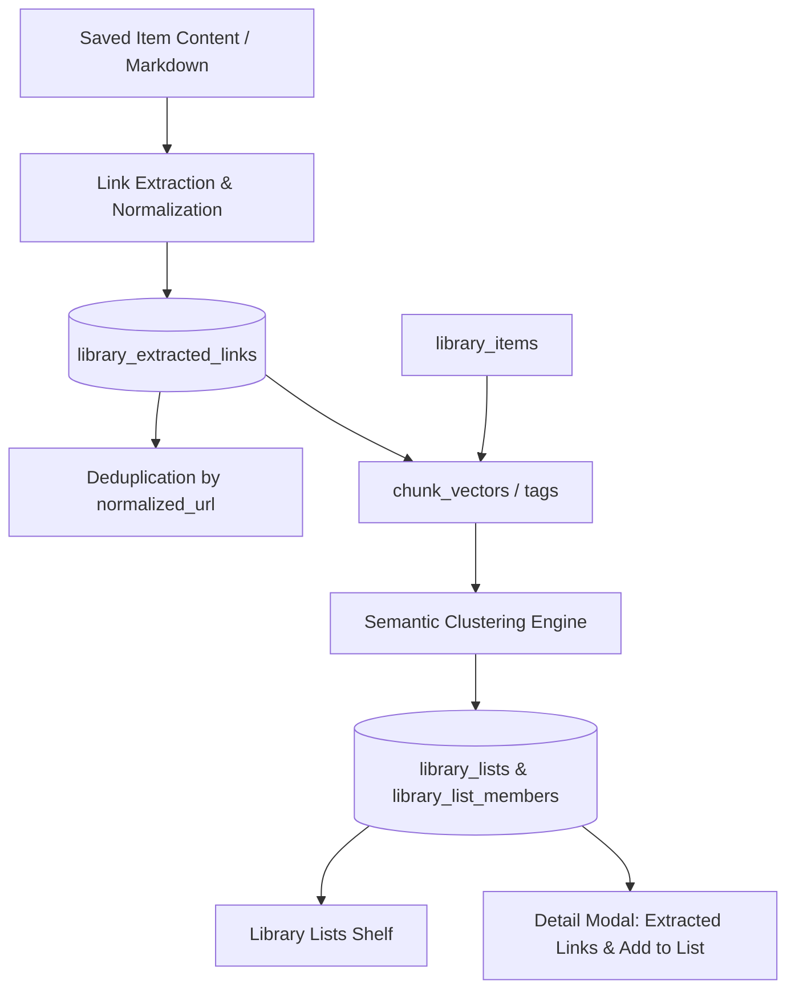

# Design Specification: Library Smart Lists & Link Extraction

**Date**: 2026-11-04  
**Status**: Pending Review  
**Subsystem**: Library (`backend/library/`, `frontend/src/views/library/`)  

---

## 1. Goal & Context

Users save diverse content (articles, documentation, videos, notes) into the Amethyst Library. Currently, outgoing links embedded in content are not harvested into a queryable index, and there is no first-class "Lists" subsystem to group closely related content and links together without duplicates.

This design introduces:
1. **Automated Link Harvesting**: Extracts, normalizes (removes tracking params), and stores all outbound URLs referenced in saved items.
2. **First-Class Lists & Collections**: Database tables (`library_lists` and `library_list_members`) supporting both saved items and extracted links with strict database-level unique constraints preventing duplicates.
3. **Semantic Auto-Clustering Engine**: Groups closely related saved content and links using vector embeddings and tag similarity into coherent themed lists (e.g. "AI Coding Tools", "System Architecture", "Design Systems").
4. **Library Lists UI**: Visual lists shelf in `/library` with cluster chips, member management, and an outbound links browser in the detail modal.

---

## 2. Architecture & Components



### 2.1 Database Schema (`backend/db/schema.sql`)

```sql
-- Extracted outbound links from saved library items
CREATE TABLE IF NOT EXISTS library_extracted_links (
    id INTEGER PRIMARY KEY AUTOINCREMENT,
    source_item_id INTEGER NOT NULL REFERENCES library_items(id) ON DELETE CASCADE,
    url TEXT NOT NULL,
    normalized_url TEXT NOT NULL,
    domain TEXT NOT NULL,
    title TEXT,
    created_at TEXT DEFAULT (datetime('now')),
    UNIQUE(source_item_id, normalized_url)
);
CREATE INDEX IF NOT EXISTS idx_extracted_links_norm ON library_extracted_links(normalized_url);
CREATE INDEX IF NOT EXISTS idx_extracted_links_source ON library_extracted_links(source_item_id);
CREATE INDEX IF NOT EXISTS idx_extracted_links_domain ON library_extracted_links(domain);

-- Curated and smart clustered lists
CREATE TABLE IF NOT EXISTS library_lists (
    id INTEGER PRIMARY KEY AUTOINCREMENT,
    title TEXT NOT NULL,
    description TEXT DEFAULT '',
    icon TEXT DEFAULT 'bookmark',
    is_smart BOOLEAN DEFAULT 0,
    created_at TEXT DEFAULT (datetime('now')),
    updated_at TEXT DEFAULT (datetime('now'))
);
CREATE INDEX IF NOT EXISTS idx_library_lists_title ON library_lists(title);

-- Members of lists: can be library items or extracted links (strictly deduplicated)
CREATE TABLE IF NOT EXISTS library_list_members (
    id INTEGER PRIMARY KEY AUTOINCREMENT,
    list_id INTEGER NOT NULL REFERENCES library_lists(id) ON DELETE CASCADE,
    item_id INTEGER REFERENCES library_items(id) ON DELETE CASCADE,
    link_id INTEGER REFERENCES library_extracted_links(id) ON DELETE CASCADE,
    position INTEGER DEFAULT 0,
    added_at TEXT DEFAULT (datetime('now')),
    CHECK ((item_id IS NOT NULL AND link_id IS NULL) OR (item_id IS NULL AND link_id IS NOT NULL)),
    UNIQUE(list_id, item_id),
    UNIQUE(list_id, link_id)
);
CREATE INDEX IF NOT EXISTS idx_list_members_list ON library_list_members(list_id);
CREATE INDEX IF NOT EXISTS idx_list_members_item ON library_list_members(item_id);
CREATE INDEX IF NOT EXISTS idx_list_members_link ON library_list_members(link_id);
```

---

### 2.2 Backend Link Harvester (`backend/library/links.py`)

- **Normalization**:
  - Leverages existing `normalize_url(url)` to strip tracking parameters (`utm_*`, `fbclid`, `igsh`, `si`), lowercase hostname, canonicalize paths, and drop trailing slashes.
- **Harvesting**:
  - Scans markdown text, post captions, and resources using regex and markdown link parsers `[title](url)`.
  - Extracts domain name using `urllib.parse.urlparse`.
  - Inserts records into `library_extracted_links` using `INSERT OR IGNORE`.
- **Hooks**:
  - Runs automatically inside `LibraryService.capture_media`, `replace_text`, and `enrich`.
  - Provides `LibraryService.backfill_extracted_links()` to process pre-existing library items.

---

### 2.3 Semantic Clustering Engine (`backend/library/clustering.py`)

- **Similarity Clustering**:
  - Gathers candidate items with their vector embeddings from `backend/retrieval/store.py` (and falls back to tag/category similarity if vectors are unavailable).
  - Uses cosine distance clustering (agglomerative / threshold `>= 0.70`) to group items that are closely related in topic and substance.
- **Cluster Synthesis & Deduplication**:
  - Synthesizes list title from shared high-frequency tags, domains, or common entities.
  - Creates or updates `library_lists` where `is_smart = 1`.
  - Inserts items and their associated extracted links into `library_list_members`.
  - The schema's `UNIQUE(list_id, item_id)` and `UNIQUE(list_id, link_id)` ensures zero duplicates within each list.

---

### 2.4 REST API Surface (`backend/api/main.py`)

| Endpoint | Method | Description |
|---|---|---|
| `/api/library/lists` | GET | List all custom and smart lists with item/link counts |
| `/api/library/lists` | POST | Create a new custom list |
| `/api/library/lists/{id}` | GET | Fetch list details, included library items, and extracted links |
| `/api/library/lists/{id}` | DELETE | Delete list (cascades to members, items unaffected) |
| `/api/library/lists/{id}/members` | POST | Add item (`item_id`) or link (`link_id`) to list (deduplicated) |
| `/api/library/lists/{id}/members/{member_id}` | DELETE | Remove a member from the list |
| `/api/library/lists/auto-cluster` | POST | Trigger semantic clustering to generate/update smart lists |
| `/api/library/links` | GET | Query extracted outbound links across the library |

---

### 2.5 Frontend UI Components

1. **`LibraryListsShelf.jsx`** (`frontend/src/views/library/LibraryListsShelf.jsx`):
   - Horizontal pill shelf rendered below the search bar in `Library.jsx`.
   - "All Items" default tab, followed by Smart Lists (`✦ AI Tools`, `✦ Web Architecture`) and Custom Lists.
   - "+ New List" button and "⚡ Auto-Group" action button.
   - Selecting a list filters the canvas to items in that list and reveals an Outbound Links drawer.
2. **Detail Modal Links Section** (`frontend/src/views/library/LibraryDetailModal.jsx`):
   - Outbound Links tab/list showing all harvested URLs from the current document.
   - Quick action to open external link or add it directly to a list.

---

## 3. Error Handling & Edge Cases

| Scenario | Behavior |
|---|---|
| Markdown has duplicate links to same URL | Normalization deduplicates prior to database insert. |
| User attempts to add duplicate item/link to list | Database `UNIQUE` constraint triggers `INSERT OR IGNORE`; returns success. |
| Deleting a library item | Foreign key `ON DELETE CASCADE` automatically removes all extracted links and list memberships for that item. |
| Item has no outbound links | Item can still be clustered into lists based on text embedding vectors. |

---

## 4. Verification Plan

1. **Schema & Migration Tests**:
   - Verify table creation, indexes, and unique constraints.
2. **Link Extraction Tests**:
   - Parse markdown text with varying URL formats, query strings, and tracking params; verify normalized persistence.
3. **Clustering & Deduplication Tests**:
   - Insert dummy items with shared semantic vectors; trigger `auto_cluster_lists()`.
   - Assert smart lists are created with no duplicate items or links.
4. **API & Frontend Verification**:
   - Test `/api/library/lists*` endpoints via FastAPI `TestClient`.
   - Verify frontend compiles cleanly (`npm run build`).
