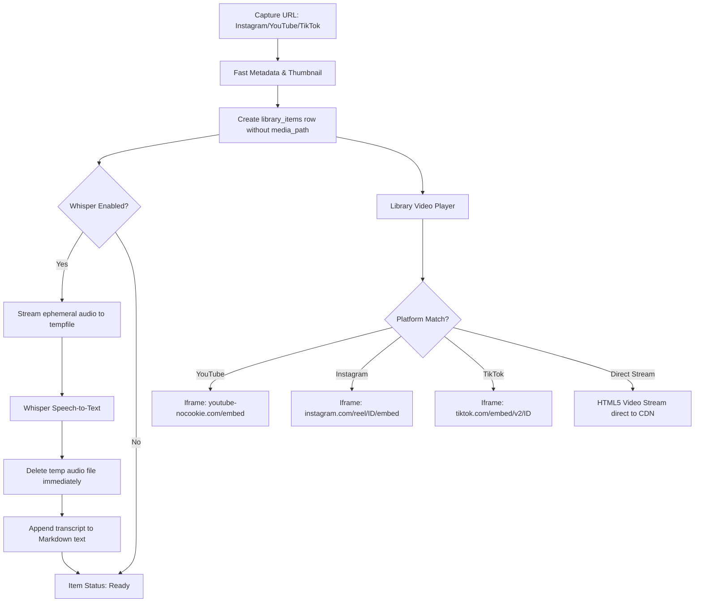

# Design Specification: Library Zero Video Download & Ephemeral Streaming Pipeline

**Date**: 2026-11-04  
**Status**: Pending Review  
**Subsystem**: Library (`backend/library/`, `frontend/src/views/library/`)  

---

## 1. Goal & Context

Amethyst captures URLs from multiple platforms (YouTube, Instagram Reels, TikTok, X, web). Currently, `backend/library/reels.py` downloads full `.mp4` video files to local disk (`~/.amethyst/library/media/{id}.mp4`) and triggers auto-syncing of these large binaries to Google Drive. This causes excessive disk and network usage, slow background processing, and storage bloat.

This design transitions Amethyst to a **zero-download video architecture**:
1. No video `.mp4` binaries are ever permanently stored on disk or synced to Google Drive.
2. Ingestion fetches only metadata and cover thumbnails.
3. If Whisper audio transcription is enabled, the pipeline downloads an ephemeral, audio-only stream into scratch space, transcribes it, and immediately unlinks the audio file.
4. Playback in the UI uses native iframe embeds (YouTube, Instagram, TikTok) or direct remote streaming URLs with automatic fallback to platform source links.
5. Legacy `.mp4` files currently on disk in `~/.amethyst/library/media/` are safely purged and their database pointers set to `NULL`.

---

## 2. Architecture & Components

### 2.1 Backend Changes

#### `backend/library/reels.py`
- **Remove video file persistence**:
  - Remove `await self._fetch(reel.url, scratch_video)` full video download.
  - Remove all calls moving videos into `media_path(item_id, ".mp4")`.
  - Ensure `media_path` is never set on `library_items`.
- **Ephemeral Audio Extraction**:
  - Introduce `_extract_ephemeral_audio(url, scratch_dir)`:
    - Uses `yt-dlp` extracting audio stream only (`--extract-audio --audio-format wav --audio-quality 0`) or targeted audio stream into a scratch path.
    - Probes duration via `probe_duration`.
    - If duration exceeds limit, aborts and cleans up temp audio.
    - Runs `transcribe(audio_path)`.
    - Guarantees `audio_path.unlink(missing_ok=True)` in a `finally` block.
- **Resources definition**:
  - Resources list stores `{"type": "embed", "platform": "instagram", "url": reel.url, "embed_url": embed_url}` instead of local `/api/library/{id}/media`.

#### `backend/library/service.py`
- Update `capture_media` and `enrich`:
  - Do not check `media_path` or attempt video frame extraction from non-existent `.mp4` files.
  - Rely on thumbnail URLs obtained during oEmbed/metadata extraction.
- **Legacy Video Purge Routine**:
  - Add `purge_legacy_video_files()`:
    - Finds all files under `~/.amethyst/library/media/` matching `*.mp4`, `*.webm`, `*.mov`, `*.mkv`.
    - Unlinks these files safely.
    - Executes `UPDATE library_items SET media_path = NULL WHERE media_path IS NOT NULL`.
  - Wire purge into startup migration and an administrative endpoint: `POST /api/library/purge-media`.

#### `backend/library/storage/sync.py`
- Ensure file collector ignores `.mp4` files.
- Google Drive auto-sync will only mirror Markdown text, thumbnails, and slide images.

---

### 2.2 Frontend Changes

#### `frontend/src/views/library/LibraryDetailModal.jsx`
- Compute `videoItem` based on URL patterns rather than local `media_path`:
  - **YouTube**:
    - Detect `youtube.com/watch?v=ID`, `youtube.com/shorts/ID`, or `youtu.be/ID`.
    - `embedUrl = "https://www.youtube-nocookie.com/embed/" + id + "?autoplay=1&rel=0"`
    - `platform = "youtube"`
  - **Instagram**:
    - Detect `instagram.com/reel/SHORTCODE` or `instagram.com/p/SHORTCODE`.
    - `embedUrl = "https://www.instagram.com/reel/" + shortcode + "/embed/"`
    - `platform = "instagram"`
  - **TikTok**:
    - Detect `tiktok.com/@user/video/ID` or shortlinks.
    - `embedUrl = "https://www.tiktok.com/embed/v2/" + id`
    - `platform = "tiktok"`
  - **Direct Stream**:
    - Direct remote MP4 link (if available from resources `remote_url`).
- Pass normalized `videoItem` with `embedUrl`, `isVertical`, `platform`, `fallbackUrl` into `LibraryVideoPlayer`.

#### `frontend/src/views/library/LibraryVideoPlayer.jsx`
- Prioritize embedded playback:
  - If `embedUrl` is present:
    - Render responsive `<iframe>` styled cleanly within `.lib-player-media-wrap`.
    - Aspect ratio: `9:16` for vertical content (reels, shorts, TikTok) and `16:9` for standard video.
  - If direct remote stream URL exists:
    - Attempt `<video src={currentSrc}>`.
    - On error (`onError`), automatically swap to `embedUrl` or show "Watch on [Source]" button.
  - Ensure subtitle/closed caption track overlays still function if transcript text is available.

---

## 3. Data Flow

1. **User enters video/reel URL**:
   - `LibraryService.capture_url` routes to `ReelCapture` or YouTube metadata fetcher.
   - Fast metadata returns title, author, thumbnail, duration.
   - Item row created in `library_items` with `status: "enriching"`, `media_path: null`.
2. **Background Enrichment**:
   - If speech transcription is enabled, worker fetches audio stream only into temporary scratch directory.
   - Whisper runs transcription.
   - Audio scratch file deleted in `finally`.
   - Markdown body updated with `## Transcript`.
   - Item status set to `ready`.
3. **Frontend Display**:
   - Card displays cover thumbnail and duration badge.
   - Detail modal opens: user plays video directly via iframe embed or direct remote stream.

---

## 4. Error Handling & Edge Cases

| Scenario | Behavior |
|---|---|
| Instagram embed blocked by user browser settings | Display fallback button: "Watch on Instagram" with original URL |
| Audio download fails or times out | Log debug notice, skip transcript, set item status to `ready` |
| Video exceeds max duration setting | Skip audio fetch, log note, mark ready |
| Legacy items with `media_path` pointing to deleted files | Purge script clears `media_path`; UI falls back to original item URL embed |

---

## 5. Verification & Testing

1. **Unit & Integration Tests (`tests/test_library_zero_download.py`)**:
   - Test `ReelCapture.capture`: verify `media_path` is `None` and no `.mp4` file is saved in media directory.
   - Test ephemeral audio workflow: mock yt-dlp/whisper, verify audio file exists during transcription and does not exist after.
   - Test `purge_legacy_video_files`: create dummy `.mp4` files, invoke purge, assert files removed and DB rows updated.
2. **Frontend Verification**:
   - Test YouTube video modal: verify iframe embed loads and plays.
   - Test Instagram reel modal: verify embed renders with 9:16 aspect ratio.
   - Test responsive layout and theater mode.
