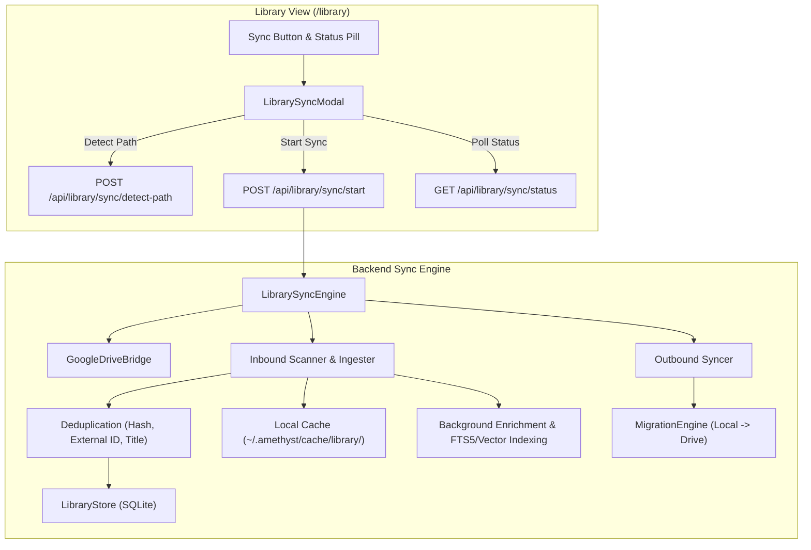

# Amethyst Library — Google Drive Sync and Integration Design

**Date:** 2026-11-06  
**Status:** Approved Architectural Design  
**Author:** Amethyst Agent Pair  

---

## 1. Overview & Goals

Transform the Amethyst Library into a full two-way cloud-synchronized knowledge repository with Google Drive via Composio. When a user connects Google Drive:
1. The system detects or lets the user specify the Google Drive folder containing library items.
2. The system imports existing items from Google Drive into Amethyst's local Library (creating metadata rows, storing local cache, generating enrichments, and indexing into SQLite FTS5 and vector chunks).
3. The system synchronizes unmigrated local items to Google Drive with SHA-256 and title deduplication.
4. The system provides an integrated sync management interface directly inside the Library view (`/library`) while adhering to high-craft design standards (WCAG AA accessibility, tokenized spacing, clear visual hierarchy).
5. **Strict Safety Constraint**: Existing personal folders in Google Drive named `amethyst` or `Amethyst` are never hijacked or treated as library storage without explicit structure verification and user confirmation.

---

## 2. Personal Folder Collision Prevention & Path Detection

### 2.1 The Personal Folder Hijacking Problem
Users often have pre-existing personal folders in their Google Drive named `amethyst` or `Amethyst` containing unrelated files (documents, photos, projects). Previous logic naively matched `name_exact == "Amethyst"` and used it as the storage root, causing accidental file placement and clutter.

### 2.2 Root Verification Marker (`.amethyst-library.json`)
To guarantee that a Google Drive folder is an intentional Amethyst Library root, Amethyst establishes a lightweight verification marker:
- File name: `.amethyst-library.json`
- Content schema:
  ```json
  {
    "app": "amethyst",
    "type": "library_root",
    "version": 1,
    "created_at": "2026-11-06T12:00:00Z"
  }
  ```

### 2.3 Path Detection Modes
1. **Auto-Detection (`mode: "auto"`)**:
   - Step 1: Search Google Drive for `.amethyst-library.json`.
     - If found: Retrieve its parent folder ID and verify parent path. Mark as `[✓ Verified Library Root]`.
   - Step 2: If no marker is found, search for folder path `Amethyst/Library/` (specifically with `Library` as child of `Amethyst`).
     - If found: Check if it contains library subfolders (`articles/`, `books/`, `notes/`, `media/`). If verified, write `.amethyst-library.json` and use this folder.
   - Step 3: If a root folder named `amethyst` or `Amethyst` exists but has NO `Library/` subfolder and NO marker file:
     - Mark as `unverified_personal_folder`.
     - **Do NOT use this folder.**
     - Instead, recommend creating `Amethyst/Library/` or selecting a custom path.
   - Step 4: If no folder exists, suggest creating `Amethyst/Library/`.

2. **Manual Path Selection (`mode: "custom"`)**:
   - User inputs an arbitrary Drive folder path (e.g. `ReadingList`, `KnowledgeBase/Articles`, or a specific folder ID).
   - The backend validates the path:
     - Traverses or searches for the folder in Google Drive.
     - Inspects contents for supported documents and media.
     - Writes `.amethyst-library.json` upon user confirmation.
     - Saves `gdrive_root_id` and `gdrive_root_name` in `storage_configurations`.

---

## 3. Two-Way Sync Engine & Ingestion Pipeline

### 3.1 Architecture Overview
A dedicated sync engine (`backend/library/storage/sync_engine.py`) orchestrates two-way synchronization:



### 3.2 Inbound Discovery & Ingestion
1. **File Scanning**:
   - Discovers all files inside the verified root and recognized subfolders (`articles/`, `books/`, `notes/`, `media/`, or flat folder).
   - Supported extensions:
     - Text/Markdown: `.md`, `.txt`, `.html`
     - Books/Docs: `.pdf`, `.epub`
     - Media: `.mp3`, `.m4a`, `.mp4`, `.webm`, `.wav`
2. **Deduplication Matrix**:
   - **Rule 1 (External ID)**: If `library_items.external_id == drive_file.id`, check SHA-256 or MD5 checksum. If unchanged, skip. If updated, refresh cache.
   - **Rule 2 (Checksum)**: If `library_items.checksum == drive_file.checksum`, update existing item's `external_id = drive_file.id` and `storage_provider = 'google_drive'` without creating a new card.
   - **Rule 3 (Title & Kind)**: If normalized title and kind match an existing item, associate the Drive external ID and skip duplicate insertion.
3. **Ingestion Execution**:
   - For text files: Download content, write to cache, create `library_items` row with:
     - `title`: Extracted from markdown `# Header` or file name.
     - `kind`: Inferred from folder or extension.
     - `storage_provider`: `'google_drive'`.
     - `external_id`: Google Drive file ID.
     - `cached_locally`: `1`.
     - `sync_state`: `'synced'`.
   - Dispatch background enrichment (`enrich_library_item`) and search indexing (`indexer.index_item`).

### 3.3 Outbound Upload
- Identifies local items in `library_items` where `storage_provider = 'local'` or `external_id IS NULL`.
- Uploads markdown text and media files into target subfolders on Google Drive.
- Updates database record with `external_id`, `checksum`, `storage_provider = 'google_drive'`, `sync_state = 'synced'`.

### 3.4 REST API Surface
- `POST /api/library/sync/detect-path`:
  - Body: `{ "mode": "auto" | "custom", "custom_path": "..." }`
  - Response: `{ "verified": bool, "folder_id": str, "folder_path": str, "marker_present": bool, "file_count": int, "warning": str | null }`
- `POST /api/library/sync/start`:
  - Body: `{ "folder_id": str, "folder_path": str, "two_way": bool }`
  - Response: `{ "status": "started", "sync_id": str }`
- `GET /api/library/sync/status`:
  - Response: `{ "is_running": bool, "stage": "idle" | "scanning" | "importing" | "uploading" | "indexing" | "complete" | "failed", "found_drive_items": int, "imported_inbound": int, "uploaded_outbound": int, "skipped_duplicates": int, "errors": list[str], "last_error": str | null }`
- `POST /api/library/sync/cancel`:
  - Stops running sync gracefully.

---

## 4. Library UI Integration & Superfuture Design Review

### 4.1 Entry Point in `LibraryToolbar.jsx`
- Location: Adjacent to list view and layout switcher controls.
- Trigger button:
  - Icon: Google Drive / Cloud Sync icon with status indicator dot:
    - Green dot: Connected and in sync.
    - Amber dot: Sync recommended or active.
    - Gray dot: Disconnected.
  - Label / Tooltip: `"Google Drive Sync"` with keyboard shortcut (`Cmd/Ctrl + Shift + S`).

### 4.2 `LibrarySyncModal.jsx` Specifications
Built strictly using Amethyst's existing Bento / BoardUI design tokens (`var(--surface-*)`, `var(--accent)`, `var(--text)`):
1. **Modal Header**:
   - Title: `"Google Drive Sync & Integration"` (16px, weight 600, `var(--text)`).
   - Close button with hover and active states.
2. **Account Connection Banner**:
   - Connection status indicator, Google account email, and "Reconnect" button.
3. **Folder Path Configuration**:
   - Segmented tab toggle: `[ Auto-Detect ]` | `[ Custom Path ]`.
   - Auto-Detect tab:
     - Shows resolved path (`Amethyst/Library/`), verification status badge (`[✓ Verified Library Root]`).
     - Explicit callout if personal unverified folder was excluded.
     - "Rescan" button.
   - Custom Path tab:
     - Text input with monospace styling for path entry.
     - "Inspect Folder" button showing discovered files count before syncing.
4. **Pre-Sync Inspection Card**:
   - Summary pills: `"X items in Drive"` · `"Y local items to upload"`.
5. **Sync Action & Live Status**:
   - Primary action: `"Sync Now"` (transforms to spinning state during sync).
   - Progress bar: Smooth CSS transition, 6px height, high-contrast bar.
   - 4-metric counter grid:
     - Found in Drive: `0`
     - Inbound Imported: `0`
     - Outbound Uploaded: `0`
     - Skipped (Identical): `0`
   - Real-time stage text: *"Scanning Google Drive…"*, *"Importing articles…"*, *"Indexing search vectors…"*, *"Sync complete"*.

### 4.3 Design Review Checklist (Superfuture Rubric)
- **Visual Hierarchy**: Immediate focal point on connection and path status, secondary on sync counters, tertiary on error details.
- **Typography**: Strictly uses type scale (16px title, 13px body, 11px badges, tabular numbers on counters).
- **Spacing**: 8px baseline rhythm, 16px card padding, 12px gaps.
- **Color & Contrast**: WCAG AA compliant (all text ≥ 4.5:1, UI icons/borders ≥ 3:1). No state conveyed by color alone.
- **Accessibility**: Full keyboard navigation, `role="dialog"`, `aria-modal="true"`, focus ring visible, `Escape` key close.

---

## 5. Verification Plan

### 5.1 Automated Tests
- `tests/test_library_gdrive_sync_engine.py`:
  - Test `.amethyst-library.json` marker detection and verification.
  - Test personal `amethyst` folder collision avoidance.
  - Test inbound ingestion with deduplication (by external_id, checksum, title).
  - Test two-way sync loop (inbound + outbound).
- `tests/test_library_sync_endpoints.py`:
  - Test `detect-path`, `start`, `status`, and `cancel` endpoints.

### 5.2 Manual Verification
- Open Library (`/library`), click Cloud Sync button in toolbar.
- Test Auto-detect with existing Drive connection.
- Test Custom Path input and inspection.
- Execute sync and verify newly ingested items appear in Library grid with search indexing functioning.
