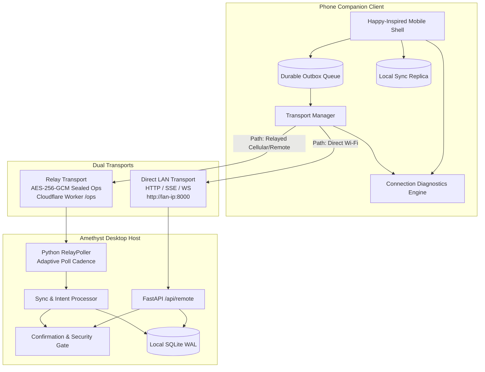

# Phone Connectivity & Long-Lasting Sync Design

**Author**: Amethyst Engineering  
**Date**: 2026-11-06  
**Status**: Validated Design Spec  
**Inspiration**: Happy (`slopus/happy`) dual-transport connection architecture and mobile companion interface

---

## 1. Problem Statement & Background

Amethyst allows pairing mobile phones with a desktop host via QR code. However, phone connectivity and real-time synchronization suffer from critical reliability and resource issues:

1. **Fragile Connection Pipeline**: `Companion.jsx` halts all sync if direct LAN calls (`/remote/capabilities`) fail or time out (12 seconds), completely preventing fallback to the Cloudflare Worker relay when off the home Wi-Fi network.
2. **Cloudflare Storage & Quota Vulnerability**: Unrestricted polling intervals and background sweeps in previous revisions consumed excessive Cloudflare D1 reads (up to 10.5 million rows/day against a 5-million free-tier limit), causing temporary lockouts.
3. **Lack of Lifecycle Awareness**: The phone companion does not properly sleep during device lock or backgrounding, leading to battery drain and pointless relay query volume.
4. **Outdated Companion UX**: The mobile phone interface lacks real-time tool approval workflows, connection transparency, and streaming visualization.

---

## 2. Core Architectural Principles

- **Zero-Waste Free Tier Preservation**: Direct LAN transport is prioritized whenever reachable (consuming 0 Cloudflare D1 requests and 0 Worker compute). Relayed transport enforces visibility-based sleep and adaptive backoff, keeping daily D1 reads below 3,000 queries.
- **Dual-Path Seamless Failover**: The client dynamically probes LAN reachability. If LAN is lost, traffic routes through the encrypted relay without UI interruption or thrown exceptions. When LAN is restored, traffic seamlessly upgrades back to direct local streaming.
- **Durable Offline Outbox**: Every user intent, prompt, and tool approval is committed to local storage with monotonic sequence IDs and HLC clocks before transmission, guaranteeing zero message loss across disconnections.
- **Happy-Inspired UI Polish**: High-density mobile UI matching Happy's ergonomics: real-time status pills, one-tap tool approval cards, collapsible thinking drawers, and comprehensive connection diagnostics.

---

## 3. System Architecture & Components

### 3.1 Transport Manager (`frontend/src/lib/sync/transportManager.js`)
The `TransportManager` coordinates connectivity state, active transports, and network lifecycle.

- **Direct Transport**: Talks directly to `hostUrl` (`http://<ip>:8000/api`).
  - Health probe: `GET /api/remote/status` with 1,500ms timeout.
  - Used for rich interactions: terminal streams, low-latency live turn execution, large attachments.
- **Relay Transport**: Talks to `relayUrl` (`https://amethyst-relay.<user>.workers.dev/ops`).
  - Used when direct probe fails or when device is on mobile data.
  - Payloads sealed with AES-256-GCM using device group key.
- **State Machine**:
  - `direct` (🟢 Green): Connected directly over LAN. Zero relay usage.
  - `relayed` (🟡 Amber): Connected via Cloudflare encrypted relay.
  - `reconnecting` (🔵 Blue Pulse): Reconnecting with exponential backoff.
  - `offline` (⚪ Gray): No network interface detected.
  - `revoked` (🔴 Red): Device token revoked on host (401 response).

### 3.2 Cloudflare Quota Protection & Polling Lifecycle
To strictly prevent Cloudflare D1 read exhaustion:

1. **Visibility Sleep (`document.visibilityState`)**:
   - When phone is locked or tab hidden: Poller is paused completely. Zero HTTP requests to Cloudflare.
   - When phone unlocks: Triggers an immediate single catch-up sync.
2. **Adaptive Polling Cadence (Relayed Mode)**:
   - **Active Burst** (3s): Triggered when a turn is in flight or pending outbox items exist. Automatically throttled back to idle after 30 seconds of inactivity.
   - **Idle Watch** (30s): Standard cadence while viewing screen without active work.
   - **Backoff on Failure**: 2s -> 4s -> 8s -> 16s -> 32s -> max 60s with 20% random jitter.
3. **Cursor-Based Delta Publication**:
   - Retains `(updated_at, id)` sweep cursor in `backend/sync/project.py`.
   - Never republishes unchanged rows.
   - Deletion of collected ops using D1 batch statements.

### 3.3 Durable Outbox & Intent Engine
1. User actions (`ask`, `stop`, `approve`, `deny`) write to `amethyst.sync.outbox.v1`.
2. Each action assigned a unique `op_id` (UUIDv4) and HLC clock.
3. If Direct path is active: Dispatched immediately to `/api/remote/actions` or `/api/remote/command`.
4. If Relayed path is active: Sealed and uploaded to `/ops`.
5. Upon 200 OK receipt from transport: Items cleared from outbox.

---

## 4. Mobile Interface Design (Happy-Inspired)

### 4.1 Frame & Header
- **Top Bar**:
  - Computer Host Name (e.g. `MacBook Pro`) & Active Agent indicator.
  - **Dynamic Transport Pill**:
    - Clicking pill opens **Connection Diagnostics Sheet**.
    - Displays current path: `Direct LAN (8ms)` or `Cloud Relay`.
  - Context menu for unpairing, resetting keys, and restarting session.

### 4.2 Agent & Session View
- **Transcript Stream**:
  - Conversational bubbles with auto-scroll and keyboard avoidance.
  - Markdown, code highlighting, and image previews.
- **Reasoning / Thinking Collapsible**:
  - Discreet disclosure panel for agent internal monologues.
- **Interactive Tool Confirmation Card**:
  - Clear card boundary with yellow/amber caution accents.
  - Tool name (`run_command`, `write_to_file`, etc.) and highlighted parameters.
  - Large touch targets ($\ge 44\times 44$ px) for **Approve** (green) and **Deny** (red).
- **Composer Dock**:
  - Auto-expanding input field, attachment icon, Stop Turn button when agent is busy, and Send action.

### 4.3 Connection Diagnostics Sheet
Inspired directly by Happy's `ConnectionDiagnosticsScreen.kt`:
- **Status**: Live state (`Connected`, `Relaying`, `Reconnecting`, `Offline`).
- **Path**: `Direct (LAN)` vs `Relayed (Cloudflare)`.
- **Latency**: Measured roundtrip in milliseconds.
- **Unsent Outbox**: Number of pending queued items.
- **Host Endpoint**: LAN IP address and port.
- **Relay Endpoint**: Worker hostname.
- **Last Synced**: Relative timestamp (`Just now`, `12s ago`).
- **Copy Diagnostics Action**: Formats state into clean debug text for clipboard.

---

## 5. Security & Invariants

1. **Zero Plaintext on Relay**: Cloudflare D1 never stores unencrypted messages or credentials.
2. **AEAD Integrity**: Authentication tag binds `op_id` and `from_device`.
3. **Hard Permission Boundaries**: Control devices cannot execute arbitrary terminal commands without explicit permission grants (`backend/security/remote_access.py`).
4. **Revocation Fail-Closed**: When a device is removed from the host, the relay mirrors the revocation within one poll. Control device receives a 401, purges local credentials, and presents the unpair screen.

---

## 6. Implementation Plan & File Touch Map

### 6.1 Frontend Files to Modify / Create
- `[NEW] frontend/src/lib/sync/transportManager.js`: Dual-path coordinator, ping probe, and state machine.
- `[MODIFY] frontend/src/lib/sync/client.js`: Integrate transportManager, update outbox flush to support dual paths.
- `[MODIFY] frontend/src/lib/sync/useSync.js`: Integrate visibility listener and adaptive backoff timer.
- `[NEW] frontend/src/mobile/ConnectionDiagnosticsModal.jsx`: Happy-inspired diagnostics modal.
- `[MODIFY] frontend/src/views/RemoteOnly.jsx`: Wrap with upgraded transport provider and status alerts.
- `[MODIFY] frontend/src/mobile/Companion.jsx`: Revamp mobile shell, remove blocking LAN call, attach transport pill and tool approval feed.
- `[MODIFY] frontend/src/views/remote/RemoteAgent.jsx`: Enhance chat bubble layout, thinking toggle, and tool cards.

### 6.2 Backend & Relay Verification
- Verify `backend/instagram/runner.py` idle backoff and relay sync.
- Verify `backend/sync/project.py` delta cursor sweep.
- Verify `relay/src/ops.ts` D1 write limits and cleanup queries.

---

## 7. Verification & Testing

### 7.1 Automated Tests
- `pytest tests/test_sync_devices.py`
- `pytest tests/test_sync_remote_control.py`
- `pytest tests/test_sync_end_to_end.py`
- `npm test` inside `relay/`
- `npm run build` inside `frontend/`

### 7.2 Manual Scenarios
1. **Direct LAN Path**: Launch host, pair phone on same Wi-Fi. Verify status pill is `Direct LAN` and latency is $< 20$ms.
2. **Failover to Relay**: Disconnect phone from Wi-Fi (switch to cellular or simulate blocked port). Verify status pill seamlessly changes to `Cloud Relay` within 2 seconds without errors.
3. **Screen Sleep Quota Test**: Lock phone screen. Check DevTools network tab / Cloudflare dashboard: verify all polling halts while locked.
4. **Offline Queue Replay**: Turn on airplane mode, type message and tap send. Verify message queues in outbox. Disable airplane mode: verify message delivers automatically.
5. **Tool Approval**: Trigger a tool requiring confirmation. Verify tool card appears on phone with formatted args, approve it, and ensure host proceeds.
