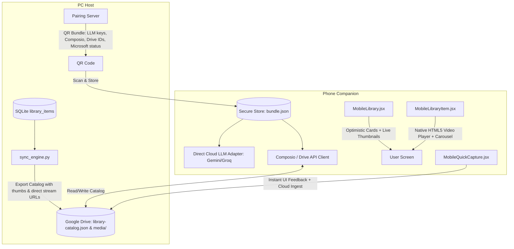

# Mobile Library & Cloud Independence Design

**Date**: 2026-11-08  
**Topic**: Mobile Library Cloud Independence, Google Drive Sync, Thumbnail & Video Playback Fixes, and QR Handoff

## 1. Problem Statement

1. **Broken Thumbnails on Mobile**: SQLite `library_items` only stores a local PC file path (`thumbnail_path`). When `export_catalog_to_drive` runs on PC, `thumbnail_path` is stripped, leaving `library-catalog.json` with zero thumbnail info. Furthermore, `Companion.jsx` stripped `thumbnail_url`, `author`, `kind`, and `resources` from items during sync.
2. **Broken Video Playback on Mobile**: `MobileLibraryItem.jsx` forced Instagram reels into an embed iframe (`https://www.instagram.com/reel/{shortcode}/embed/`) which fails or gets blocked in mobile WebViews. Meanwhile, Amethyst already extracted high-res direct `.mp4` stream URLs in `resources`, but the UI never used them.
3. **Broken / Stuck Capture & Add Button**: In `MobileQuickCapture.jsx`, two separate fields caused URLs pasted in the first box to be saved as plain notes. Off-LAN, captures queued silently in IndexedDB without visual feedback until the PC was reconnected on LAN hours later.
4. **LAN Dependency**: The mobile companion relied on `http://<lan-ip>:8000/api/...` for library reads, media, and captures, failing when outside local Wi-Fi or when PC sleeps.

## 2. Architecture & Solution

### Component Details

### A. Pairing Bundle Handoff (`backend/pairing/service.py`)
- Complete bundle includes:
  - `llm`: list of configured providers and default API key (Gemini, Groq, etc.).
  - `composio`: API key and user ID.
  - `drive`: `root_folder_id` and `inbox_folder_id`.
  - `microsoft`: explicit status object `{"connected": bool, "status": "connected" | "not_connected"}` so mobile accurately displays connection state rather than failing silently.

### B. Catalog Export with Real Media URLs (`backend/library/storage/sync_engine.py`)
- In `export_catalog_to_drive`:
  - Retain `thumbnail_url`: For each item, export a valid thumbnail reference. If an item has an external image URL in `resources` or from YouTube/Instagram, export it as `thumbnail_url`.
  - For local thumbnails, upload thumbnail still to Drive `media/` folder and store the Drive file ID or media URL in `thumbnail_url`.
  - In `resources`: preserve direct video streaming URLs (`type: 'video'`, `url: '<mp4-url>'`) and carousel slide external URLs (`remote_url`).

### C. Mobile Library View & Media Rendering
- In `frontend/src/mobile/Companion.jsx`:
  - Stop stripping properties in `.map()`. Store full item payloads in IndexedDB snapshots.
- In `frontend/src/mobile/views/MobileLibrary.jsx`:
  - Resolve thumbnails with fallbacks:
    1. Direct `thumbnail_url` from catalog.
    2. Slide or image from `resources`.
    3. YouTube thumbnail URL.
    4. Local PC URL if LAN connected.
    5. Platform fallback badge if image cannot be loaded.
- In `frontend/src/mobile/views/MobileLibraryItem.jsx`:
  - Check `resources` for direct video MP4 URL first.
  - Use native `<video controls playsInline ...>` for direct video stream playback.
  - Carousel: Enable multi-image slide navigation using `remote_url`.
  - Overview: Place the media player and full caption/summary clearly on the Overview tab.

### D. Mobile Quick Capture with Instant Feedback
- Single smart input: Auto-detect URL vs text note.
- Immediate optimistic entry in Mobile Library feed with loading spinner.
- If PC LAN connected: dispatch to `/api/mobile/captures`.
- If PC offline: phone saves capture directly to Google Drive `inbox/` folder or updates `library-catalog.json` using paired Composio/Drive tools and cloud LLM.

## 3. Verification Plan
- Unit & integration verification of catalog export with media fields.
- Mobile frontend build verification with `npm run build` in `frontend/`.
- Verify direct MP4 stream playback and carousel rendering.
- Verify status display for Microsoft To-Do when not connected.
