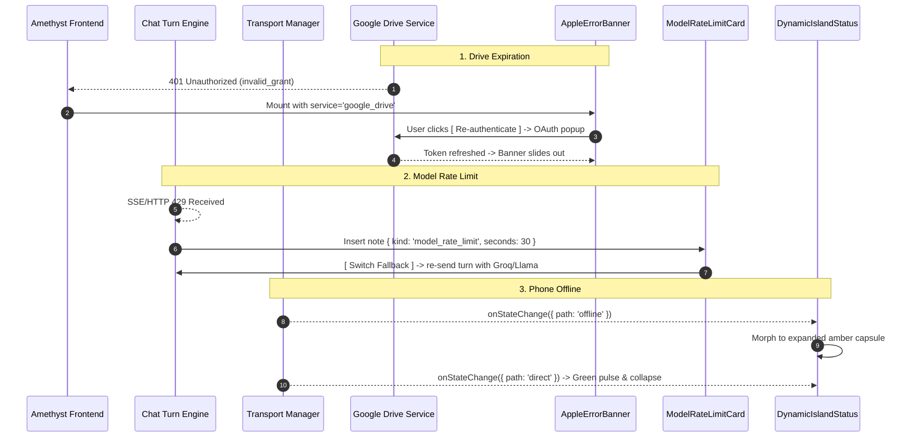

# Architecture & UI Spec: Apple-Style Error States via Stageshow

**Author:** Antigravity  
**Date:** 2026-11-09  
**Status:** Approved  
**Related Systems:** `frontend/src/views/Chat.jsx`, `frontend/src/mobile/`, `backend/connectors/googledrive.py`, `.agents/skills/stageshow/kit`

---

## 1. Problem Statement

Amethyst requires resilient, polished user experiences when critical third-party dependencies degrade or fail:
1. **Google Drive token expiration** (`401 Unauthorized` / `invalid_grant`) leaves file sync, library backups, and catalog pulls silently stalled or failing in background loops.
2. **LLM provider outages & rate limits** (HTTP `429 Too Many Requests` or `503 Service Unavailable`) currently output raw unstructured error notes into chat, forcing users to manually diagnose, re-select a model, or re-type prompts.
3. **Companion phone offline / network drops** leave remote control and real-time syncing disconnected without clear visual feedback on whether direct LAN or Cloudflare relay transport failed.

These three states must follow an Apple design language (frosted acrylic glass, SF-style typography, subtle state badges, micro-interactions) and strictly utilize the `/stageshow` kit architecture.

---

## 2. Component Architecture

The error states are implemented as modular React components in `frontend/src/components/ui/apple/` alongside an interactive Stageshow demo stage in `frontend/src/components/ui/stageshow/`:

```
frontend/src/components/ui/apple/
├── AppleErrorBanner.jsx         # Top frosted acrylic floating banner for OAuth expiration
├── ModelRateLimitCard.jsx       # Chat transcript card with live countdown & fallback switcher
├── DynamicIslandStatus.jsx      # Mobile companion Dynamic Island capsule (LAN/Relay/Offline)
└── error-states.css             # Apple-style tokens, frosted blur, pill geometries, keyframes

frontend/src/components/ui/stageshow/
└── ErrorStatesShowcase.jsx      # Authored Stageshow stage presenting all 3 flows with cursor choreography
```

### 2.1 `AppleErrorBanner.jsx` (Google Drive Token Expired)
- **Role:** Floating system notice positioned at the top of the desktop shell or settings view.
- **Visuals:** Apple frosted glass surface:
  - `background: rgba(28, 28, 30, 0.75)` (dark) / `rgba(255, 255, 255, 0.78)` (light)
  - `backdrop-filter: blur(25px) saturate(180%)`
  - Border: `1px solid rgba(255, 255, 255, 0.12)`
  - Amber SF-style warning glyph (`#FF9F0A`)
  - Typography: 13px system font with 500 weight
- **Props:**
  - `visible`: boolean
  - `service`: string (`'google_drive'`)
  - `email`: string (account identity)
  - `onReauth`: `() => Promise<void>` (triggers OAuth authorization popup)
  - `onDismiss`: `() => void`
- **Behavior:** Smooth spring slide-down entrance (`translateY(-20px) -> 0`). Tapping `Re-authenticate` opens OAuth and automatically dismisses on successful callback.

### 2.2 `ModelRateLimitCard.jsx` (LLM 429 / 503)
- **Role:** Inline transcript element rendered at the point of failure in `Chat.jsx`.
- **Visuals:** Apple Card with soft charcoal fill, circular progress indicator, and monospace countdown timer.
  - Heading: *"Rate Limit Exceeded (429)"* with provider name (e.g. Anthropic / Claude 3.5 Sonnet)
  - Body: *"Provider quota reached. Automatically retrying in {seconds}s..."*
- **State & Actions:**
  - `countdown`: live timer ticking down from `retryAfter` seconds (default 30).
  - `onRetry`: immediately fires prompt with current model.
  - `onSwitchFallback`: instantly selects fallback model (e.g. Groq Llama 3.3 70B or OpenRouter) and dispatches prompt without data loss.

### 2.3 `DynamicIslandStatus.jsx` (Companion Connectivity)
- **Role:** Mobile companion status capsule mounted at the top of `frontend/src/mobile/Companion.jsx`.
- **Visuals:** iOS Dynamic Island geometry:
  - Fill: `#000000` with subtle `rgba(255, 255, 255, 0.12)` outline.
  - Radius: `9999px`.
  - Transitions: CSS spring width/height morphing.
- **Modes:**
  - `direct` (Compact): Green status dot + *"LAN (2ms)"*
  - `standalone` (Compact): Blue cloud dot + *"Cloud Relay"*
  - `offline` (Expanded): Amber radar icon + *"Offline · Retrying in {backoff}s"* + `[ Reconnect ]` button.

### 2.4 `ErrorStatesShowcase.jsx` (Stageshow Demonstration Stage)
- Utilizes `.agents/skills/stageshow/kit` (`Stage`, `Window`, `Phone`, `Card`, `Button`, `Act`).
- Side-by-side presentation:
  - Left pane: Desktop `Window` showing `AppleErrorBanner` and `ModelRateLimitCard`.
  - Right pane: Mobile `Phone` showing `DynamicIslandStatus` morphing from LAN to Offline.
  - Animated cursor clicking `[ Re-authenticate ]` and `[ Switch to Fallback ]` with visual resolution.

---

## 3. Data Flow & Detection Wiring



---

## 4. Verification & Testing Plan

1. **Unit & Component Tests (`frontend/tests/error-states.test.mjs`):**
   - Test `AppleErrorBanner` mounts on `amethyst:auth-expired` and calls `onReauth`.
   - Test `ModelRateLimitCard` counts down accurately and triggers auto-retry or model switch.
   - Test `DynamicIslandStatus` reflects `direct`, `standalone`, and `offline` paths correctly.
2. **Visual Verification:**
   - Verify dark and light themes with backdrop blur support.
   - Verify layout responsiveness across 390px (mobile) and desktop viewports.
   - Verify Stageshow showcase renders clean geometry without layout shifts.
