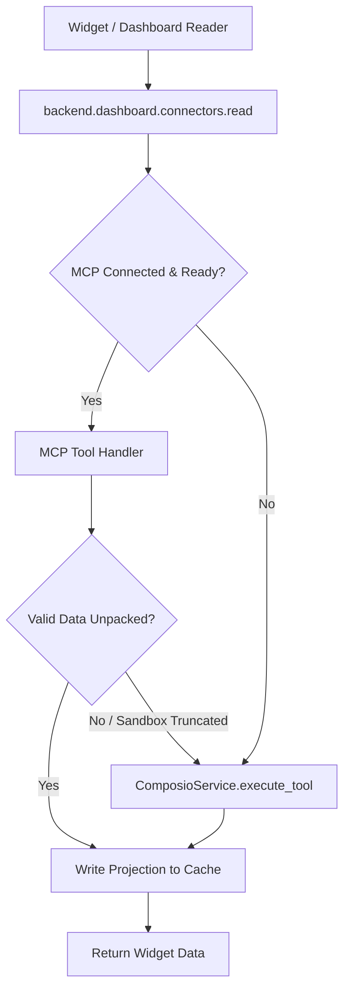

# Specification: End-to-End Composio Connectivity & Real Google Drive Integration

**Date:** 2026-11-09  
**Branch:** `agent-dev`  
**Status:** Validated Design  

---

## 1. Context & Motivation

Composio serves as the central hosted gateway for external productivity apps (Gmail, Google Calendar, Google Drive, GitHub, Slack, Discord, etc.) in Amethyst. Currently, multiple broken integration points prevent Composio and its apps from working across the onboarding flow and the dashboard widgets:
1. **Onboarding API Key Link:** Links to generic `https://composio.dev` rather than the direct key management URL (`https://app.composio.dev/settings/api-keys`).
2. **Onboarding API Key Validation & Persistence:** Every keystroke > 10 characters immediately triggers validation, resulting in 400 errors for partial keys. Furthermore, `save_composio_key` in `backend/api/main.py` invokes `_apply_connector("composio", True)`, which fails because `composio` is not an entry in `mcp.yaml`. `composio_service.set_api_key` also resets `enabled_toolkits` to `[]`, disabling all widgets.
3. **Onboarding Google Drive Mockup:** `StepStorage.jsx` calls nonexistent API methods (`connectComposioApp`) and unconditionally sets `driveConnected: true` as a fake mockup without performing real OAuth or linking storage.
4. **Widget Data Failure:** 
   - `backend/dashboard/connectors.py` aborts immediately with `RuntimeError("Connector transport unavailable")` if the MCP connection has not initialized.
   - Google Calendar responses from modern Composio are structured under `{"event_data": {"event_data": [...]}}`, which `remote.py` and `agenda.py` fail to parse with `ValueError("Invalid calendar response")`.
   - Large Gmail responses from `COMPOSIO_MULTI_EXECUTE_TOOL` return `data_preview` when saved to the remote sandbox, causing `ValueError("Invalid mail response")`.

---

## 2. Architectural Architecture & Design

### 2.1 Native Dual-Path Execution Pattern
To ensure widgets and background processes remain 100% resilient regardless of transport state:
- **Primary Path (Fast-Lane MCP):** If the MCP transport is connected, execute tool calls using `COMPOSIO_MULTI_EXECUTE_TOOL` through `MCPManager`.
- **Direct SDK Fallback:** `ComposioService.execute_tool(slug, arguments)` executes the action directly using the Composio Python SDK (`client.tools.execute`). If MCP is cold, uninitialized, or returns a sandbox truncation (`data_preview`), the direct SDK executor handles the request seamlessly.



### 2.2 Onboarding StepStorage Flow
Eliminate all mock implementations and wire real Composio and Google Drive integration:

1. **Composio Key Navigation:** Provide a direct link to `https://app.composio.dev/settings/api-keys`.
2. **Key Validation & Storage:**
   - Debounce input (or validate on blur / explicit Connect click).
   - Display distinct UI states: idle, validating (spinner), connected (green check badge), error (clear inline error message).
   - Read status from `/api/composio/status` checking `configured` and `active`.
3. **Google Drive Connection:**
   - On clicking "Connect Drive", request authorization via `/api/connectors/googledrive/authorize`.
   - Open returned URL in a new window/tab.
   - Poll `/api/connectors/connected` every 2s until `googledrive` status is `ACTIVE`.
   - Upon connection, retrieve the authenticated account email.
   - Automatically configure storage using `PATCH /api/storage/config` (`active_provider='google_drive'`, `gdrive_root_name='Amethyst/Library'`).
   - Trigger root directory verification using `POST /api/library/sync/detect-path`.

---

## 3. Detailed Component Changes

### 3.1 Backend API & Connector Management (`backend/api/main.py`)
- **`save_composio_key`:**
  - Remove brittle `_apply_connector("composio", True)` lookup in `mcp.yaml`.
  - Handle `composio` connector state directly:
    1. Validate key with `composio_service.validate_api_key(api_key)`.
    2. Store key with `composio_service.set_api_key(api_key)`.
    3. Update `CapabilityService().set_enabled(Kind.CONNECTOR, "composio", True)`.
    4. Auto-warm connectors registry via `asyncio.create_task(_registry_for(None))`.
  - Return updated status object.
- **`_apply_connector`:**
  - Add explicit handling for `name == "composio"`: verify `composio_service.is_configured()`, load config via `load_servers()`, and connect if manager is present.

### 3.2 Composio Service (`backend/mcp/composio_service.py`)
- **`DEFAULT_TOOLKITS`:** Expand default list to include `"googlecalendar"`, `"googledrive"`, `"google_maps"`, `"spotify"`, `"discord"`.
- **`set_api_key`:** Do not overwrite `enabled_toolkits` with `'[]'`. Retain existing toolkits or seed with `DEFAULT_TOOLKITS`.
- **`execute_tool(slug: str, arguments: dict[str, Any])`:**
  - Direct async tool execution via `client.tools.execute(slug=slug, arguments=arguments, user_id=uid, dangerously_skip_version_check=True)`.
  - Handle unwrapping of `data` dicts and surface real error messages.

### 3.3 MCP Manager Fast-Lane Unpacking (`backend/mcp/manager.py`)
- In `_make_composio_fast_lane_handler`:
  - Handle cases where Composio multi-execute returns `data_preview` instead of `data` due to remote sandbox file storage.
  - If `inner_data` is missing, inspect `data_preview`. If still missing or empty, fall back directly to `composio_service.execute_tool(slug, arguments)`.

### 3.4 Dashboard Connectors & Projection (`backend/dashboard/connectors.py`, `remote.py`, `agenda.py`)
- **`connectors.py`:**
  - In `_read`: Do not abort if `connection("composio") is None`. If `composio_service.is_configured()`, trigger `execute_tool` directly or warm registry.
  - In `toolkits()`: Include all required dashboard toolkits (`googlecalendar`, `gmail`, `github`, `slack`, `google_maps`, `spotify`).
  - In Gmail response parsing: Extract `messages` from `value["data"]["messages"]`, `value["messages"]`, or `value.get("data_preview", {}).get("messages")`.
- **`remote.py` & `agenda.py`:**
  - In `GOOGLECALENDAR_FIND_EVENT` parsing: Support `event_data` nested structures:
    ```python
    if isinstance(value, dict) and "event_data" in value:
        ev = value["event_data"]
        rows = ev.get("event_data", ev) if isinstance(ev, dict) else ev
    ```
  - Gracefully handle empty lists without raising `ValueError`.

### 3.5 Frontend Onboarding (`frontend/src/components/onboarding/StepStorage.jsx`)
- Replace `https://composio.dev` link with `https://app.composio.dev/settings/api-keys`.
- Replace key typing auto-save with debounced validation and explicit Connect button.
- Add real Google Drive OAuth launch using `api.connectorsAuthorize('googledrive')`.
- Add real polling of `api.connectorsConnected()` for `googledrive` connection.
- Set storage configuration via `api.updateStorageConfig`.
- Display real account email when connected; never mock connection.

---

## 4. Verification Plan

1. **Unit & Integration Tests:**
   - Test `save_composio_key` endpoint without raising `mcp.yaml` errors.
   - Test `GoogleDriveBridge.is_connected()` and `get_connection_status()`.
   - Test `connectors.read("task.agenda", "googlecalendar", ...)` with live Composio response structures.
   - Test `remote.project("GOOGLECALENDAR_FIND_EVENT", ...)` against both legacy `items` and modern `event_data` payloads.
   - Test `mail.provide("need.inbox")` with mock/live Gmail responses.
2. **End-to-End Onboarding Verification:**
   - Launch application, verify redirect link opens `app.composio.dev/settings/api-keys`.
   - Validate API key input behavior, error display on invalid key, success state on valid key.
   - Connect Google Drive through real Composio OAuth popup, verify polling detects connection and updates UI with real user email.
3. **Dashboard Widget Verification:**
   - Open Today view (`/today`) on cold start.
   - Verify Agenda (`task.agenda`), Priority Inbox (`need.inbox`), and other connected widgets load and render real data.
