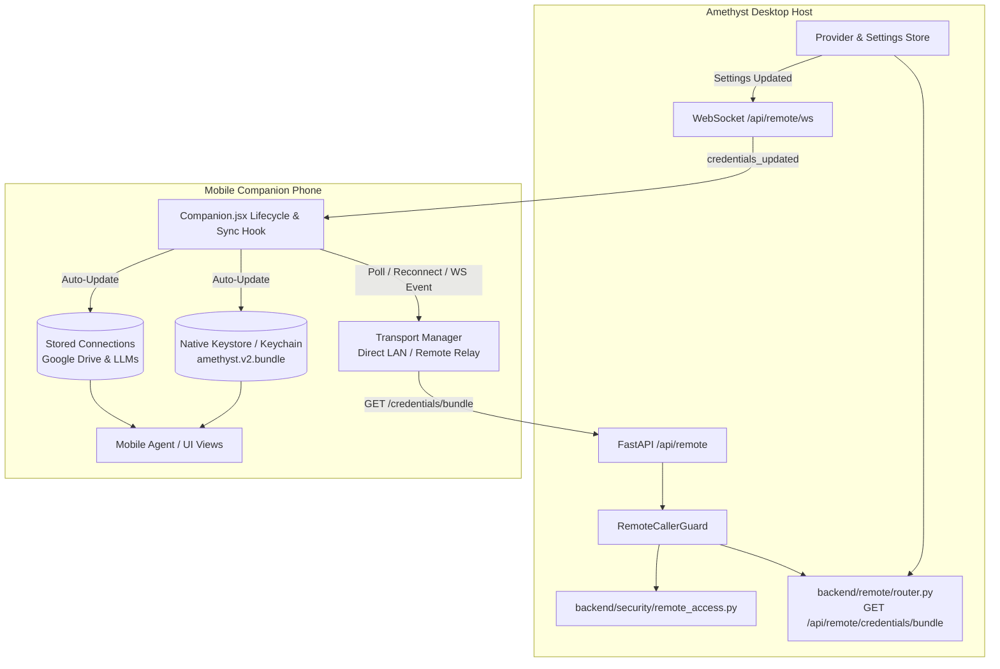

# Mobile Remote Access Permissions & Credential Sync Design

**Author**: Amethyst Engineering  
**Date**: 2026-11-09  
**Status**: Validated Design Spec  
**Sub-Project**: 1 of 4 (Permissions & Credential Sync)

---

## 1. Problem Statement & Context

The Amethyst mobile companion app pairs with a desktop host via CONTRACT v2 QR pairing. Once paired, two primary failure modes degrade the mobile companion experience:

1. **Re-enrich 403 Forbidden ("Device lacks remote access permission")**:
   - In `MobileLibraryItem.jsx`, tapping **Re-enrich** calls `POST /api/library/{id}/enrich`.
   - `backend/security/remote_access.py` maps remote requests to capabilities. For `/api/library`, it only grants `GET /api/library...`.
   - As a result, `capability(path, method)` returns `None` for `POST /api/library/{id}/enrich`, `POST /api/library/{id}/reindex`, `PUT/PATCH/DELETE /api/library/{id}`, `POST /api/library`, and `POST /api/ai/transform`.
   - The remote caller guard in `backend/api/main.py` evaluates `allowed(device, None) -> False` and blocks the request with HTTP 403: `{"detail": "Device lacks remote access permission"}`.

2. **Credential Drift & Independence**:
   - The phone companion stores an initial bundle (`amethyst.v2.bundle`) containing LLM providers and Google Drive/Composio credentials.
   - When the user adds a new LLM provider (e.g. Anthropic, OpenAI, Gemini, Ollama, DeepSeek), changes an API key, or updates Google Drive folder IDs on the desktop app, the paired phone remains unaware and runs with outdated credentials.
   - The phone companion has no automated re-sync mechanism to refresh its bundle from the desktop host when the PC wakes up or reconnects across LAN or remote networks.
   - The phone must be completely independent when the PC is asleep or offline, using its locally stored keys and direct Composio/Drive tool connections, while automatically receiving updated credentials as soon as the PC is reachable.

---

## 2. Core Architectural Principles

- **Explicit Capability Floor**: Companion devices only access routes mapped to an explicit capability in `backend/security/remote_access.py`. Paired companion devices holding the `library` permission must be allowed to trigger library enrichment, reindexing, note updates, and capture additions.
- **Independence First**: The mobile companion operates as a standalone agent. When disconnected from the desktop host, it executes turns using its locally encrypted vault keys (`bundle.llm`), direct Composio integrations (`bundle.composio`), and Google Drive folder references (`bundle.drive`).
- **Zero-Friction Auto-Sync**: When the desktop host is online, any credential updates or newly configured providers automatically propagate to paired mobile devices over direct LAN and remote proxy without requiring the user to re-scan the pairing QR code.
- **Credential Storage Invariants**: API keys and tokens travel only over authenticated, device-token-guarded channels (`GET /api/remote/credentials/bundle`). Credentials are never stored plaintext in public sync tables.

---

## 3. System Architecture & Components

### 3.1 Remote Access Capability Expansion (`backend/security/remote_access.py`)

Expand the capability map to include all mobile library operations and AI transform endpoints under the appropriate capability:

| Method | Path Pattern | Capability | Rationale |
|---|---|---|---|
| `GET\|POST\|PUT\|PATCH\|DELETE` | `r"/api/library(?:/[^/]+(?:/(?:thumbnail\|media\|slides/\d+\|enrich\|reindex))?)?"` | `library` | Permits re-enrich, re-index, note edits, deletes, and thumbnail/media access for paired devices holding `library: true`. |
| `POST` | `r"/api/library/sync/(?:start\|detect)"` | `library` | Permits starting on-demand catalog sync from mobile. |
| `GET` | `r"/api/library/sync/status"` | `library` | Permits polling library sync status from mobile. |
| `POST` | `r"/api/ai/transform"` | `paired` | Permits AI Note Assistant ("Fix Grammar", "Word Better", "Research") on mobile. |
| `GET` | `r"/api/remote/credentials/bundle"` | `paired` | Permits paired companion devices to fetch current LLM providers and Drive configurations. |

### 3.2 Credentials Bundle Endpoint (`backend/remote/router.py`)

Add `GET /api/remote/credentials/bundle` under `/api/remote`:
- **Authentication**: Checks device principal via `RemoteCallerGuard`. Verifies `device.revoked_at is None` and role is `control`.
- **Payload Composition**:
  - `llm`: Full list of configured providers from `configured_providers()`, active default tier from `load_tiers()`, resolved API keys via `resolve_api_key()`.
  - `composio`: Current active `api_key` and `user_id` from `composio_service` or phone configuration.
  - `drive`: `root_folder_id`, `inbox_folder_id`, and `connected: bool(root_folder_id)`.
  - `prompts`: Default summary prompts.
- **WebSocket Broadcast**:
  - In `backend/remote/router.py`, register a notification trigger `broadcast_credentials_updated()`.
  - Whenever settings save on PC (`api.saveProviders`, `api.savePhonePairingSettings`, etc.), trigger the broadcast to all active `/api/remote/ws` connections.

### 3.3 Mobile Companion Auto-Sync Client (`frontend/src/`)

1. **API Client Extension (`frontend/src/api.js`)**:
   - Add `api.getCredentialsBundle() -> GET /api/remote/credentials/bundle`.

2. **Sync Handler in `frontend/src/mobile/Companion.jsx`**:
   - **Trigger Conditions**:
     1. On initial mount / transport connection establishment.
     2. On transport upgrade (e.g. LAN newly detected by `TransportManager`).
     3. On WebSocket push message `{ "type": "credentials_updated" }`.
     4. On app resume (`visibilitychange` when `document.visibilityState === 'visible'`).
   - **Update Logic**:
     - Fetch `newBundle = await api.getCredentialsBundle()`.
     - Compare with current stored bundle via stable JSON hash or timestamp.
     - If changes are detected:
       - Invoke `saveBundle(newBundle)` into Android Keystore / iOS Keychain.
       - Update service connections via `saveConnections(...)` so Google Drive and LLM status immediately refresh across all mobile views.
       - Dispatch window event `amethyst:credentials-synced`.
   - **Offline Grace**:
     - If the network call fails or times out (PC asleep/unreachable), catch and ignore quietly.
     - Mobile continues running using existing cached vault credentials.

---

## 4. Security & Error Handling

1. **Access Control**:
   - `GET /api/remote/credentials/bundle` requires a valid, unrevoked device token created during QR pairing. Unpaired or revoked callers receive HTTP 401/403.
2. **Local Token Integrity**:
   - When separate phone keys are enabled (`use_separate_keys = true`), `GET /api/remote/credentials/bundle` preserves phone-only credential separation.
3. **No Database Leaks**:
   - Secrets are not serialized into synced SQLite tables (`ops.py`) or Cloudflare relay logs. Credential sync is strictly point-to-point over TLS between host and authenticated device.

---

## 5. Verification Plan

### Automated Backend Tests
- `tests/test_remote_access_library.py`:
  - Test `capability("/api/library/1/enrich", "POST") == "library"`.
  - Test `capability("/api/library/1/reindex", "POST") == "library"`.
  - Test `capability("/api/ai/transform", "POST") == "paired"`.
  - Test `capability("/api/remote/credentials/bundle", "GET") == "paired"`.
  - Test `RemoteCallerGuard` grants access to paired device token for `POST /api/library/1/enrich` and rejects unauthenticated caller.
- `tests/test_remote_credentials_bundle.py`:
  - Test `GET /api/remote/credentials/bundle` returns valid CONTRACT v2 bundle schema (`providers[]`, `default`, `composio`, `drive`).

### Manual & End-to-End Verification
- **Re-enrich Test**:
  - Open a saved library item on mobile companion (`MobileLibraryItem.jsx`).
  - Click **Re-enrich**.
  - Confirm HTTP 200 response; enrichment begins without 403 error.
- **AI Note Assistant Test**:
  - Click **Fix Grammar** or **Word Better** in a library note.
  - Confirm HTTP 200 response from `/api/ai/transform`.
- **Credential Auto-Sync Test**:
  - On PC Settings, configure a new LLM provider or update an existing key.
  - Wake phone companion or trigger refresh.
  - Confirm mobile vault receives the updated providers list without re-pairing.
- **Offline Independence Test**:
  - Put PC to sleep / disconnect LAN.
  - Trigger mobile agent turn or local quick capture on phone.
  - Confirm phone uses local vault keys and succeeds independently.
