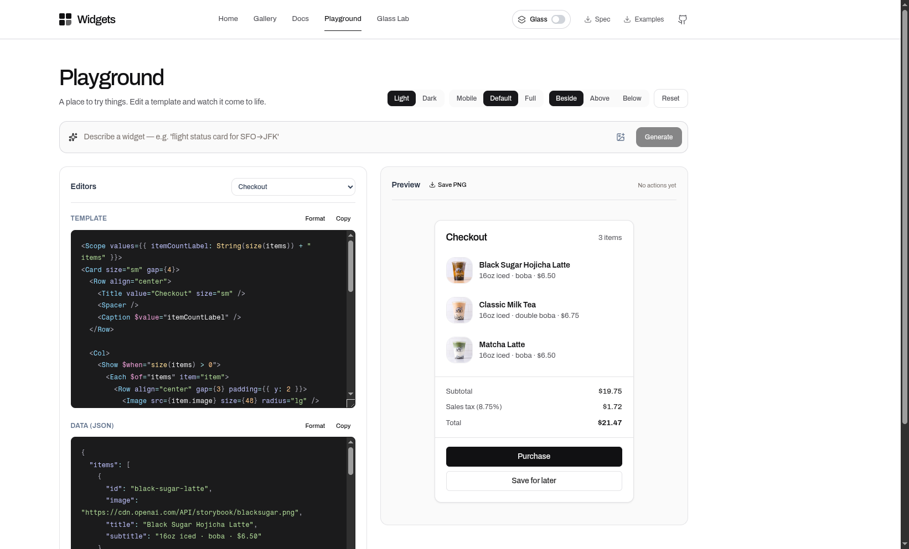

# Widget loop: Today section

This file tells the agent how to build one Today-section widget at a time using the Widgets playground (https://widgets.gan.dev/playground).

## What the playground looks like



(`playground-ui.png` sits next to this file. If you can't view images, use the description below.)

Page: https://widgets.gan.dev/playground. Top to bottom:

- **Nav bar:** Home, Gallery, Docs, Playground, Glass Lab. On the right: a Glass toggle (leave it off), and Spec and Examples download links (not needed for this loop).
- **View controls (top right of the page):** Light / Dark, Mobile / Default / Full, Beside / Above / Below, and Reset. Light / Dark is the widget's theme.
- **Prompt box:** a single input that says "Describe a widget" with a **Generate** button on the right. Next to Generate there is a small image icon, which looks like an attach-image button. This is where the master prompt goes.
- **Editors panel (left):** a dropdown at the top (it shows the sample "Checkout" widget on first load), then a **TEMPLATE** editor and a **DATA (JSON)** editor. Each has **Format** and **Copy** buttons.
- **Preview panel (right):** the live widget, a **Save PNG** button, and an actions log that says "No actions yet" until you click something in the widget.

The page loads with a sample widget (Checkout). It is not yours. Don't copy it by mistake.

## Read first

1. The repo's own `AGENTS.md` rules win over everything in this file. Follow its start-of-task routine: read `docs/agent-context/INDEX.md`, then `docs/dashboard-spec.md`, `docs/agent-context/sections/today.md` and `docs/agent-context/components/widget-system.md`. Verify documented paths against the real source.
2. You do not design or write widget templates yourself. The playground generates them and validates its own output. Your job is to feed it a good prompt, pick a variant, and wire it into the app.

## Repo guardrails that apply to every widget

- Use theme tokens only. No hex colors, no hardcoded visual values. The playground allows hex and gradients, so if a chosen variant uses them, replace them with the token equivalents or pick another variant.
- Drafts only. Any action that writes goes through the permission gate in `backend/security/confirmation.py`. A widget button never writes directly.
- Never invent features or data. The playground's sample data is for design only and must not ship in the app. Controls that have no real backend action are removed.
- No mock functionality, and no pretending an integration is live.
- Keep changes focused on the widget. Run only the tests for code you touched, and verify the served desktop build.

The playground returns four things per widget: `designSpec`, `template`, `data`, `theme`. Together these are the deliverable.

---

## States every widget must handle

A widget is not done when the happy path looks good. Every widget needs a designed view for each state it can really be in, at every size (compact, medium, large). The layout and size should stay the same between states so the dashboard doesn't jump around.

The widget's `data` carries a `status` field, and the template branches on it. That is how the playground preview and the real app both switch states.

| `status` | When | What to show |
|---|---|---|
| `loading` | First load, nothing to show yet | A skeleton in the shape of the ready layout. Never a bare spinner on an empty tile. |
| `ready` | Normal | The widget. |
| `refreshing` | Showing data while fetching new data | The ready view plus a small quiet indicator. No layout change. |
| `empty` | Loaded fine, nothing to show | Plain words on why it's empty, and a next step if a real one exists. |
| `not_connected` | A connector or setup step is missing (Composio, calendar, mail, etc.) | What's missing and a Connect action that goes to the real setup. |
| `offline` | No internet, and the widget needs it | Last known data marked "Offline, updated {time}" if there is any. Otherwise a short offline message. |
| `stale` | Data is older than it should be | The data, with "Updated {time}" clearly visible. |
| `error` | The fetch or action failed | What failed, what is still intact, and a Retry action. No raw error codes. |
| `partial` | Some sources worked, some didn't | The data that loaded, and a small note about what's missing. |

Rules:
- Only include states the widget can really be in. Work this out from the code in Step 1 (does it need the network? does it need a connector? can it be empty?). Don't design states the backend can't produce.
- Unknown is not zero. If a value isn't available, say "Not available". Never show 0 or an empty bar as if it were real.
- Don't claim success, "Live" or "Synced" unless the data says so.
- All text for states comes from `data` (`message`, `lastUpdated`), so the app can fill it in. No hardcoded copy about the cause.
- Offline detection must use whatever signal the app already has. If there isn't one, report it instead of inventing one.

---

## Wiring: real data only

The playground's `data` is sample data for designing. It never ships. Every widget in the app must run on the real backend.

1. **No mock data in the app.** Nothing the app can reach at runtime may use mock, sample, fixture or hardcoded data. Fixtures are allowed only in `dash.gallery` and in tests, in files named `*.fixture.json`, and nothing outside those may import them. When you finish, search the widget's code for fixture imports and for hardcoded titles, names, numbers and URLs. There must be none.
2. **No fallback to fake values.** If the backend is slow, empty or failing, show the right state. Never fall back to fixture data, and never invent defaults like `0` or "Unknown track". Unknown shows "Not available".
3. **Every field is traced to a real source.** Write `widgets/<widget-id>/wiring.md` with three tables:
   - **Fields:** each field the template reads, the backend source (file and function, or endpoint), its type, and what to show when it is null or missing.
   - **Actions:** each action type, the backend handler it calls, whether it goes through the permission gate, and what the data looks like afterwards.
   - **Status:** each `data.status` value and the real condition that produces it.
4. **A field with no real source is never mocked.** Either remove that part of the design by changing the prompt and regenerating, or report it as a backend gap. If the widget has no backend data at all, stop and mark it blocked in your report. Build the missing backend piece only if the owner asks.
5. **One adapter per widget.** A single function turns the real backend payload into the template's `data`, including the display strings (times, durations, counts with units). The template stays untouched.
6. **Updates use the app's existing mechanism.** Find how other Today widgets get fresh data (polling, push or events, see `widget-system.md`) and use the same one. If none fits, report it. Don't invent a new refresh loop or an interval.
7. **Actions go to the backend and nothing else.** `onAction` calls the real handler. No pretending it worked. While waiting, set `status` to `refreshing`. On success the new data comes from the backend. On failure, keep the last data, show an error with Retry. Anything that writes goes through the permission gate.
8. **Handle the different things the backend can return.** Map each real condition to a status, using what the code actually produces:

| Real condition | `data.status` |
|---|---|
| No response yet, first load | `loading` |
| Response with data | `ready` |
| Re-fetching while data is shown | `refreshing` |
| Response with nothing to show | `empty` |
| Connector or setup missing (check the real connector status) | `not_connected` |
| Request fails or times out | `error` |
| No network, for widgets that need it (use the app's existing signal) | `offline` |
| Data older than the threshold in `docs/dashboard-spec.md` (if none is defined, report it, don't invent one) | `stale` |
| Some sources answered, some didn't | `partial` |

Only wire the statuses this widget can really produce.

---

## Known failure: the first music widget attempt

The first attempt gave the agent a gallery sample and said "completely replace the widget and copy the exact design". The result did not match.

Original design from the playground (`parity-original.png`):


What the agent built (`parity-agent-attempt.png`):


Differences visible in the two pictures:
- Labels ("Volume", "Speed") are in a monospace font. The original uses the same sans-serif font as everything else.
- The volume and speed fields are dark and heavy. The original has light fields with a chevron.
- The divider line and the "Speed changes..." note are gone, and the spacing and corner radius are different.
- The progress bar and controls look faded, like a disabled state.
- Two buttons were added (-15s and +15s) that are not in the original design.
- The "SILENT PREVIEW" label was kept even though the widget now plays real media.

A second problem was spotted: parts of the widget used mock data instead of being wired to the backend. That is why "Wiring: real data only" above exists, and why the Definition of done below asks for proof.

Most likely cause of the visual differences: the agent re-implemented the layout in its own components and CSS instead of rendering the template with the real renderer, and then added to it. The fix is the rule above (always `WidgetRenderer`, template unchanged) plus the parity check in Step 8.

---

## Turning a gallery sample into a real widget

Sometimes the owner hands over a template that came from the gallery rather than from a fresh prompt (the music sample was one). Gallery samples are demos, not widgets, so do this before wiring anything:

1. **Keep one design.** A sample can contain many layouts (the music sample had 15 players, 3 tabs and a category picker). Keep only the layout the owner asked for, and delete the rest, along with the tabs and intro text.
2. **Delete the demo content:** sample tracks, sample images, fake listening history, demo lyrics, and any copy like "silent preview", "demo", "illustrative" or "local setting only". Every visible string must come from real data.
3. **Replace the simulation.** Samples fake the backend with local state: `updateState` and `patchState` actions that flip `playingId` or change `position`, and a `RunInterval` that advances time by itself. In the real widget:
   - State shown (playing or not, position, track, volume) comes from `data`, filled from the backend.
   - Buttons send host actions like `{ type: "music.play_pause" }` that arrive in `onAction` and go to the backend. They do not change local state to look as if they worked.
   - A local `RunInterval` is only allowed to move a progress bar forward while the backend says it is playing, and it must resync on every backend update. If that's more than needed, just show the backend's position.
4. **Remove controls the backend can't do.** Check what the backend really supports (play/pause, next, previous, seek, volume, speed, shuffle, repeat). Remove the rest. Don't leave them faded, and don't add controls the design never had. If the owner wants one that's missing, re-prompt the playground with it in the actions list.
5. **No fake signals.** Animated equalizer bars are decoration, not audio levels. Leave them out unless the owner says to keep them. If kept, animate them only while the backend says it is playing and never label them as live audio.
6. Then continue from the loop at Step 7 (Implement), and still do the state work and parity check.

---

## Step 0 (once, before the first widget)

The playground's output is rendered by an open-source renderer, `WidgetRenderer`, published as `@tugan/widgets` (repo: https://github.com/Gan-Tu/Widgets, Apache-2.0). **The app must render every widget with this renderer. Never re-create a widget by hand in your own React and CSS.** Re-creating it is what makes the result look different from the playground (see "Known failure" below).

Check `docs/agent-context/components/widget-system.md` and `package.json` for whether it is already installed.

- If it is: note where, and how a widget gets registered.
- If it is not: install it (`npm install @tugan/widgets`), import `@tugan/widgets/styles.css` once in the app entry, and note it in your report. Before relying on it, check it works with the app's React version (the app uses React 19). If it doesn't, STOP and report. Don't fall back to hand-porting.

Basic use:

```
import "@tugan/widgets/styles.css";
import { WidgetRenderer } from "@tugan/widgets";

<WidgetRenderer template={templateString} data={data} theme={appTheme} onAction={(action, formData) => { /* send to backend */ }} />
```

- `template` is the string copied from the playground, unchanged.
- `theme` comes from the app's current light or dark theme. Never hardcode it.
- `data` must be a stable reference between renders (memoize it). A fresh object each render resets the widget's local state.
- `onAction` receives every action that isn't handled inside the widget. This is where actions go to the real backend.
- Widget colors, fonts and radius come from `--widget-*` CSS variables under `.widget-root`. Do not change them while building a widget. First get the widget to match the playground exactly with the defaults. Mapping those variables to Amethyst's theme is a separate, deliberate step done once for all widgets, and the owner approves it.

---

## The loop (one widget per run)

For each widget id in the queue:

1. **Read the real widget.** Find the widget id in `docs/agent-context/sections/today.md` and `docs/dashboard-spec.md`. Open its backend payload (the actual fields and types it returns), the existing widget UI, and `docs/widget-howto.md`. Note which actions actually exist and which go through the permission gate. A control only goes in the design if it does something real. Also work out which states from the "States" section this widget can really be in, and what the backend returns for each (status values, error shapes, last-updated time, connector status). Find the data source: the endpoint, store or hook the widget reads from, how it refreshes, and the handler behind each action. If you can't find a real source for the widget's data, stop and mark it blocked. Do not continue with mock data.

2. **Build the prompt.** Every prompt is three parts in this order: the **shared baseline**, the **production rules**, and the **widget part**, all from "Master prompt" below. Save the two shared blocks once as `widget-prompts/_shared.md` and paste them in unchanged every time. Never paraphrase, shorten or reorder them. They are what keeps every widget consistent. Fill in only the widget part, once per size (compact, medium, large), and save each as `widget-prompts/<widget-id>-<size>.md`.

3. **Run it in the playground, one size at a time.** Open the playground in the browser, paste one prompt into the prompt box, and click Generate. Each run must produce one widget at one size. Don't ask for several sizes or a whole collection in one prompt, because that produces a gallery-style template that can't be used in the app. Wait until the Preview shows a new widget instead of the sample Checkout. Check the Editors dropdown to see how generated variants are listed, and look at each one. If the playground can't be driven (login, captcha, paste blocked), stop and ask the owner to paste it and return the output.

4. **Check, then pick.** Generate up to 3 times per size. First reject any output that breaks the production rules. Read the template and DATA, and reject if you find any of:
   - a hex color, a gradient, or a forced `theme` on a Card
   - `RunInterval`, `now()`, or `updateState` / `patchState` that changes anything the backend owns (playing, position, done, counts, status)
   - tabs, pickers or headings that switch between designs, more than one design in the template, or numbering or collection titles
   - words like demo, preview, sample, illustrative, example or placeholder
   - a hardcoded image URL, `availableImages`, or hardcoded sample names, numbers or times
   - a control that isn't in the ACTIONS list, or a control shown faded or disabled to hint at a missing feature
   - data fields that aren't in the DATA CONTRACT, or renamed ones
   - decorative animation that doesn't reflect real data

   If an output is rejected, regenerate with one extra line naming the broken rule. If all 3 tries fail, stop and report which rule keeps breaking. Don't fix the template by hand.

   Then choose from what's left by these rules, in order:
   - The playground rendered it without validation errors.
   - Uses the real data fields with no extras needed.
   - Has a designed view for every state the widget can really be in, at every size, driven by `data.status`.
   - Every control maps to a real action in the ACTIONS list.
   - Readable in light and dark.
   - Fewest components that still look premium. Prefer clean and quiet over busy.
   - Matches the shared baseline: same header pattern, padding, type sizes, button style and accent use as the Today widgets already built. Put it next to them in `dash.gallery` to check. If it looks like it belongs to a different product, regenerate.

5. **Copy the output.** For the chosen variant, use the **Copy** button on the TEMPLATE editor and the **Copy** button on the DATA (JSON) editor. The widget must not force a theme. The app passes its own light or dark theme to the renderer, so check the variant in both Light and Dark in the playground. Use **Save PNG** to keep a picture of the variant for the changelog.

6. **Save the output** to `widgets/<widget-id>/` (or wherever `widget-system.md` says widget files live; follow the repo's convention if it differs): `template.txt`, `data.fixture.json` (the playground's sample data, used only by `dash.gallery` and tests), `meta.json` (`designSpec`, chosen variant, playground prompt files), and `wiring.md` (see "Wiring: real data only").

7. **Implement.**
   - Build the adapter from `wiring.md`: real backend payload in, template `data` out. Keep the template's field names, and map real fields to them in the adapter, not by editing the template. The sample data from the playground must not appear anywhere in the app's runtime path.
   - Map action types to real Amethyst actions.
   - Map the backend's real status and errors to `data.status` in the adapter. Every state comes from real conditions (connector status, network, errors, timestamps), not from decorative placeholders.
   - Render with `WidgetRenderer` and the template string exactly as copied. Do not hand-edit the template for looks, and do not add or remove controls in it. If the design needs to change, tweak the prompt and re-run the playground.
   - If an action needs a payload the template doesn't send, report it. Don't patch the template.

8. **Verify.** First, parity: put the widget in the app at the same size and theme as the playground preview and compare it with the playground's **Save PNG** image. Compare the font, label case, corner radius, spacing, field style, icons, and the number and order of controls. Any difference is a bug. Fix it in the adapter or the wiring, never by editing the template, and list the differences you found and fixed in your report. If the app's global styles are changing the widget, report which rule. Then, in the playground, change `status` in the DATA editor to each state and check the Preview, at each size, in light and dark. If a state is missing or broken, change the prompt and re-run; don't patch the template by hand. Then run it in `dash.gallery` at each size, in light and dark, feeding it each state with real-shaped payloads. Test offline by actually going offline, not by faking a value. Run only the tests for code you touched, plus lint, and check the served desktop build. Report what you could not test (live services). Then go through the Definition of done below.

9. **Update docs.** Add an entry to `docs/dashboard-changelog.md`. Update `docs/agent-context/sections/today.md` and `components/widget-system.md` only if component structure or conventions changed. Don't touch docs for purely cosmetic changes.

10. **Commit** one widget per commit, only when every Definition of done item is true or listed in your report as untested. Then move to the next id.

Never claim a widget works against live services unless you actually ran it against them.

---

## Definition of done

A widget is done when all of these are true. For each one, put the evidence in your report, not just a tick.

- [ ] **No mock data.** The search for fixture imports and hardcoded values in the widget's runtime code came back empty. Paste the search you ran.
- [ ] **Wiring written.** `wiring.md` has the fields, actions and status tables, and every row points to real code.
- [ ] **Ran against the real backend.** Name the endpoint or hook called and paste a short, redacted sample of the real response next to what the widget showed for it.
- [ ] **States triggered for real where possible.** For example: stop the backend and see `error`, go offline and see `offline`, use an empty vault or no tasks and see `empty`, use a missing connector and see `not_connected`. List any state you could only check with a fixture as "fixture-tested only".
- [ ] **Every action performed against the real backend.** Say what you clicked and what changed in the data afterwards. Writes were checked going through the permission gate.
- [ ] **Parity check done** against the playground's Save PNG, with the differences listed and fixed.
- [ ] **Docs updated** (changelog entry at minimum).

Anything you could not verify goes under "Not verified". Never write "works" for something you didn't run.

---

## Master prompt

A prompt is the **shared baseline** + the **production rules** + the **widget part**. The first two never change from widget to widget. If the owner wants to change the look of the whole dashboard, change the shared baseline in one place and regenerate the widgets already built so they stay consistent.

### Shared baseline (paste unchanged into every prompt)

```
You are designing one widget in a set that must look like it belongs to the same product: a desktop personal-AI app, clean and Apple-like, Linear/Raycast-level polish. It sits on a dashboard next to other small widgets, so it must be glanceable.

SHARED BASELINE
- Structure: a single Card. A header row with a small Caption label (and a small icon if it helps) on the left, and a status or one quiet action on the right. Then the content. Use the same header pattern in every widget.
- Type: one large Title or Stat for the single most important value, Text for supporting content, Caption for labels and metadata. At most three type sizes in one widget.
- Spacing: use the default Card padding and do not override it. Gap 3 between groups, gap 1 inside a group. Use whitespace instead of dividers and nested boxes.
- Color: built-in color tokens only. Neutral surfaces. At most one accent, used only for the primary action or the one thing that needs attention. Success, warning and danger colors only for real status, always together with words.
- Buttons: at most one primary action (solid, pill). Everything else is ghost or soft. Icon-only buttons have an aria label.
- Icons: built-in icons, small, one size everywhere.
- Avoid: gradients, glow, glassmorphism, decorative shadows, nested cards, heavy borders, decorative imagery, stock-looking filler.
- Theme: the widget follows the app's light or dark theme. Never force a theme on the Card.
```

### Production rules (paste unchanged into every prompt)

```
PRODUCTION RULES
This is a real app widget, not a gallery demo.
1. Design exactly ONE widget at exactly the SIZE given. No tabs or pickers for choosing between designs, no collection titles, intro text, numbering or "study" labels, and no second design in the same template.
2. Everything shown comes from the DATA CONTRACT. Do not hardcode sample names, numbers, times or titles in the template. Fixed UI words (button labels, small captions) go in a "labels" object in the data.
3. Times, durations, dates and counts with units arrive as ready-to-show strings in the data. Do not compute them in the template and do not use now().
4. The data is the single source of truth. Do not simulate anything: no RunInterval, no timers, no local state that fakes a result (flipping a playing or done flag, advancing a progress bar, counting up). Buttons only send the actions listed under ACTIONS, as plain actions with a payload, and change nothing locally. Local state is allowed only for purely visual choices, such as a section opened or closed.
5. Only the actions listed exist. Do not add any other control: no extra buttons, skip or seek steps, toggles, sliders or selects. Never show a control disabled or faded to hint at a missing feature.
6. Do not write the words demo, preview, sample, illustrative, example or placeholder anywhere.
7. Images come only from the data field named under IMAGES. Never hardcode a URL and never use availableImages.
8. No hex colors, no gradients, no forced theme. Built-in tokens only.
9. No decorative animation. Motion only where it shows real activity from the data, for example a small indicator while status is "refreshing".
10. Use the data field names exactly as given. Do not rename, add or drop fields. If you think a field is missing, say so in designSpec instead of inventing it.
```

### Widget part (fill the `{...}` parts, one prompt per size)

```
WIDGET: "{WIDGET NAME}"

PURPOSE
{One line: what this widget answers at a glance, and the single most important thing on it.}

SIZE: {Compact | Medium | Large}
Target width {px, from docs/dashboard-spec.md}. {What to keep at this size, and for Large what extra it can show.}

DATA CONTRACT
The widget receives exactly this data. Use these field names and types.
{JSON example copied from the real backend payload, plus status, message, lastUpdated and labels}

ACTIONS
Only these actions exist:
{list of action types and payloads, or "display only, no controls"}

STATES
The data has a "status" field and the template must branch on it. Design every state listed below at this size. Keep the layout the same size in all states.
Status values for this widget (delete any that don't apply):
- loading: skeleton in the shape of the ready layout, no bare spinner
- ready: normal view
- refreshing: ready view plus a small quiet indicator
- empty: "{empty copy}" and {next step, or none}
- not_connected: "{what is missing}" with a Connect action
- offline: last known data marked "Offline, updated {time}", or a short message if no data
- stale: data with "Updated {time}" clearly visible
- error: "{what failed, what is still fine}" with a Retry action
- partial: loaded data plus a small note about what's missing
Unknown values show "Not available", never 0. Do not claim "Live" or "Synced" unless the data says so.

IMAGES
{Which field holds an image URL, or "no images, use initials or icons".}
```

---

## Worked example 1: music

Only the widget part is shown. The shared blocks go above it unchanged. Run it three times, changing only the SIZE section.

```
WIDGET: "Now playing"

PURPOSE
Shows what is playing right now: track, artist, and whether it is playing.

SIZE: Medium
Target width {from dashboard-spec}. Artwork, title, artist, progress bar with elapsed and total time. {Compact: one row with a small thumbnail, title, artist. Large: big artwork plus album and source.}

DATA CONTRACT
{
  "status": "ready",
  "message": "",
  "lastUpdated": "10:42",
  "isPlaying": true,
  "title": "Weightless",
  "artist": "Marconi Union",
  "album": "Weightless",
  "artworkUrl": "<url or null>",
  "positionSec": 94,
  "durationSec": 480,
  "positionLabel": "1:34",
  "durationLabel": "8:00",
  "source": "Spotify",
  "labels": { "nowPlaying": "Now playing", "nothingPlaying": "Nothing playing" }
}
{CONFIRM FROM CODE. These field names are an example. Replace with the real payload.}

ACTIONS
{CONFIRM FROM CODE: default is display only, no controls. If play/pause, next and previous exist, list each as a type with its payload.}

STATES
Status values: loading, ready, empty ("Nothing playing"), not_connected ("Connect a music source"), error ("Can't reach music source", Retry), stale (last track with "Updated {time}").
{CONFIRM FROM CODE which of these the backend can produce, and delete the rest.}

IMAGES
artworkUrl holds the artwork. If it is null, show a neutral music icon tile.
```

## Worked example 2: tasks for today

```
WIDGET: "Today's tasks"

PURPOSE
Shows how many tasks are left today and the next few to do.

SIZE: Medium
Target width {from dashboard-spec}. Progress summary plus the next 3 tasks with checkboxes. {Compact: remaining count and the next task. Large: full list for today, overdue first.}

DATA CONTRACT
{CONFIRM FROM CODE. Example shape only:}
{
  "status": "ready",
  "message": "",
  "lastUpdated": "10:42",
  "doneCount": 2,
  "totalCount": 6,
  "summaryLabel": "2 of 6 done",
  "items": [
    { "id": "t1", "title": "Review PR", "dueLabel": "10:30", "done": false },
    { "id": "t2", "title": "Reply to Kunal", "dueLabel": "", "done": true }
  ],
  "labels": { "title": "Today", "empty": "Nothing planned today" }
}

ACTIONS
{CONFIRM FROM CODE. Example: task.toggle with payload { id }. If it writes anywhere, it must go through the permission gate. Nothing else.}
The checkbox sends the action and changes nothing locally. The new state comes back in the data.

STATES
Status values: loading, ready, empty ("Nothing planned today"), error ("Couldn't load tasks", Retry). Tasks are local, so no offline or not_connected state unless the backend syncs with an external service.
{CONFIRM FROM CODE which of these the backend can produce, and delete the rest.}

IMAGES
No images. Use icons only.
```

---

## Kickoff prompt for the agent

Paste this at the start of a run:

```
Follow docs/widgets-playground/WIDGET_LOOP.md and the repo AGENTS.md. Do the next widget in the Today section.
Render it with WidgetRenderer from @tugan/widgets using the exact template from the playground. Do not re-create the design in your own components or CSS, do not add or remove controls, and do not edit the template. Build each prompt from widget-prompts/_shared.md plus the widget part, and never paraphrase the shared blocks. Generate one widget per size. Everything shown must come from the real backend. No mock, sample or fixture data may be reachable in the app at runtime, and every control must do something real. Write wiring.md and finish with the Definition of done, with evidence for each item. Compare the result with the playground's Save PNG image and report any differences.
```

If the owner hands you an existing gallery template, read "Turning a gallery sample into a real widget" first.

---

## Queue

Add one widget id per line. The agent works top to bottom. If this list is empty, build it from the Today section's widget list in `docs/agent-context/sections/today.md`, and skip any widget already marked done in `docs/dashboard-changelog.md`.

```
glance.music
task.today
```